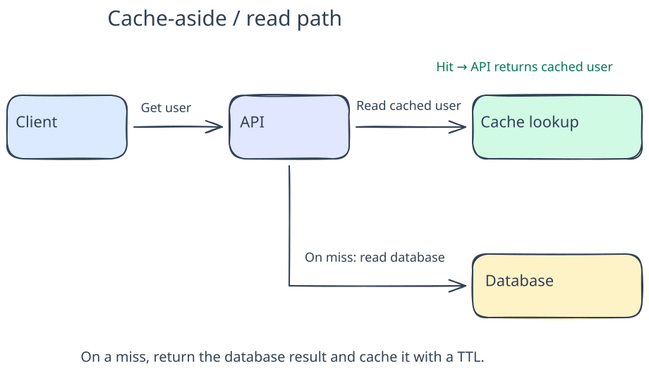
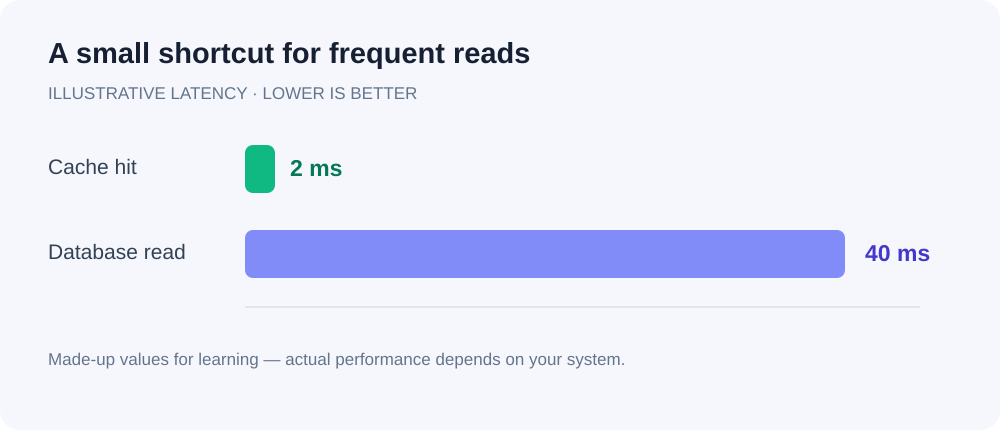

> **Sample learning note.** The design and numbers below are illustrative. This page demonstrates how notes, diagrams, code, and images look together.

## The idea in 30 seconds

Keep frequently requested data close to your application. With **cache-aside**, the application checks the cache first. On a miss, it reads the database and stores a copy in the cache with an expiry time.

The database remains the source of truth. A cache speeds up reads, but adds questions about freshness, failures, and invalidation.

## Sketch the read path



[Open the editable Excalidraw drawing in Obsidian](obsidian://open?vault=Notes&file=HLD%2Fassets%2Fcache-aside.excalidraw.md)

1. A client asks the API for a user.
2. The API looks up the user in the cache.
3. On a hit, return the cached user. On a miss, read the database, cache the result, and return it.

## A small code example

```python
def get_user(user_id, cache, database):
    key = f"user:{user_id}"

    cached = cache.get(key)
    if cached is not None:
        return cached  # Cache hit: avoid the database read.

    user = database.find_user(user_id)
    if user is not None:
        cache.set(key, user, ttl_seconds=60)

    return user
```

This is pseudocode with simplified cache and database interfaces. A real implementation also needs serialization, timeouts, failure handling, and a strategy for concurrent cache misses.

## An image makes the tradeoff visible



These are **made-up numbers**, not benchmark results. At an assumed 90% hit rate, a sequential cache-first lookup would average approximately `2 + (0.10 × 40) = 6 ms`, excluding network overhead and cache writes. Tail latency can still be much worse.

## What can go wrong?

| Situation | Design question |
| --- | --- |
| A user updates their profile | When do we invalidate or refresh the cached copy? |
| A popular key expires | How do we prevent many requests hitting the database together? |
| The cache is unavailable | Can the database handle fallback traffic? |
| A key is missing from the database | Should we briefly cache the absence? |

## Check your understanding

- Why is `cached is not None` safer here than `if cached`?
- What happens if the database changes immediately after a cache miss reads it?
- Would a shorter TTL always be better?

## Read next

Connect this note to cache invalidation, request coalescing, TTL jitter, and the thundering herd problem.
