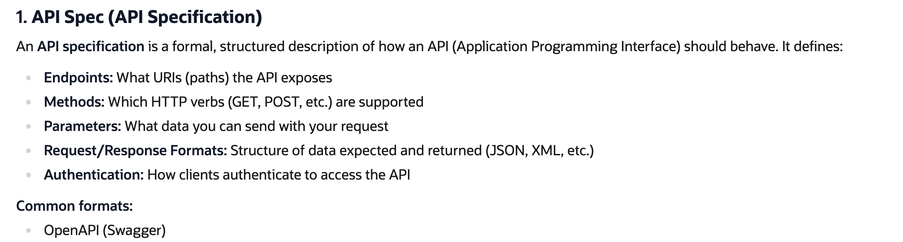
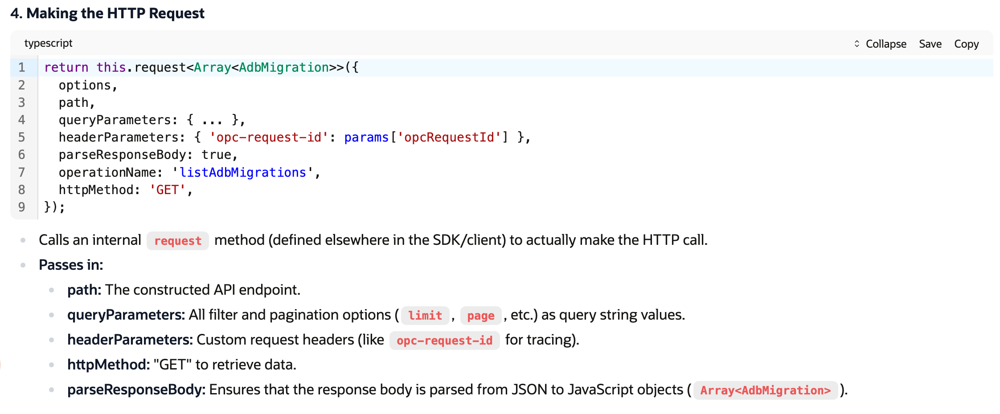
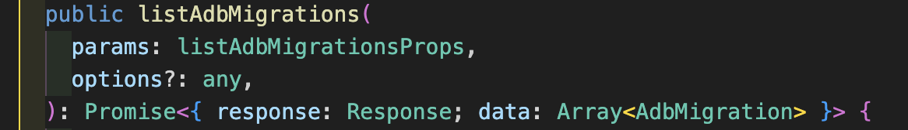
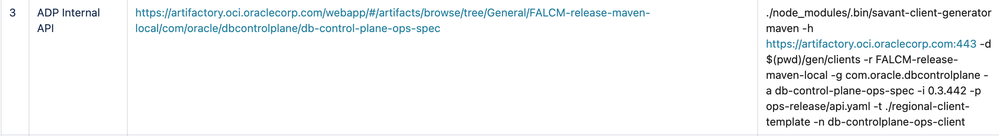

# 1.2 REST API

.cond.yaml typically stands for "conditional YAML". .cond.yaml files (modularize OpenAPI specifications)—and files like definitions.cond.yaml, parameters.cond.yaml, and paths.cond.yaml—are YAML files used to modularize API specifications, commonly following the [OpenAPI Specification ](<https://swagger.io/specification/>)or similar schema standards. Their names reflect the type of content they hold (definitions, parameters, paths), supporting modular, collaborative API design and compliance with best practices in API management.

**definitions.cond.yaml**

Contains reusable data models (schemas) describing the shapes of requests and responses (e.g., “User”, “Order”), much like the “components/schemas” section in OpenAPI 3.

**parameters.cond.yaml**

Lists reusable parameter definitions (e.g., “userId”, “Authorization header”), so you can reference them across multiple endpoints. Contains information about query parameters.

**paths.cond.yaml**

Contains the actual endpoint definitions, including the URLs, HTTP methods, and what parameters/requests they accept.

**API Client**

An API client is a piece of software/code that interacts with an API according to the rules described in its API specification. It has strongly-typed functions or methods that mirror and call REST API endpoints, including all query parameters and headers as function arguments.

An API client:

  - Sends requests to the API’s endpoints

  - Handles authentication, headers, and payloads as described in the spec

  - Receives and processes responses

Clients can be:

  - Code libraries (SDKs)

  - Tools like Postman or curl

  - Custom apps that consume the API

**EXAMPLE SDK:**

**db-control-plane-ops ---> this is api client sdk, for internal use 'ops', which has different methods,**** each mapping to a different API endpoint or operation.**

**EXAMPLE METHOD:**

listAdbMigrations

- Purpose:
Retrieves a list of "AdbMigrations", possibly filtered by various optional query parameters.

- Parameters:

  - params: An object with filter and pagination options (like limit, page, sortOrder, etc.).

  - options: (Optional) Extra options for the HTTP request.

- Returns:
A Promise that resolves to an object containing the raw HTTP response and the parsed data (array of AdbMigration).

**API Surface: **

The documentation and interface (signature) for a callable API client method, listing all parameters a user can or must supply. Three parts:

  - **The method signature (****listAdbMigrations(...)****) --  The ****API Client Method Signature refers specifically to the declaration of the callable method within the API client—essentially, how a developer would call that method in code, and what arguments they need to supply.**

  - **The return type**

  - **Its parameter types (****listAdbMigrationsProps****) -- ****TypeScript interface that defines the parameters (inputs) for the listAdbMigrations API client method.**

export interface listAdbMigrationsProps {

regionId: string;

subdomain?: string;

limit?: number;

page?: string;

opcRequestId?: string;

sortOrder?: string;

podDbId?: string;

lifecycleState?: string;

operation?: string;

migrationId?: string;

migStartTimeSortOrder?: string;

progressStatus?: string;

currentPhase?: string;

}

**API Artifacts**

API artifacts are files and resources generated and used during API development, documentation, and distribution. In the context of software engineering, especially within enterprise environments, the term “artifact” refers broadly to any file or bundle produced as a result of the build, packaging, or documentation process.

Common API artifacts include:

  - API specifications (e.g., OpenAPI/Swagger YAML or JSON files)

  - SDKs (Software Development Kits, such as JARs, NPM packages, Python wheels, etc.)

  - Client libraries

  - Compiled binaries (e.g., JAR, DLL, EXE)

  - Documentation bundles (HTML, PDF docs, Markdown files)

  - Docker images

  - Test reports or other metadata

**EXAMPLE: **

fa-control-plane-ops-spec

General

Properties

Info

| Name: | fa-control-plane-ops-spec |
| --- | --- |
| Repository Path: | FALCM-release-maven-local/com/oracle/facontrolplane/fa-control-plane-ops-spec/ |
| URL to file: | [https://artifactory.oci.oraclecorp.com:443/FALCM-release-maven-local/com/oracle/facontrolplane/fa-control-plane-ops-spec/](<https://artifactory.oci.oraclecorp.com/FALCM-release-maven-local/com/oracle/facontrolplane/fa-control-plane-ops-spec/>) |
| Deployed By: | buildservice-deployer-2 |
| Artifact Count / Size: | 22506 / 2.42 GB |
| Created: | 2020-07-08 23:21:36 +00:00 (1896d 13h 1m 24s ago) |
