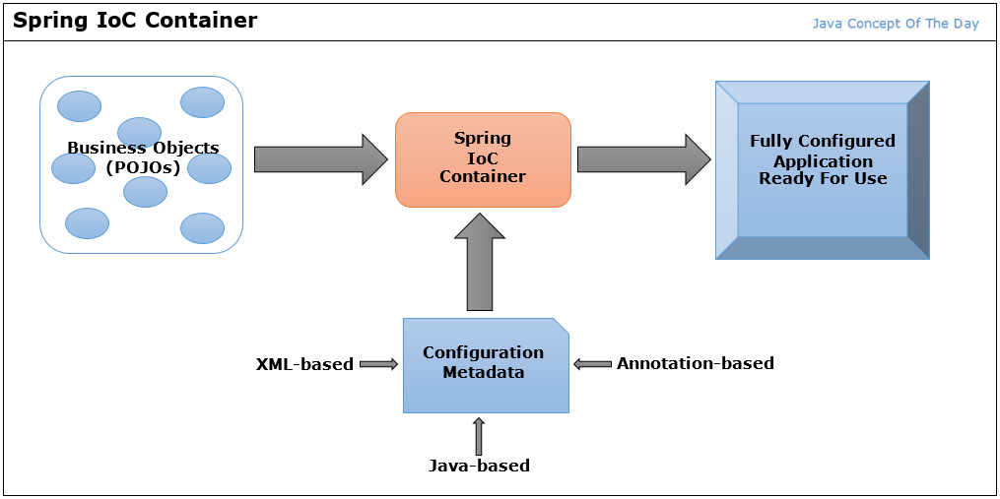
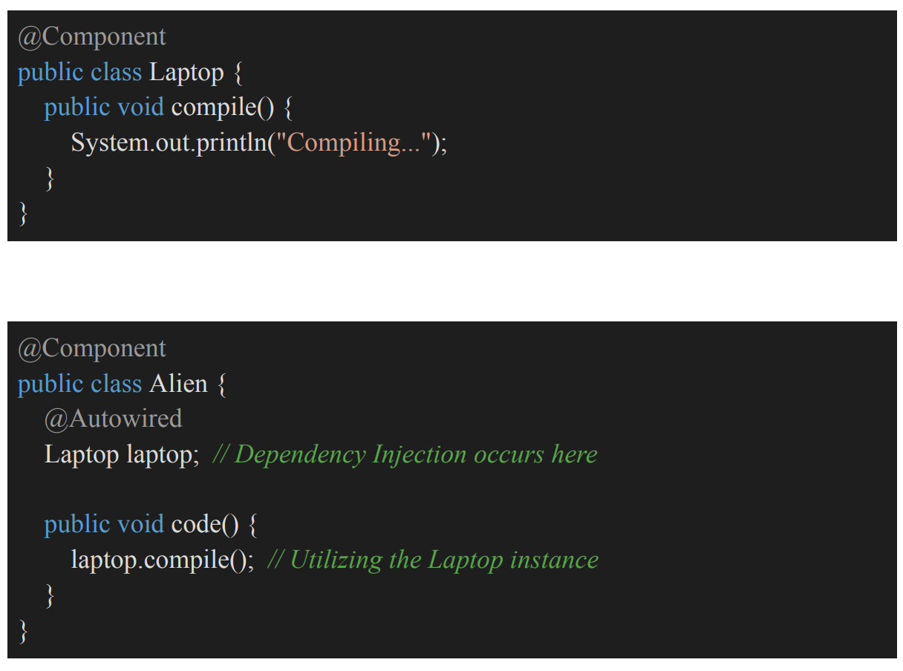

# 4.3 IoC | Dependency Injection

IOC - Inversion of Control

  - IoC is a design principle in which the control of object creation and management is transferred from the application code to a framework or container.

  - This allows developers to focus on the core business logic while the framework takes care of the lifecycle and interactions of the objects.

  - Spring works with IoC Container.  IoC is a principle.

DI - Dependency Injection

  - Design pattern used to inject objects into our application, implementing the IoC principle

  - DI is a specific implementation of IoC that involves providing an object's dependencies from an external source rather than having the object create them internally. This fosters loose coupling between classes and enhances testability and maintainability.

  - LaptopObj and AlienObj are available in the IOC container, but how can we inject LaptopObj in AlienObj

