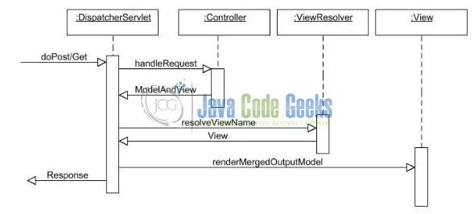

# 5.2 Spring MVC

Model-View-Controller (Mvc) is a well-known design pattern for designing the GUI based applications. It mainly decouples the business logic from UI by separating the roles of Model, View, and Controller in an application. This pattern divides the application into three components to separate the internal representation of the information from the way it is being presented to the user. The three components are:

- Model (M): Model’s responsibility is to manage the application’s data, business logic, and the business rules. It is a POJO class which encapsulates the application data given by the controller

- View (V): A view is an output representation of the information, such as displaying information or reports to the user either as a text-form or as charts. Views are usually the JSP templates written with Java Standard Tag Library (JSTL)

- Controller (C): Controller’s responsibility is to invoke the Models to perform the business logic and then update the view based on the model’s output. In the spring framework, the controller part is played by the Dispatcher Servlet

