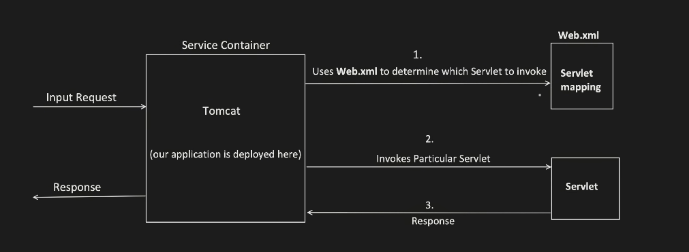
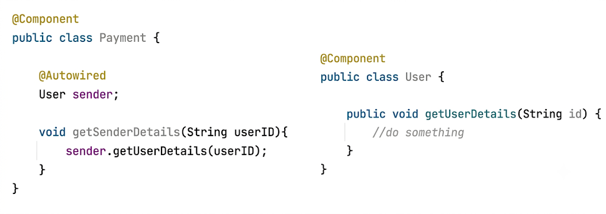
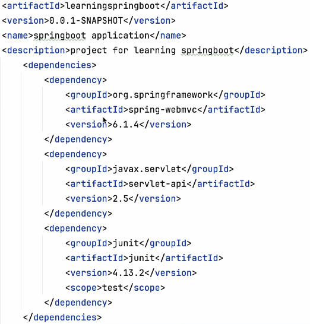
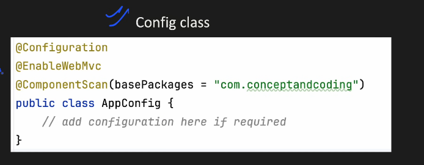
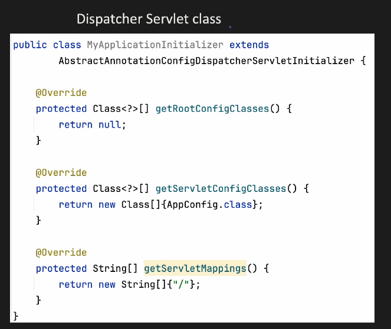
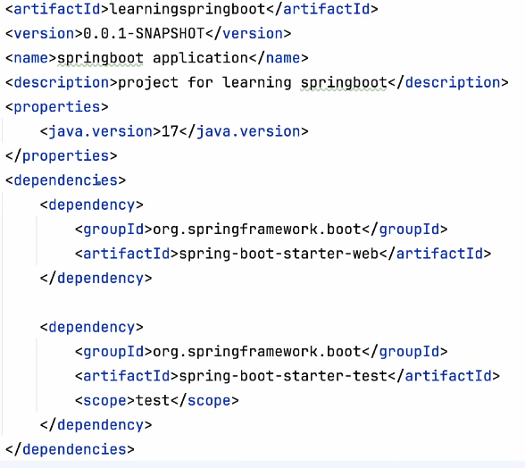
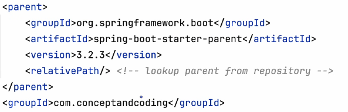
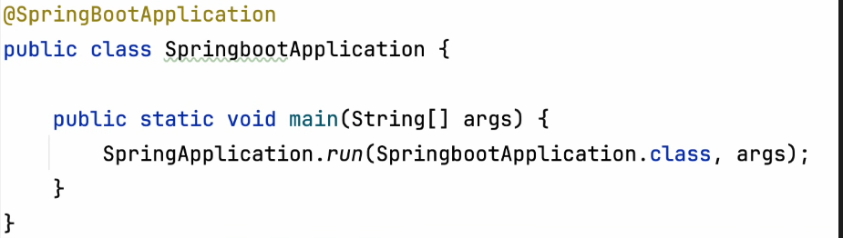

# 5.3 Springboot

| @WebServlet("/demoservletone/\*") public class DemoServlet1 extends HttpServlet { @Override protected void doGet(HttpServletRequest request, HttpServletResponse response) { String requestPathInfo = request.getPathInfo(); if(requestPathInfo.equals("/")) { //do something } else if(requestPathInfo.equals("/firstendpoint")) { //do something } else if(requestPathInfo.equals("/secondendpoint")) { //do something } } @Override protected void doPut(HttpServletRequest request, HttpServletResponse response) { //do something } } @WebServlet("/demoservlettwo/\*") public class DemoServlet2 extends HttpServlet { @Override protected void doGet(HttpServletRequest request, HttpServletResponse response) { //do something } @Override protected void doPut(HttpServletRequest request, HttpServletResponse response) { //do something }>>< } | <servlet> <servlet-name>DemoServlet1</servlet-name> <servlet-class>DemoServlet1</servlet-class> </servlet> <servlet-mapping> <servlet-name>DemoServlet1</servlet-name> <url-pattern>/demoservletone</url-pattern> <url-pattern>/demoservletone/firstendpoint</url-pattern> <url-pattern>/demoservletone/secondendpoint</url-pattern> </servlet-mapping> <servlet> <servlet-name>DemoServlet2</servlet-name> <servlet-class>DemoServlet2</servlet-class> </servlet> <servlet-mapping> <servlet-name>DemoServlet2</servlet-name> <url-pattern>/demoservelet2/</url-pattern> </servlet-mapping> |
| --- | --- |

**Request-Handling Methods**

Servlets that extend HttpServlet primarily use these methods to process incoming requests.

| // REAL IMPLEMENTATION (not easily swappable) public class RealPaymentProcessor { public void processPayment(String orderId) { // Calls an actual payment gateway API (difficult to mock/stub) System.out.println("Processing actual payment for order: " + orderId); } } |
| --- |
| // HARD-WIRED SERVLET public class PaymentServlet extends HttpServlet { // Hard-coded to a concrete class. No interface! private RealPaymentProcessor paymentProcessor = new RealPaymentProcessor(); @Override protected void doPost(HttpServletRequest req, HttpServletResponse resp) { String orderId = req.getParameter("orderId"); // Tight coupling to the real processor. paymentProcessor.processPayment(orderId); } } |

| **// INTERFACE (the contract)** **public** **interface** **PaymentProcessor**** {** **void** **processPayment****(****String** **orderId****);** **}** **// CONCRETE REAL IMPLEMENTATION** **@****Service** **public** **class** **RealPaymentProcessor** **implements** **PaymentProcessor**** {** **    @****Override** **public** **void** **processPayment****(****String** **orderId****) {** **// Calls actual payment gateway** **System****.****out****.****println****(****"Spring: Processing actual payment for order: "** **+**** orderId);** **    }** **}** |
| --- |
| **// DECOUPLED SPRING CONTROLLER** **@****RestController** **public** **class ****PaymentController**** {** **// Inject the dependency via its interface.** **private final ****PaymentProcessor paymentProcessor****;** **    @****Autowired ****// Constructor injection (preferred)** **public ****PaymentController****(****PaymentProcessor ****paymentProcessor****) {** **this****.****paymentProcessor ****=**** paymentProcessor;** **    }** **    @****PostMapping****(****"/pay"****)** **public ****void ****processPayment****(@****RequestParam ****String ****orderId****) {** **// The controller doesn't know (or care) which implementation it's using.** **paymentProcessor****.****processPayment****(orderId);** **    }** **}** |
| **// UNIT TEST WITH MOCKING** **@****ExtendWith****(****MockitoExtension****.****class****) ****// For JUnit 5** **class** **PaymentControllerTest**** {** **    @****Mock ****// Create a mock implementation of the interface** **private ****PaymentProcessor mockPaymentProcessor****;** **    @****InjectMocks ****// Inject the mock into the controller** **private ****PaymentController paymentController****;** **    @****Test** **void ****testProcessPayment****() {** **// 1. Arrange: Define the behavior of our mock** **String orderId ****= ****"12345"****;** **doNothing****().****when****(mockPaymentProcessor).****processPayment****(orderId);** **// 2. Act: Call the method on the class under test** **paymentController****.****processPayment****(orderId);** **// 3. Assert: Verify the mock was called correctly** **verify****(mockPaymentProcessor, ****times****(****1****)).****processPayment****(orderId);** **    }** **}** |

Request

Response

Tomcat

(our application is

deployed here)

Servlet Container

DispatcherServlet

1. Choose the controller

1. Create an instance

1. Invokes Controller method

1. Response

Uses HandlerMapping

IoC (Initiate an instance of Controller along with dependecies)

Respective API get involved

@Controller

@RequestMapping("/paymentapi")

public class PaymentController {

@Autowired

PaymentDAO paymentService;

@GetMapping("/payment")

public String getPaymentDetails() {

return paymentService.getDetails();

}

}

pom.xml

| @Target(ElementType.TYPE) @Retention(RetentionPolicy.RUNTIME) @Documented @Inherited @SpringBootConfiguration    // 1. Configuration @EnableAutoConfiguration    // 2. Auto-Configuration @ComponentScan              // 3. Component Scanning public @interface SpringBootApplication { // ... attribute definitions } |
| --- |
