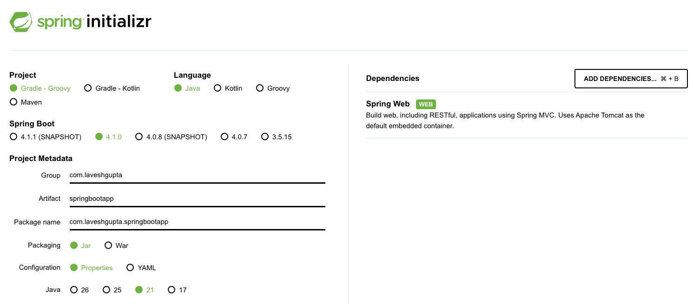
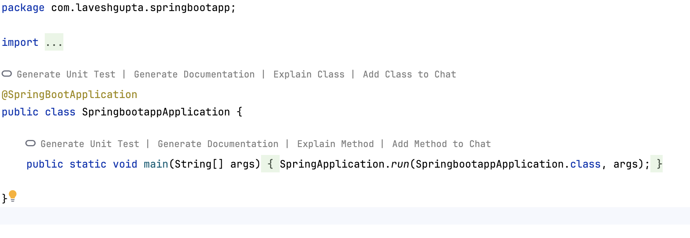

# 5.5 Architecture | Spring Initializer

[Spring Boot Architecture |Spring Initializer | Spring Boot | Video - 2](<https://www.youtube.com/watch?v=TRqWKOiRQX8>)

[Spring boot Project setup and Layered Architecture Introduction](<https://www.youtube.com/watch?v=4QWW4v2u_ZI&list=PL6W8uoQQ2c60g6_fcjDCLHSx1LBeVYqyZ&index=3&pp=iAQB>)

[Spring Boot Local Setup Tutorial in Hindi | Step-by-Step Guide for Beginners](<https://www.youtube.com/watch?v=pCyVJqaACVA>)

