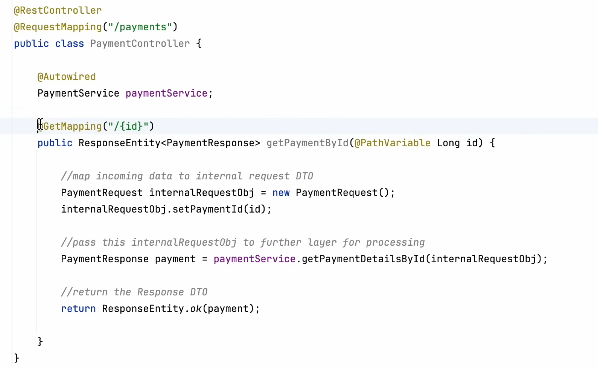
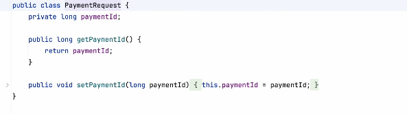
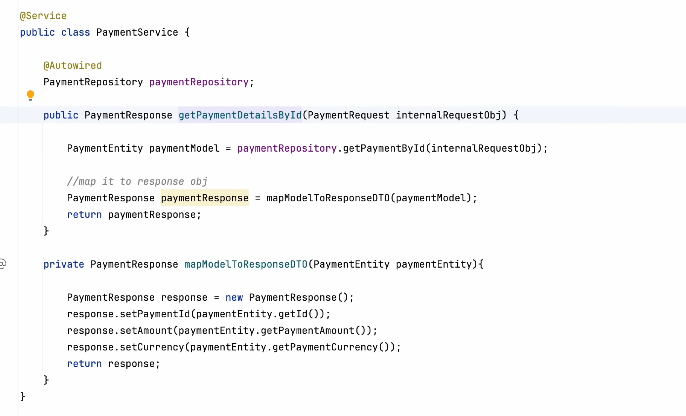
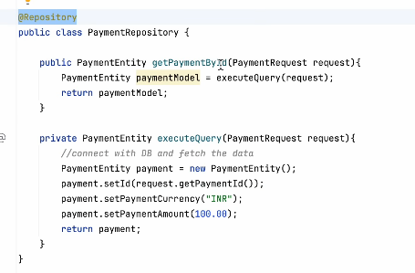
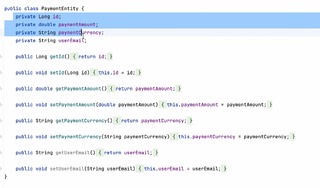
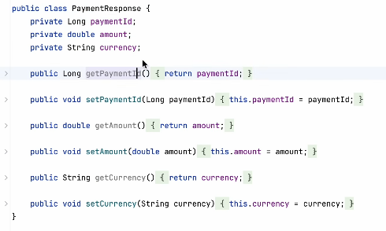

# 5.5.1 Layered Architecture

Clients

DTO

Utility

Entity

Configuration

Controller

Layer

Service

Layer

Repository

Layer

Database

@Entity *// 1. Marks this class as a database table*

@Table(name = "customer_records") *// 2. (Optional) Changes the table name in the DB. Defaults to class name "Customer" if omitted.*

public class Customer {

@Id *// 3. REQUIRED: Marks this field as the Primary Key*

@GeneratedValue(strategy = GenerationType.IDENTITY) *// 4. Tells the DB to auto-increment this ID*

private Long id;

@Column(name = "email_address", unique = true, nullable = false) *// 5. (Optional) Customizes the column rules*

private String email;

private String firstName; *// Will automatically map to a column named "first_name"*

*    // 6. REQUIRED: A standard no-argument constructor (Hibernate needs this to create objects via reflection)*

public Customer() {}

*// Getters and Setters omitted for brevity*

}

