# 5.6 Maven | Dependency | pom.xml

[Spring Boot Dependency Management | application.properties | Pom.xml | Spring Boot |Java| Video - 4](<https://www.youtube.com/watch?v=Tb_jZKlsSAU>)

[Introduction to Maven and its Lifecycle | Spring boot Maven project](<https://www.youtube.com/watch?v=1e4jNP8iKLo&list=PL6W8uoQQ2c60g6_fcjDCLHSx1LBeVYqyZ&index=4&pp=iAQB>)

*<?*xml version="1.0" encoding="UTF-8"*?>*

<project xmlns="http://maven.apache.org/POM/4.0.0" xmlns:xsi="http://www.w3.org/2001/XMLSchema-instance"

xsi:schemaLocation="http://maven.apache.org/POM/4.0.0 https://maven.apache.org/xsd/maven-4.0.0.xsd">

<modelVersion>4.0.0</modelVersion>

<parent>

<groupId>org.springframework.boot</groupId>

<artifactId>spring-boot-starter-parent</artifactId>

<version>4.1.0</version>

<relativePath/> *<!-- lookup parent from repository -->*

</parent>

<groupId>com.laveshgupta</groupId>

<artifactId>springbootapp</artifactId>

<version>0.0.1-SNAPSHOT</version>

<name/>

<description/>

<url/>

<licenses>

<license/>

</licenses>

<developers>

<developer/>

</developers>

<scm>

<connection/>

<developerConnection/>

<tag/>

<url/>

</scm>

<properties>

<java.version>21</java.version>

</properties>

<dependencies>

<dependency>

<groupId>org.springframework.boot</groupId>

<artifactId>spring-boot-starter-webmvc</artifactId>

</dependency>

<dependency>

<groupId>org.springframework.boot</groupId>

<artifactId>spring-boot-starter-webmvc-test</artifactId>

<scope>test</scope>

</dependency>

<dependency>

<groupId>org.springframework.boot</groupId>

<artifactId>spring-boot-starter-actuator</artifactId>

</dependency>

</dependencies>

<build>

<plugins>

<plugin>

<groupId>org.springframework.boot</groupId>

<artifactId>spring-boot-maven-plugin</artifactId>

</plugin>

</plugins>

</build>

</project>

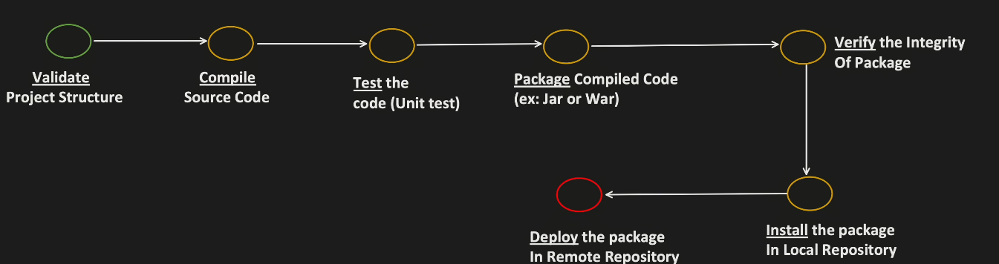

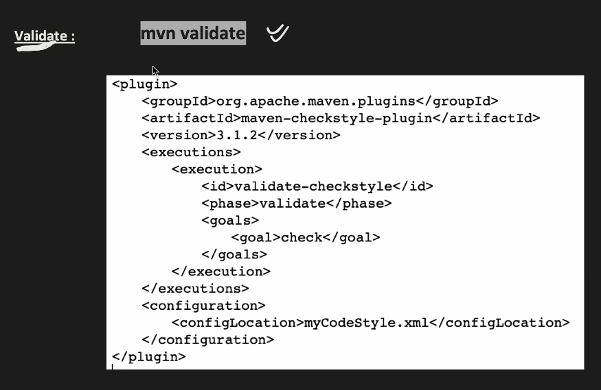

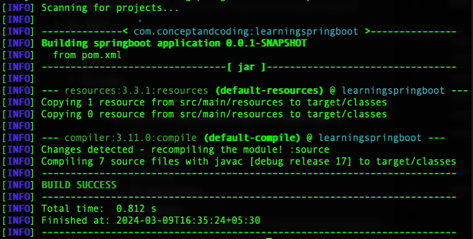

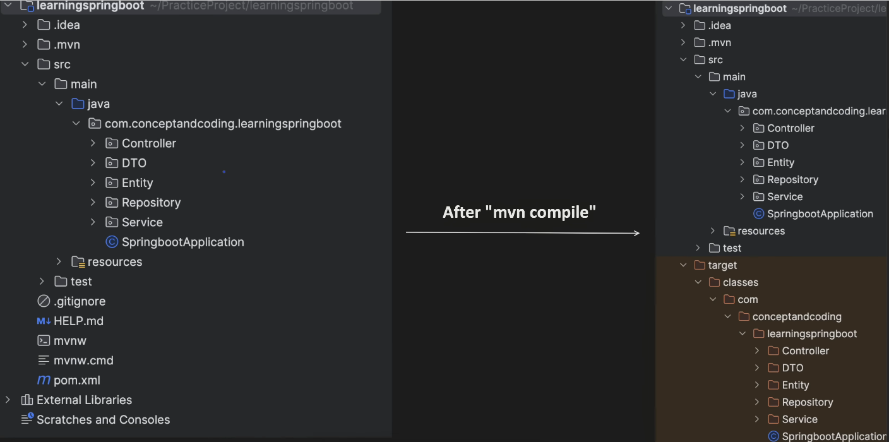

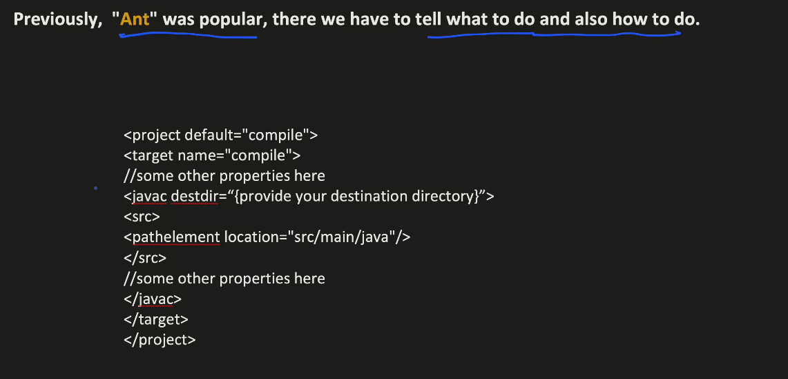

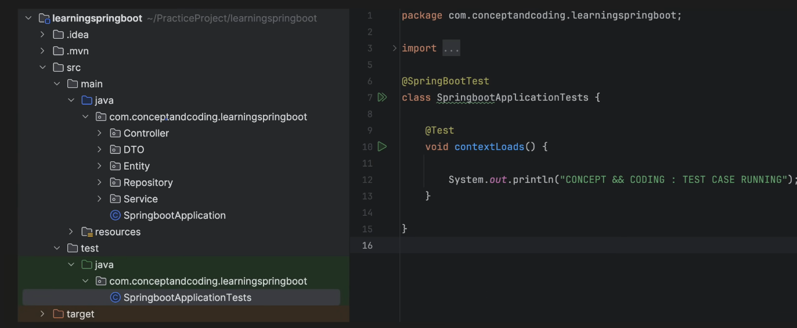

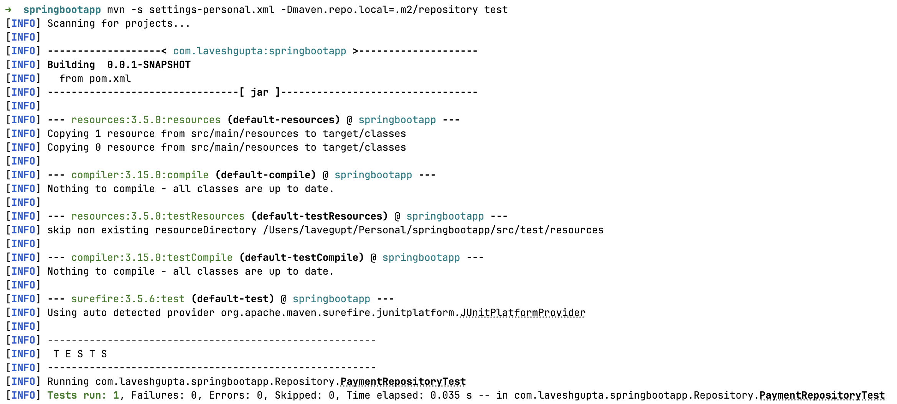

\[INFO\] --- jar:3.5.0:jar (default-jar) @ springbootapp ---

\[INFO\] Building jar: /Users/lavegupt/Personal/springbootapp/target/springbootapp-0.0.1-SNAPSHOT.jar

\[INFO\]

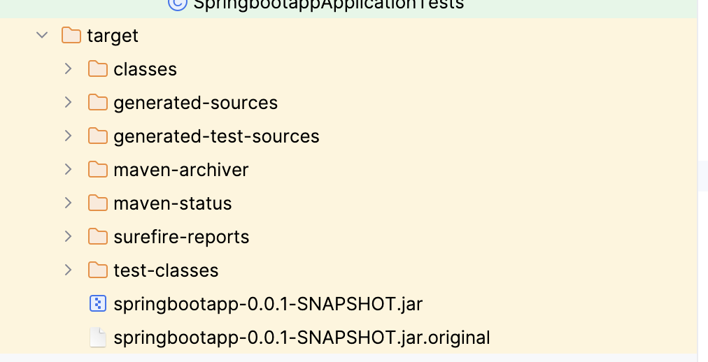

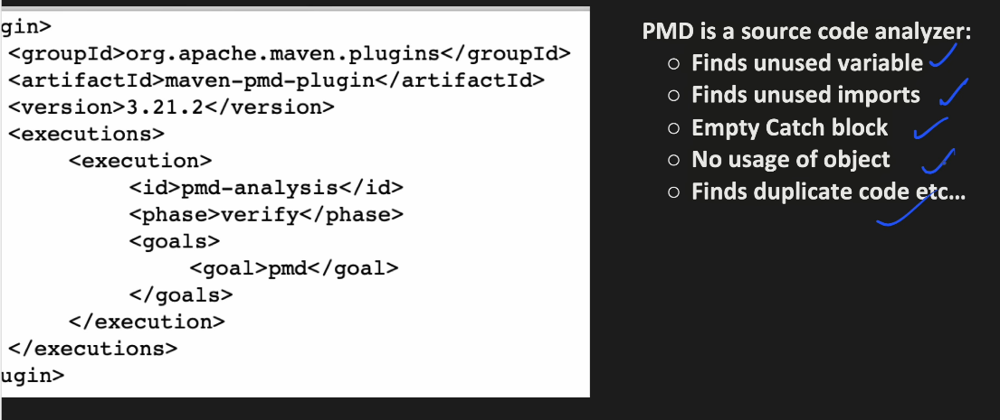

every corporate mnc will have their own repository to maintain the artifacts they will not use the public maven central in that case you need to configure that either in the project or you need to configure that in the settings.xml which is present in the m2 folder there is one folder with repository and one settings.xml that will ahve all the global configurations whcih can be used by all the projects in your system

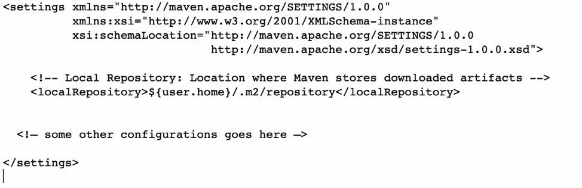

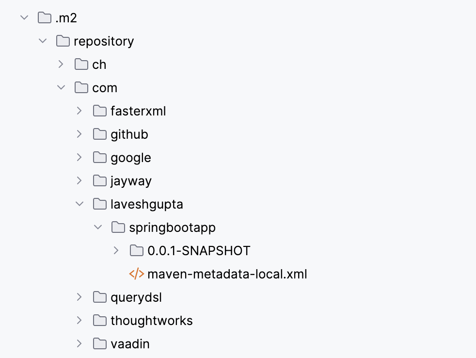

Installing

/Users/lavegupt/Personal/springbootapp/target/springbootapp-0.0.1-SNAPSHOT.jar

to

/Users/lavegupt/Personal/springbootapp/.m2/repository/com/laveshgupta/springbootapp/0.0.1-SNAPSHOT/springbootapp-0.0.1-SNAPSHOT.jar

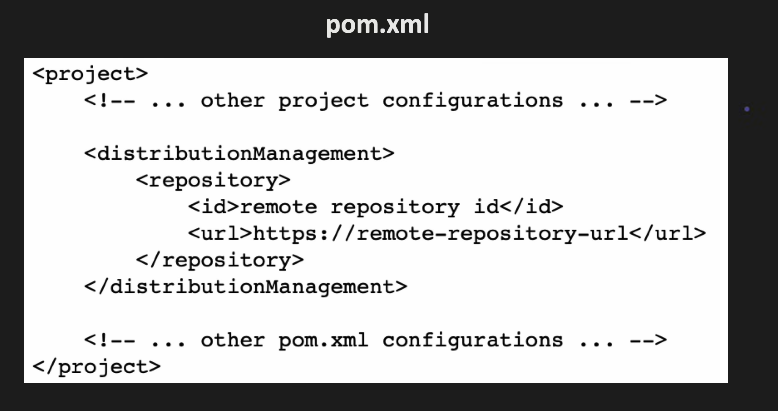

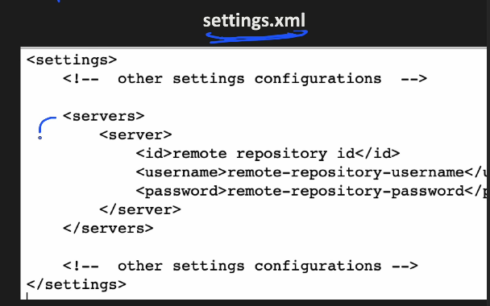

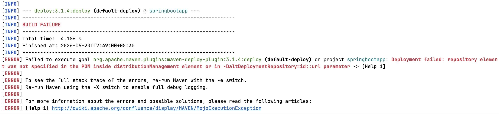
