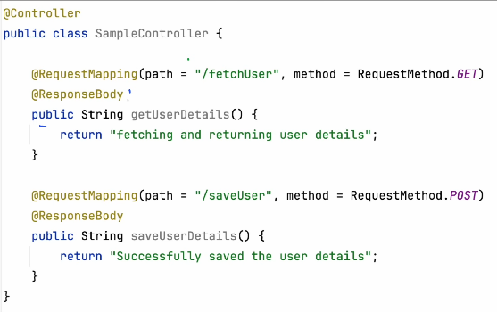
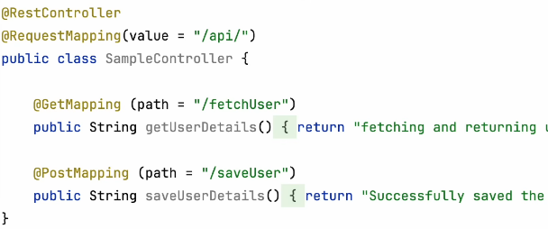
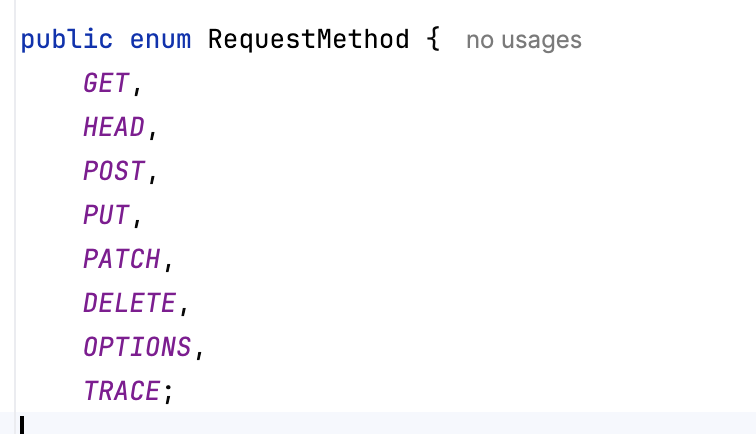
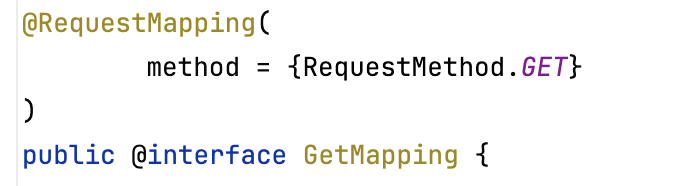

# 5.7 Annotations

[Spring Boot Annotations | @Controller | @Service | @RequestMapping | Spring Boot |   Video - 2](<https://www.youtube.com/watch?v=6UTymvNQ2To>)

[Spring boot Annotations (Controller Layer) | Controller, RestController, RequestMapping etc.](<https://www.youtube.com/watch?v=ndSUJYNa8T8&list=PL6W8uoQQ2c60g6_fcjDCLHSx1LBeVYqyZ&index=5&pp=iAQB>)

[Spring Boot Annotations in Hindi | Spring boot Course |  Important Interview Questions](<https://www.youtube.com/watch?v=Mr9uTRsW88k>)

- @SpringBootApplication

- @Controller

- @RestController

- @RequestMapping

- @GetMapping

- @PostMapping

- @PutMapping

- @DeleteMapping

- @ResponseBody

- @ResponseEntity

- @RequestParam

- @RequestBody

- @PathVariable

Request

Response

Tomcat

(our application is

deployed here)

Servlet Container

DispatcherServlet

1. Choose the controller

1. Create an instance

1. Invokes Controller method

1. Response

Uses HandlerMapping

IoC (Initiate an instance of Controller along with dependecies)

Respective API get involved

Instead of looking for a view template (like Thymeleaf or JSP) to render an HTML page, Spring uses an HTTP message converter to serialize the returned Java object into formats like JSON or XML.

If you omit @ResponseBody from a method inside a standard @Controller class, Spring Boot assumes you are trying to serve an HTML web page.

