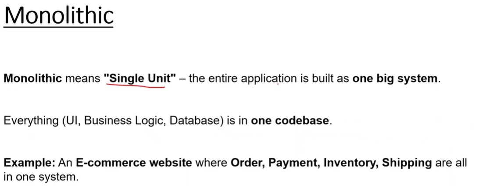
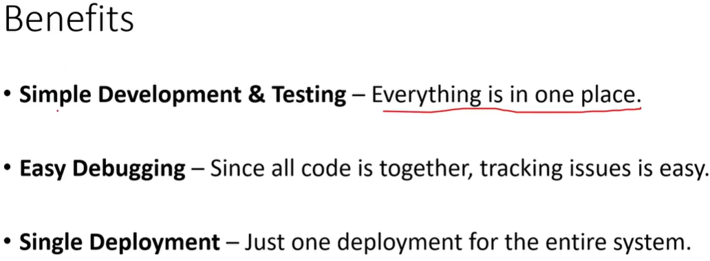
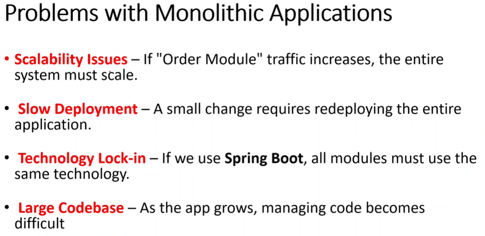
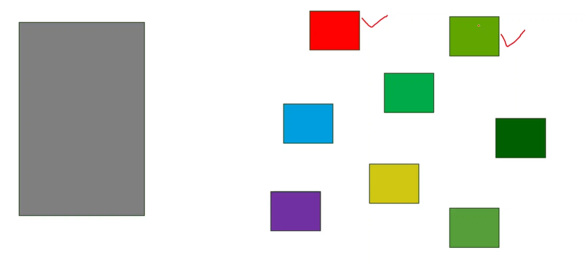
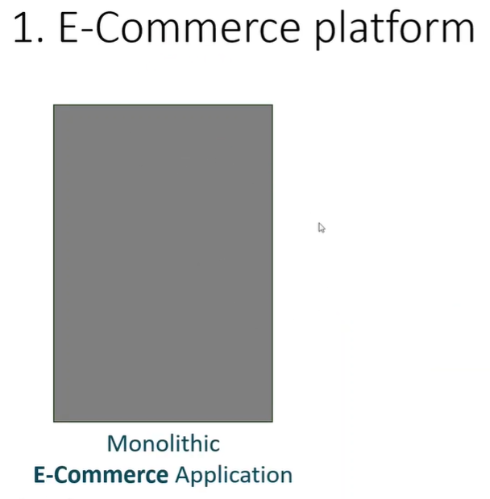
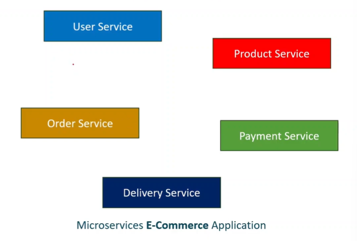
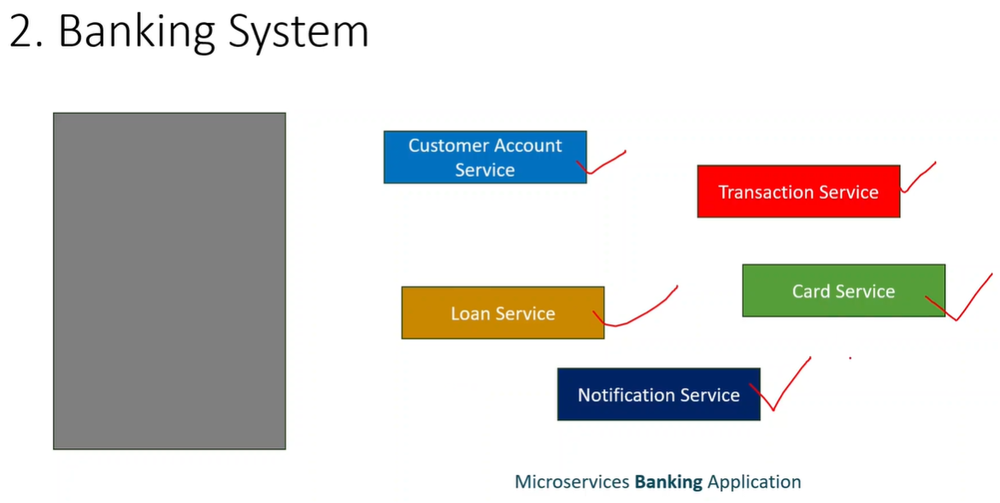
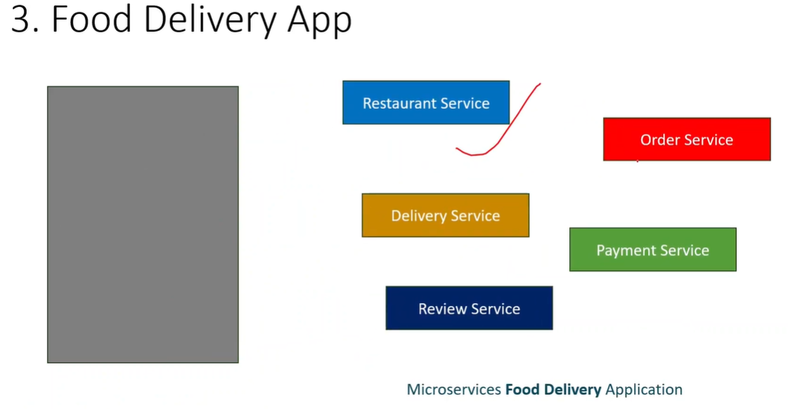

# 7.3 Microservices | Java | SpringBoot

What are microservices?

Earlier whole application was tested and deployed as a bundle. All services (like user management, product service etc) were in a single application. Monolith architecture.

MONOLITH                                         MICROSERVICE

Example:

Each micro-service can have its own tech-stack and DB. Each service runs independently of each other, and communicates to each other synchronously/ asynchronously (HTTP/gRPC etc).

Number of microservices and functions can be decided on basis of amount of resources, budget and service  management overhead.

