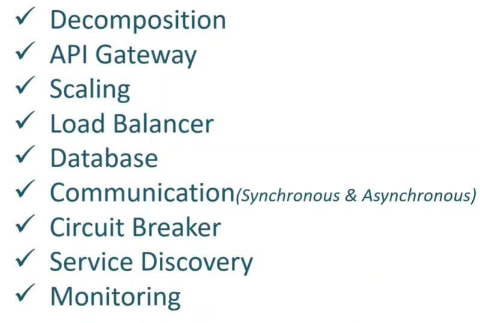
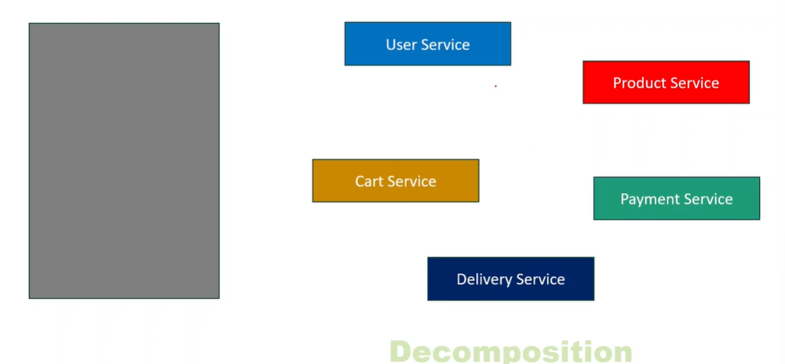
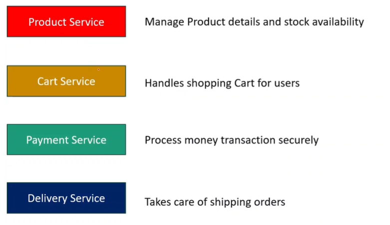
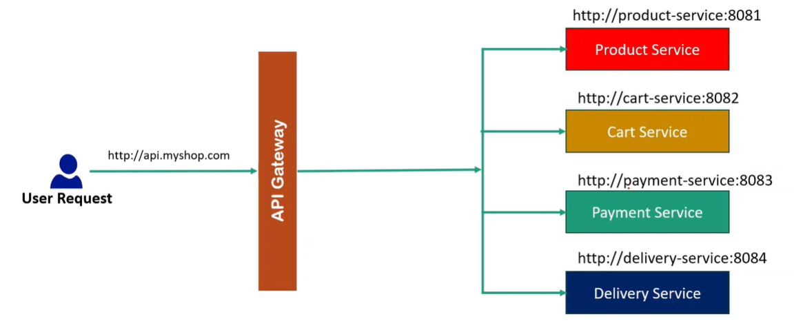
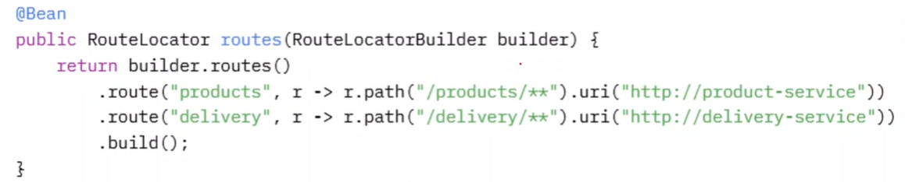
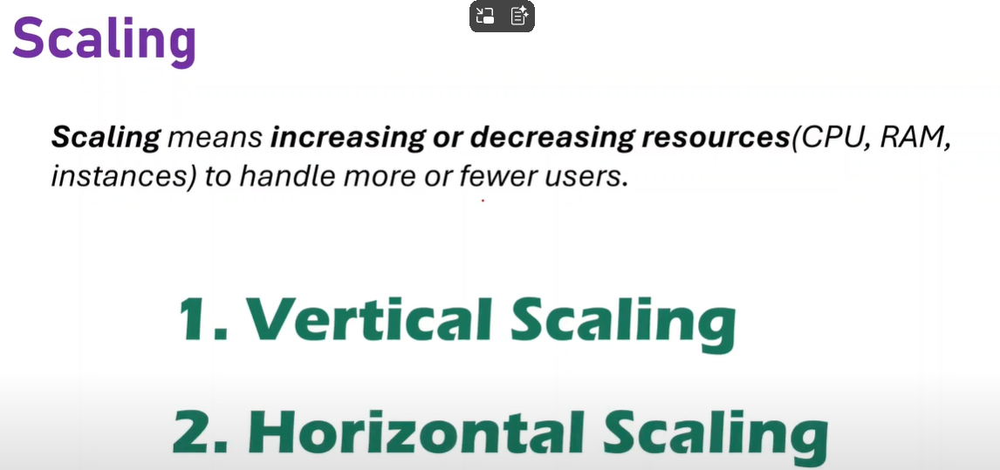
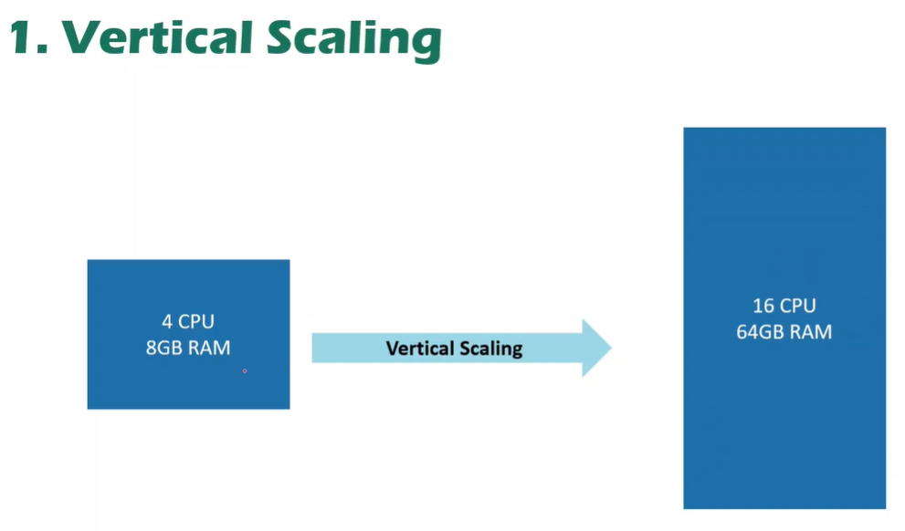
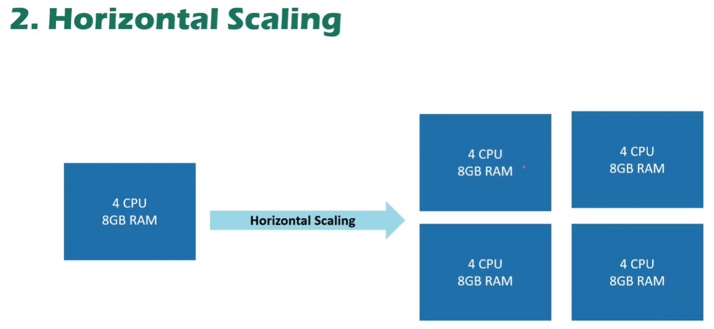

# 7.3.1 Microservices - Key Components

## Decomposition

Converting Monolithic service by breaking it down strategically into multiple small and independent services. The services should be loosely coupled, scaleable and manageable.

How is user able to communicate with these services?

## API Gateway

Ports and IP adress of microservices are kept private and not exposed to users to request. All requests come to API Gateway (single entry point) and it has underlying logic and conditions through which it forwards the requests to required service.

User is given Public API address of API gateway through which it can communicate with microservices.

We can use Spring Cloud Gateway to implement the API Gateway

What if millions of users hit e-commerce website during sale?

