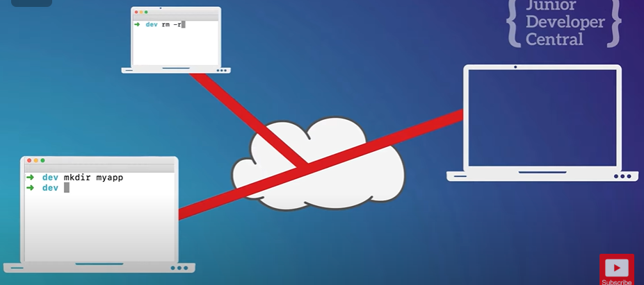
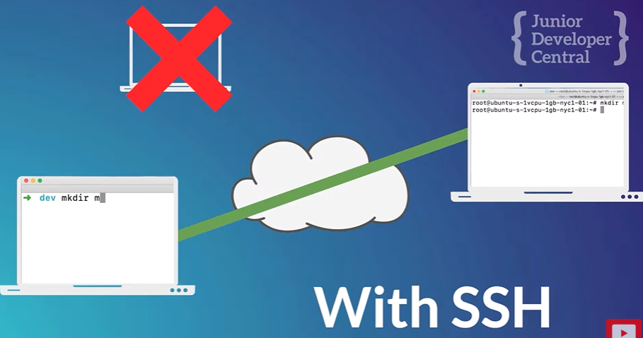
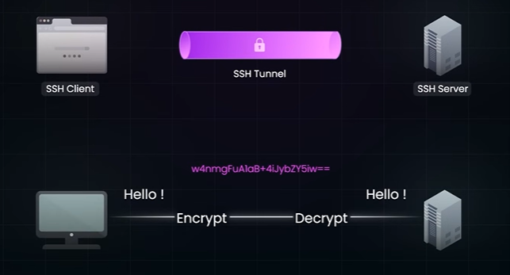

# 9.2 SSH

SSH USAGE:

PS C:\\Users\\Lavesh> ssh

usage: ssh \[-46AaCfGgKkMNnqsTtVvXxYy\] \[-B bind_interface\] \[-b bind_address\]

\[-c cipher_spec\] \[-D \[bind_address:\]port\] \[-E log_file\]

\[-e escape_char\] \[-F configfile\] \[-I pkcs11\] \[-i identity_file\]

\[-J destination\] \[-L address\] \[-l login_name\] \[-m mac_spec\]

\[-O ctl_cmd\] \[-o option\] \[-P tag\] \[-p port\] \[-Q query_option\]

\[-R address\] \[-S ctl_path\] \[-W host:port\] \[-w local_tun\[:remote_tun\]\]

destination \[command \[argument ...\]\]

- SSH (Secure Shell) provides a secure connection to another computer/server to remotely execute shell commands (remote command line access)

- Networking Protocol

- Allows secure communications, can secure any network service

If we send a request to a remote server, there is a chance that the request can be intercepted by a malicious server listening for requests on the network that your requests passes through.

SSH connection requires a ssh-client running on both devices. SSH connection is typically made through command line. Linux/Mac - default, windows - putty/ git bash/ WSL

To make a SSH connection:

username - with which you want to connect to the server

serverhost - IP address or Domain of the remote server

authentication - via password or key

Password -

Key -

- used to prove that you're authorised to use the server

- server doesnt need to ask for password everytime you connect

- useful in a continous integration workflow

- ./ssh/ has keys - public and private

- private key: stays on our computer

- public key: stored on remote server to verify connection

Generating Key:

ssh-copy-id root@server.juniordevelopercentral.com

this will copy your public key

now we won't be prompter for the password and we can connect directly with

ssh <ip or domain>

Copy project files to remote server. (scp: outdated)

git clone <repo_url>

repo_url = ssh://git@mycompany.com:repos/project.git

remote server = The **Git hosting server** where the repository lives. The server authenticates you using your **SSH key. **Then it sends back all the repo’s commits/objects so your machine can clone it.
