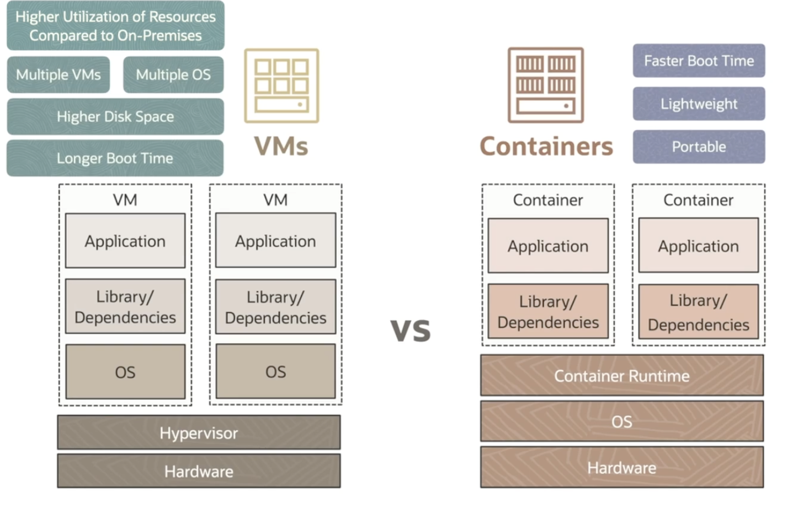
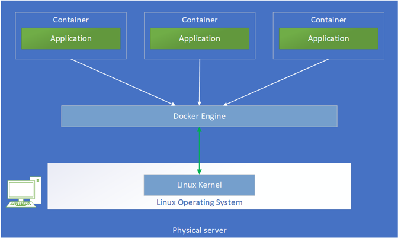
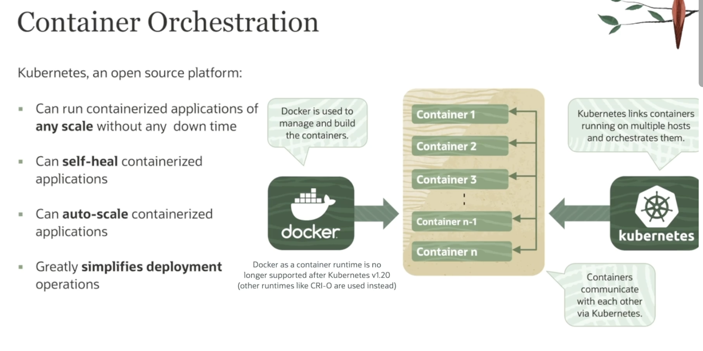
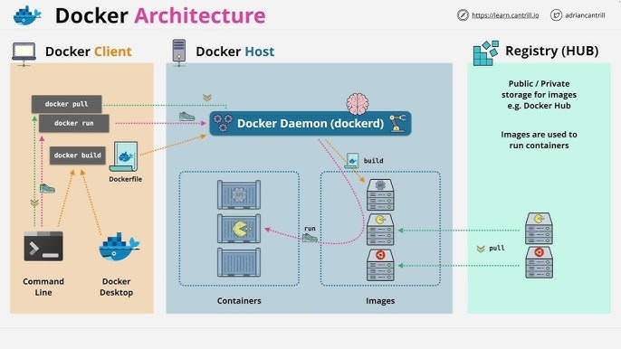
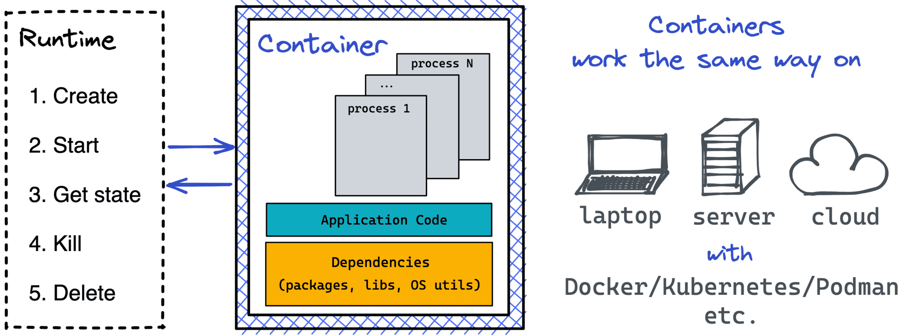
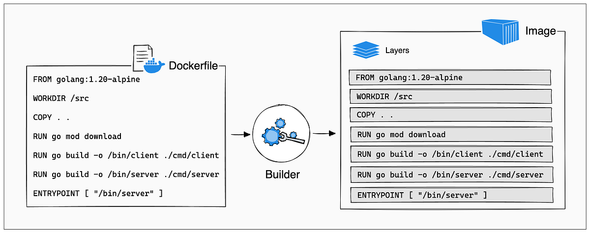
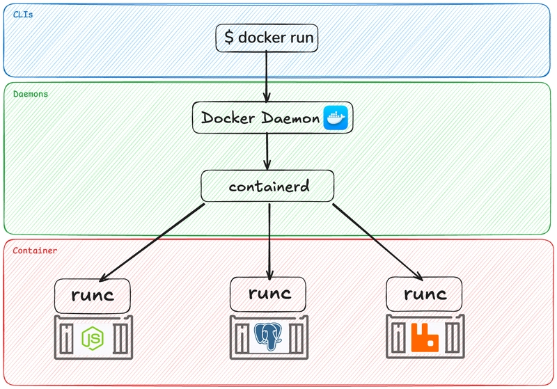
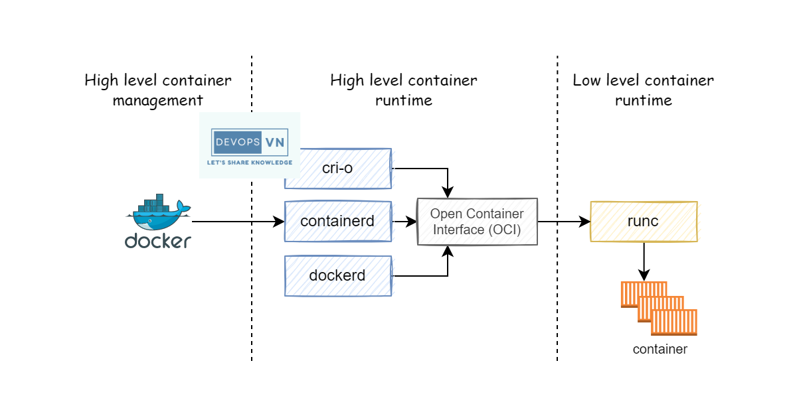

# 9.4.1 Containers

- Lightweight, portable and self sufficient units

- https://github.com/khalid-el-masnaoui/docker-notes/blob/main/ARCHITECTURE.md 
Containers contain:

- Application Code

- Dependencies (Libraries, Binaries)

- Runtime and System Tools

- Containers eliminate **"it works on my machine"** issues

- VMs v/s Containers:

- **Traditional VMs:**

- Heavy Weight

- Start in minutes, long boot up time

- High overhead (CPU and RAM)

- Require full blown OS

- Difficult to port

- Emulates full hardware stack, includes guest OS +application

- Runs on a hypervisor (virtual box, KVM, VMware)

- Strong Isolation, can run multiple OS

- **Containers**

- Lightweight and faster

- Quick start in seconds

- Shares OS Kernel

- Portable across environments

- Linux, and Container Runtime Engine running on top of it.

- OS level virtualization, shares HOST OS kernel, but isolates the user space

- CI/CD and microservices (MSA)

- Weaker Isolation compared to VMs.

- Needs container aware security.

- Benefits of Containers:

- Fast Startup

- Consistency across Dev, Test and Production

- Easy Scaling

- Better Resource Utilization

- Features of Container Runtime:

- Abstraction OS Level

- Startup time

- Size, isolation, portable, performance

**COMMON TOOLS TO CREATE CONTAINER ENVIROMENT:**

- Docker -> Most popular container engine, Docker Daemon

- Podman -> Docker Compatible, Daemonless

- Rocket (Rkt)

**KUBERNETES:**

1. Open source platform

1. For automating, deploying, scaling and management of containerized applications

1. K8 manages and scales containers, high automation, deploy, manage, connect, scale up/down

1. It works on large scale distributed microservices application

1. Container communicate with each other via k8

STATEFUL AND STATELESS APPLICATIONS:

- Stateless:

- Doesn't retain any data or session state

- Is independent and self-contained

- Eg: REST API, Serverless functions (OCI), Load balancer health check

- Stateful:

- Retain information about clients between requests

- Eg: Login session, shopping carts

- Databases, Redis, Kafka

**COMPONENTS OF CONTAINER BASED DEPLOYMENT:**

- App Code --> any language… java python etc

- Dependencies

- Frameworks, libraries, system tools

- Docker File --> instructions to build the container image

- Container image --> Immutable artifact that is built from the dockerfile (immutable: can't change or modify once it has been built)

- Registry --> centralized location to store container images in a database eg: Docker Hub, OCI Registry, etc.

- Runtime Engine --> Docker, **Podman**, Containerd

- Orchestrator --> K8, Docker Swarm

- Deployment Tools --> Kubectl, Helm etc.

KEY PRINCIPLES:

- Break apps into independent, loosely coupled services - Microservices

- Package services into portable, lightweight containers - process of image

- Automate everything, build, test, using CI/CD - Devops

- Define the infrastructure - IaC

- Built in logging, metrics and tracing - Observability

- Auto scale up/down - Elasticity

- Restart failed services automatically - self healing

**OPEN CONTAINER INTIATIVE** and its specifications (OCI)

- Open Source Governance (Linux Foundation)

- To promote standardization in the container ecosystem

- Container Runtime

- Container image formats

- Container Distribution

- This avoids vendor lock-in (develop in docker, run in podman possible - if developed according to OCI), ensure portability (can run on different container runtime), and ensures inter-operability across platforms and tools.

- OCI Specifications:

- OCI Image specifications

- defines the format for container images, ensures images can be run on any COMPLIANT RUNTIME

- Includes:

- JSON manifest describing layers

- Layered filesystems

- Configuration for environment variables, entry points

- Optional signatures (for trust)

- Image can be created by docker or podman

- Image is stored in registries in docker hub, OCIR etc

- OCI Runtime specifications

- Image is a file, container is a process (how to run a container - start, stop, restart)

- Implemented by low level runtimes

- Includes:

- Lifecycle of containers (create, start, delete)

- Eg: runc (Go) or crun (C) (runtime for containers)

- Runc does the low level 'stuff' to create and run containerised processes

- OCI Distribution Specification

- Standard for how images are pushed /pulled from registry

- API compatible

- Enables:

- Pushing / pulling from OCI compliant registry

- Support signing, artifacts and content discovery

- Content addressable image layers

**Docker pull image-name**

**Podman pull from . . . **

**CONTAINER RUNTIME:**

- Software:

- Runs and manager the containers on a single host

- Provides the low level interface between OS and container

- Uses the linux kernel features like namespaces, cgroups and security

- **Runc** -  default low level oci runtime

- **Containerd** - high level runtime managing the runc used by K8s

- Docker is software - full container platform including high level and low level runtime (containerd + runc)

- Alternatives -> podman, rootless, daemonless

- Docker relies on a central background daemon to manage containers, whereas Podman is daemonless and manages containers directly as user processes. Daemon has secuity isues, it is like a SINGLE POINT OF FAILURE.

**CLUSTER OF CONTAINER RUNTIMES:**

- Multiple hosts/nodes each running a container runtime, all managed together by an orchestrator

- Purpose:

- To schedule, run and monitor across a fleet of machines

- Provides HA, scaling, and self-healing

- Features lieks load balancing, auto scaling, rolling updates.

- Eg:

**How to use podman**

Run podman help in the terminal for a list of commands to interact with Podman. For example, try the 'Create' button within the Containers tab of Podman Desktop and view your containers with podman:

$ podman ps

**How to use Compose**

Run podman compose up (podman CLI v4.7.0+) or docker-compose in a directory with a compose.yaml. Podman Desktop will automatically detect the Compose deployment and show it in the container list.'

$ podman compose up

https://developers.redhat.com/articles/2023/11/06/working-kubernetes-podman-desktop

[Podman Tutorial Zero to Hero \| Full 1 Hour Course](<https://www.youtube.com/watch?v=YXfA5O5Mr18>)

Podman ps -a

Podman images

lavegupt@dhcp-10-120-179-155 ~ % podman network ls

NETWORK ID    NAME        DRIVER

2f259bab93aa  podman      bridge

lavegupt@dhcp-10-120-179-155 ~ % podman image pull httpd

Resolving "httpd" using unqualified-search registries (/etc/containers/registries.conf.d/999-podman-machine.conf)

Trying to pull docker.io/library/httpd:latest...

Getting image source signatures

Copying blob sha256:467c0fff8f96e617dcb807506012967cbed89965e7efbed6877a6f01713f2694

Copying blob sha256:4f4fb700ef54461cfa02571ae0db9a0dc1e0cdb5577484a6d75e68dc38e8acc1

Copying blob sha256:9a6263cdeaa5d408640880103ee36920ef814974ca8e2674412ad6460e8968c9

Copying blob sha256:abbcef294b4b5d709328047fe9874938c8561d6cf524433da7f6dd34df73912f

Copying blob sha256:e26a37ad57f7f9891d64d04a074f5562bc313aba88254f8844b4be5c50c1a5a2

Copying blob sha256:a925f5a0ddd22ab8698b0409c53d014e92fbeeb06ae0fd7f8676753c301d2687

Copying config sha256:a3279e1b0b243bef0c304b9b0d804b24004c7b669e162a290fca6fda44dbfd71

Writing manifest to image destination

A3279e1b0b243bef0c304b9b0d804b24004c7b669e162a290fca6fda44dbfd71

lavegupt@dhcp-10-120-179-155 ~ % podman images

REPOSITORY               TAG         IMAGE ID      CREATED      SIZE

docker.io/library/httpd  latest      a3279e1b0b24  2 weeks ago  150 MB

lavegupt@dhcp-10-120-179-155 ~ % podman inspect httpd | more

\[

{

"Id": "a3279e1b0b243bef0c304b9b0d804b24004c7b669e162a290fca6fda44dbfd71",

"Digest": "sha256:d8d30805eab436b9741da45f7c184f231e720b1f2398a7f04f79788bfd179537",

"RepoTags": \[

"docker.io/library/httpd:latest"

lavegupt@dhcp-10-120-179-155 ~ % podman container run -d --name testcontaug httpd

a948cd3baca85fb7e78f564de094558620985958aa9f6106e4c649abf05d9c6b

IMAGE = CLASS

CONTAINER = OBJECT

lavegupt@dhcp-10-120-179-155 ~ % podman ps -a

CONTAINER ID  IMAGE                           COMMAND           CREATED             STATUS             PORTS       NAMES

a948cd3baca8  docker.io/library/httpd:latest  httpd-foreground  About a minute ago  Up About a minute  80/tcp      testcontaug

lavegupt@dhcp-10-120-179-155 ~ % podman stats

ID            NAME         CPU %       MEM USAGE / LIMIT  MEM %       NET IO          BLOCK IO      PIDS        CPU TIME    AVG CPU %

a948cd3baca8  testcontaug  0.01%       2.753MB / 2.042GB  0.13%       1.866kB / 908B  0B / 4.096kB  82          20.116ms    0.01%

lavegupt@dhcp-10-120-179-155 ~ % podman container inspect testcontaug

\[

{

"Id": "a948cd3baca85fb7e78f564de094558620985958aa9f6106e4c649abf05d9c6b",

"Created": "2025-08-25T14:34:22.862274331+05:30",

"Path": "httpd-foreground",

"Args": \[

"httpd-foreground"

\],

"State": {

"OciVersion": "1.2.1",

"Status": "running",

"Running": true,

"Paused": false,

"Restarting": false,

"OOMKilled": false,

"Dead": false,

"Pid": 4830,

"ConmonPid": 4828,

"ExitCode": 0,

"10.88.0.2"

lavegupt@dhcp-10-120-179-155 ~ % curl localhost

curl: (7) Failed to connect to localhost port 80 after 0 ms: Couldn't connect to server

- The container’s internal IP is 10.88.0.2, and it has port 80 exposed within its own network namespace.

- The "Ports": {"80/tcp": null} means port 80 is not mapped to any port on your host machine—it’s only available to other containers on the same Docker network.

lavegupt@dhcp-10-120-179-155 ~ % podman run -d --name myhttpd -p 8080:80 httpd

52592e0dff2728a899b7567e9677394a399c5818694278c4366e0341703c58a5

lavegupt@dhcp-10-120-179-155 ~ % curl [http://localhost:8080](<http://localhost:8080/>)

<html><body><h1>It works!</h1></body></html>

lavegupt@dhcp-10-120-179-155 ~ % podman container logs testcontaug

AH00558: httpd: Could not reliably determine the server's fully qualified domain name, using 10.88.0.2. Set the 'ServerName' directive globally to suppress this message

AH00558: httpd: Could not reliably determine the server's fully qualified domain name, using 10.88.0.2. Set the 'ServerName' directive globally to suppress this message

\[Mon Aug 25 09:04:23.060428 2025\] \[mpm_event:notice\] \[pid 1:tid 1\] AH00489: Apache/2.4.65 (Unix) configured -- resuming normal operations

\[Mon Aug 25 09:04:23.060479 2025\] \[core:notice\] \[pid 1:tid 1\] AH00094: Command line: 'httpd -D FOREGROUND'

lavegupt@dhcp-10-120-179-155 ~ % podman container exec testcontaug pwd

/usr/local/apache2

lavegupt@dhcp-10-120-179-155 ~ % podman container exec testcontaug ls

bin

build

cgi-bin

conf

error

htdocs

icons

include

logs

modules

lavegupt@dhcp-10-120-179-155 ~ % podman container exec testcontaug cat htdocs/index.html

<html><body><h1>It works!</h1></body></html>

lavegupt@dhcp-10-120-179-155 ~ % podman container exec -it testcontaug bash

root@a948cd3baca8:/usr/local/apache2# ls

bin  build  cgi-bin  conf  error  htdocs  icons  include  logs modules

root@a948cd3baca8:/usr/local/apache2# cat htdocs/index.html

<html><body><h1>It works!</h1></body></html>

root@a948cd3baca8:/usr/local/apache2# pwd

/usr/local/apache2

lavegupt@dhcp-10-120-179-155 ~ % podman ps

CONTAINER ID  IMAGE                           COMMAND           CREATED         STATUS         PORTS                 NAMES

a948cd3baca8  docker.io/library/httpd:latest  httpd-foreground  29 minutes ago  Up 29 minutes  80/tcp                testcontaug

52592e0dff27  docker.io/library/httpd:latest  httpd-foreground  10 minutes ago  Up 10 minutes  0.0.0.0:8080->80/tcp  myhttpd

lavegupt@dhcp-10-120-179-155 ~ % podman container stop testcontaug

Testcontaug

lavegupt@dhcp-10-120-179-155 ~ % podman container exec -it testcontaug bash

Error: can only create exec sessions on running containers: container state improper

lavegupt@dhcp-10-120-179-155 ~ % podman ps

CONTAINER ID  IMAGE                           COMMAND           CREATED         STATUS         PORTS                 NAMES

a948cd3baca8  docker.io/library/httpd:latest  httpd-foreground  29 minutes ago  Up 29 minutes  80/tcp                testcontaug

52592e0dff27  docker.io/library/httpd:latest  httpd-foreground  10 minutes ago  Up 10 minutes  0.0.0.0:8080->80/tcp  myhttpd

lavegupt@dhcp-10-120-179-155 ~ % podman container stop testcontaug

testcontaug

lavegupt@dhcp-10-120-179-155 ~ % podman container exec -it testcontaug bash

Error: can only create exec sessions on running containers: container state improper

lavegupt@dhcp-10-120-179-155 ~ % podman container rm testcontaug

testcontaug

lavegupt@dhcp-10-120-179-155 ~ % podman ps

CONTAINER ID  IMAGE                           COMMAND           CREATED         STATUS         PORTS                 NAMES

52592e0dff27  docker.io/library/httpd:latest  httpd-foreground  16 minutes ago  Up 16 minutes  0.0.0.0:8080->80/tcp  myhttpd

lavegupt@dhcp-10-120-179-155 ~ % podman container stop myhttpd

myhttpd

lavegupt@dhcp-10-120-179-155 ~ % podman ps

CONTAINER ID  IMAGE       COMMAND     CREATED     STATUS      PORTS       NAMES

lavegupt@dhcp-10-120-179-155 ~ % podman image rm httpd

Error: image used by 52592e0dff2728a899b7567e9677394a399c5818694278c4366e0341703c58a5: image is in use by a container: consider listing external containers and force-removing image

lavegupt@dhcp-10-120-179-155 ~ % podman container rm myhttpd

myhttpd

lavegupt@dhcp-10-120-179-155 ~ % podman image rm httpd

Untagged: docker.io/library/httpd:latest

Deleted: a3279e1b0b243bef0c304b9b0d804b24004c7b669e162a290fca6fda44dbfd71

lavegupt@dhcp-10-120-179-155 ~ %

**UBUNTU**

lavegupt@dhcp-10-120-179-155 ~ % podman image pull ubuntu

Resolved "ubuntu" as an alias (/etc/containers/registries.conf.d/000-shortnames.conf)

Trying to pull docker.io/library/ubuntu:latest...

Getting image source signatures

Copying blob sha256:49a8ca9a328e179fe07d40f7f2fd5fb2860b5c45463c288b64f05be521173d2e

Copying config sha256:a7ff8584a5ea1fd67b1493a7b55d03a4f042fae15d6f4b2064a8a4f9c62c3183

Writing manifest to image destination

a7ff8584a5ea1fd67b1493a7b55d03a4f042fae15d6f4b2064a8a4f9c62c3183

lavegupt@dhcp-10-120-179-155 ~ % podman image inspect  ubuntu

\[

{

"Id": "a7ff8584a5ea1fd67b1493a7b55d03a4f042fae15d6f4b2064a8a4f9c62c3183",

"Digest": "sha256:4da877f7fd9fc69fc19ff008c4e96cf74b1905258468c551cf8748cacdcd3c9a",

"RepoTags": \[

"docker.io/library/ubuntu:latest"

\],

lavegupt@dhcp-10-120-179-155 ~ % podman run --name tub ubuntu

lavegupt@dhcp-10-120-179-155 ~ % podman ps -a

CONTAINER ID  IMAGE                            COMMAND     CREATED         STATUS                     PORTS       NAMES

01eb4325c385  docker.io/library/ubuntu:latest  /bin/bash   36 seconds ago  Exited (0) 36 seconds ago              tub

lavegupt@dhcp-10-120-179-155 ~ % podman container run -it --name tub ubuntu

root@27356b9839d7:/# ps

PID TTY          TIME CMD

1 pts/0    00:00:00 bash

4 pts/0    00:00:00 ps

root@27356b9839d7:/# pwd

/

root@27356b9839d7:/# ls

**bin**  **boot**  **dev**  **etc**  **home**  **lib**  **media**  **mnt**  **opt**  **proc**  **root**  **run**  **sbin**  **srv**  **sys**  tmp  **usr**  **var**

root@27356b9839d7:/# exit

exit

lavegupt@dhcp-10-120-179-155 ~ % podman start tub

tub

lavegupt@dhcp-10-120-179-155 ~ % podman ps

CONTAINER ID  IMAGE                            COMMAND     CREATED        STATUS        PORTS       NAMES

27356b9839d7  docker.io/library/ubuntu:latest  /bin/bash   4 minutes ago  Up 7 seconds              tub

lavegupt@dhcp-10-120-179-155 ~ % podman image ls

REPOSITORY                TAG         IMAGE ID      CREATED      SIZE

docker.io/library/ubuntu  latest      a7ff8584a5ea  3 weeks ago  103 MB

lavegupt@dhcp-10-120-179-155 ~ % podman exec -it tub bash

root@27356b9839d7:/# ps ax

PID TTY      STAT   TIME COMMAND

1 pts/0    Ss+    0:00 /bin/bash

4 pts/1    Ss     0:00 bash

7 pts/1    R+     0:00 ps ax

root@27356b9839d7:/# echo $PPID ---> root process

0

root@27356b9839d7:/# echo $$    --> current process

4

root@27356b9839d7:/# uname

Linux

root@27356b9839d7:/# uname -a

Linux 27356b9839d7 6.12.13-200.fc41.aarch64 #1 SMP PREEMPT_DYNAMIC Sat Feb  8 20:30:50 UTC 2025 aarch64 aarch64 aarch64 GNU/Linux

root@27356b9839d7:/#

**Installation of packages inside of container process:**

root@27356b9839d7:/# apt-get -y update

root@27356b9839d7:/# apt-get install vim

root@27356b9839d7:/# vim lavesh

root@27356b9839d7:/# cat lavesh

This is first file in my vim in Docker ~Lavesh

root@27356b9839d7:/#

lavegupt@dhcp-10-120-179-155 ~ %  podman exec tub cat lavesh

This is first file in my vim in Docker ~Lavesh

lavegupt@dhcp-10-120-179-155 ~ % podman attach --detach-keys="ctrl-y" tub

root@27356b9839d7:/# ps ax

PID TTY      STAT   TIME COMMAND

1 pts/0    Ss     0:00 /bin/bash

356 pts/0    R+     0:00 ps ax

root@27356b9839d7:/# echo $PPID

0

root@27356b9839d7:/# echo $$

1

root@27356b9839d7:/# Error: detached from container

**Username:** 98761368-labuser01

**Tenancy Name:** ocuocictrng27

**Compartment Name:** [98761368-C01](<https://cloud.oracle.com/identity/compartments/ocid1.compartment.oc1..aaaaaaaakeikpg42v3we3ypcislbwir5q5hj6nq2ups3rql3gmkmgmbw4rva>)

**Compartment OCID:** ocid1.compartment.oc1..aaaaaaaakeikpg42v3we3ypcislbwir5q5hj6nq2ups3rql3gmkmgmbw4rva

**Tenancy OCID:** ocid1.tenancy.oc1..aaaaaaaagu5bmovulbef7bydmdymd6fiy22w23qym5gjpf5y7w4hw6eio5uq

**VCN OCID:** ocid1.vcn.oc1.iad.amaaaaaalubh47iavr6jjcikjxtvdqnlx2xgvtyhjf4whwqagl254w3fq42a

Public IP:  129.213.26.23

x_98761368@cloudshell:~ (us-ashburn-1)$ uname -m

aarch64

x_98761368@cloudshell:~ (us-ashburn-1)$ docker image ls

REPOSITORY               TAG         IMAGE ID      CREATED      SIZE

docker.io/library/httpd  latest      199e3a035264  2 weeks ago  120 MB

RUNNING OCI INSTANCE ON LOCAL TERMINAL:

\[root@instance-20250826-1054 ~\]# history

1  id

2  dnf install docker

3  docker version

4  systemctl status podman

5  systemctl start podman

6  systemctl status podman

7  podman --version

8  docker --version

9  dnf install docker-cli

10  dnf install Docker-cli

11  vi .bashrc

12  source .bashrc

13  docker --version

14  history

\[root@instance-20250826-1054 ~\]# docker ps

CONTAINER ID  IMAGE                           COMMAND           CREATED         STATUS         PORTS       NAMES

59dec605a438  docker.io/library/httpd:latest  httpd-foreground  12 seconds ago  Up 12 seconds  80/tcp      ttt

\[root@instance-20250826-1054 ~\]# docker inspect ttt | grep -i ip

"**IP**Address": "10.88.0.2",

"**IP**PrefixLen": 16,

"**IP**v6Gateway": "",

"Global**IP**v6Address": "",

"Global**IP**v6PrefixLen": 0,

"LinkLocal**IP**v6Address": "",

"LinkLocal**IP**v6PrefixLen": 0,

"**IP**Address": "10.88.0.2",

"**IP**PrefixLen": 16,

"**IP**v6Gateway": "",

"Global**IP**v6Address": "",

"Global**IP**v6PrefixLen": 0,

"**IP**AMConfig": null,

"**Ip**cMode": "shareable",

\[root@instance-20250826-1054 ~\]# curl 10.88.0.2

<html><body><h1>It works!</h1></body></html>

Whenever we start and stop the containers the IP address also gets changes. So, if I restart the cotnaienr and do curl again then I won't be able to hit the old IP address, I will need to get the new address using grep and then do curl on that IP.
