# 9.5 ELK

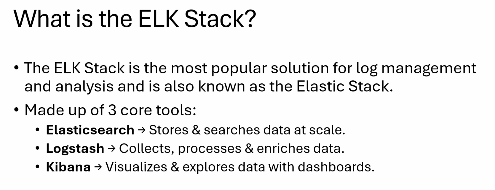

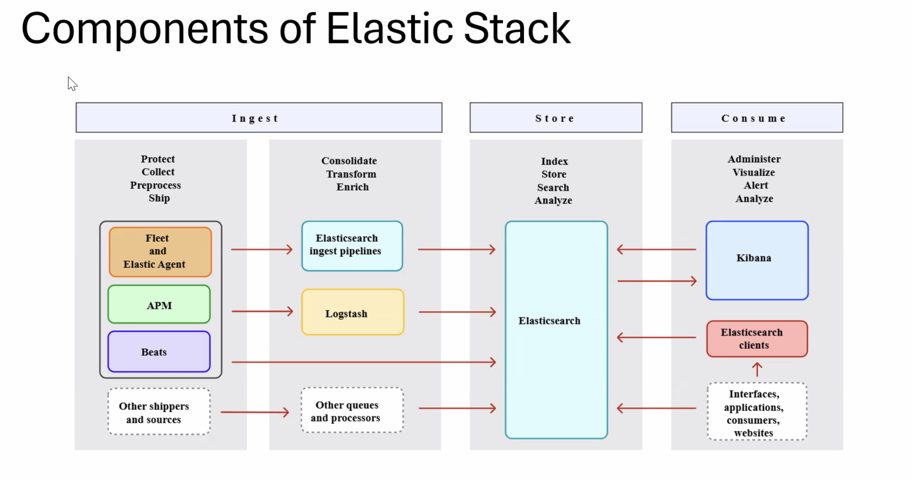

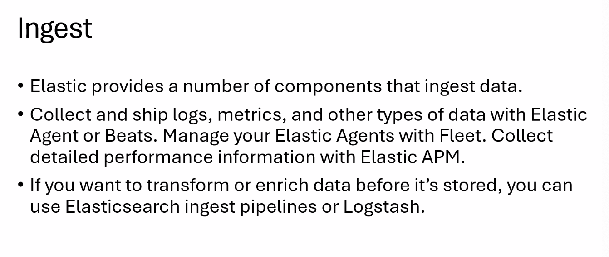

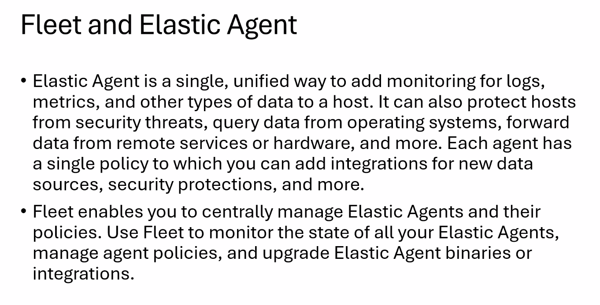

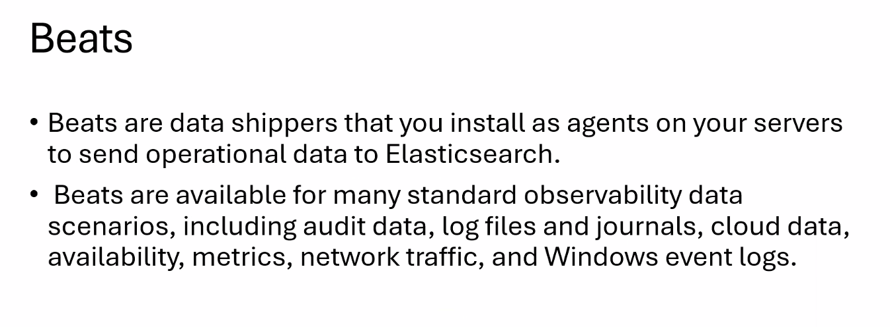

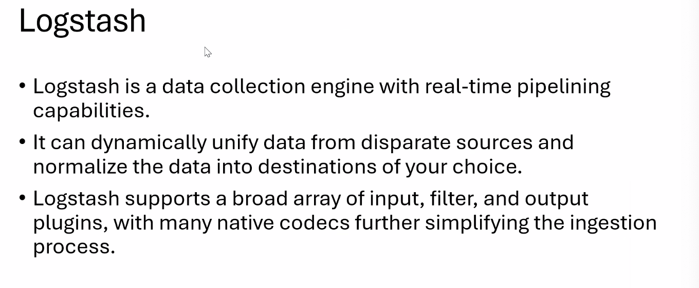

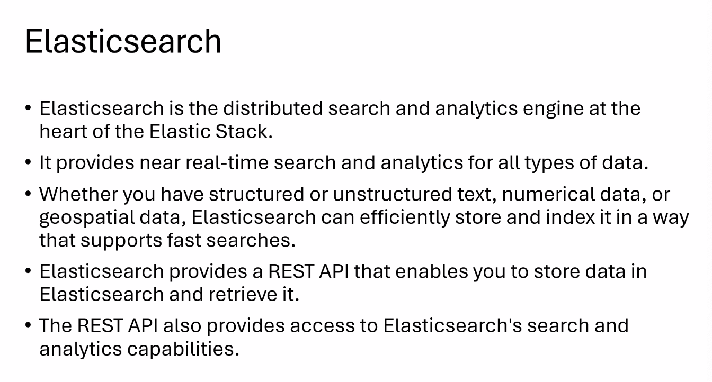

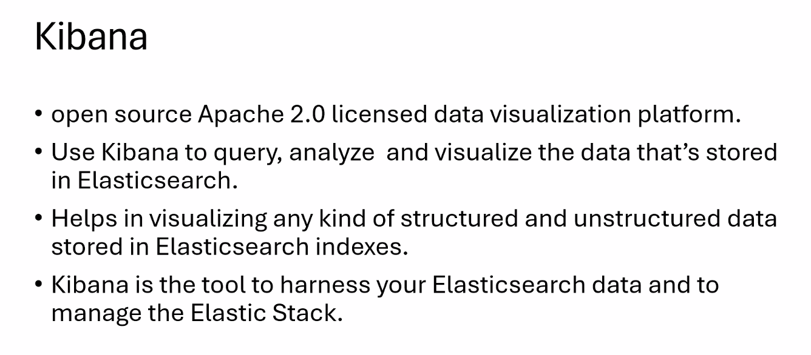

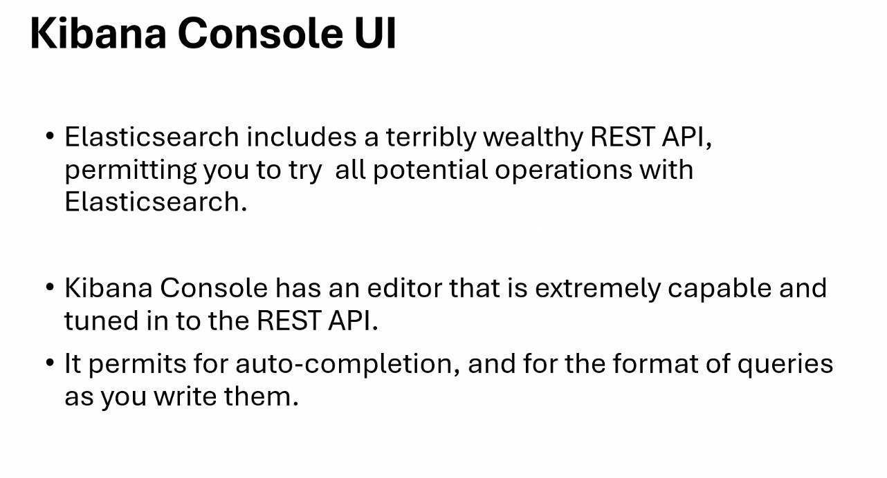

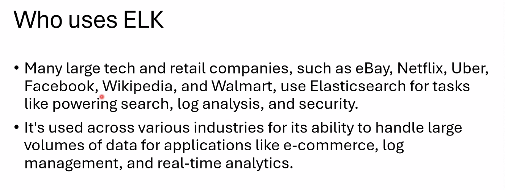

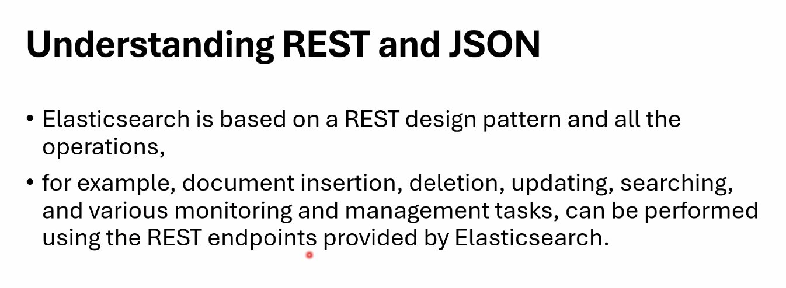

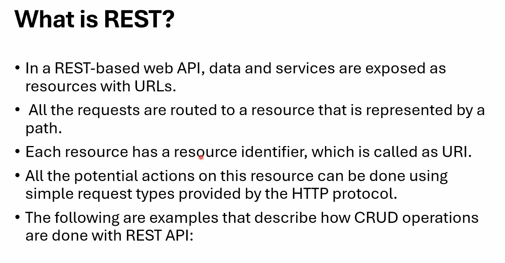

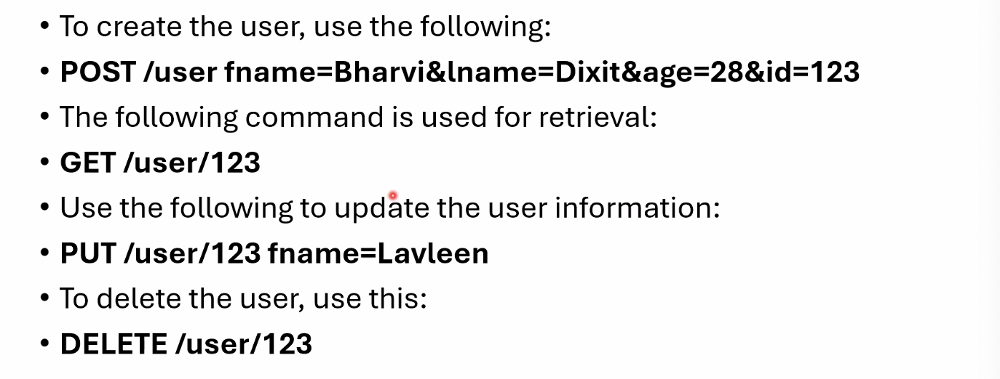

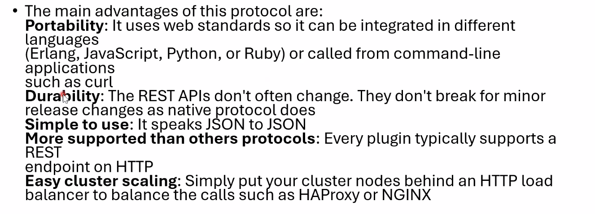

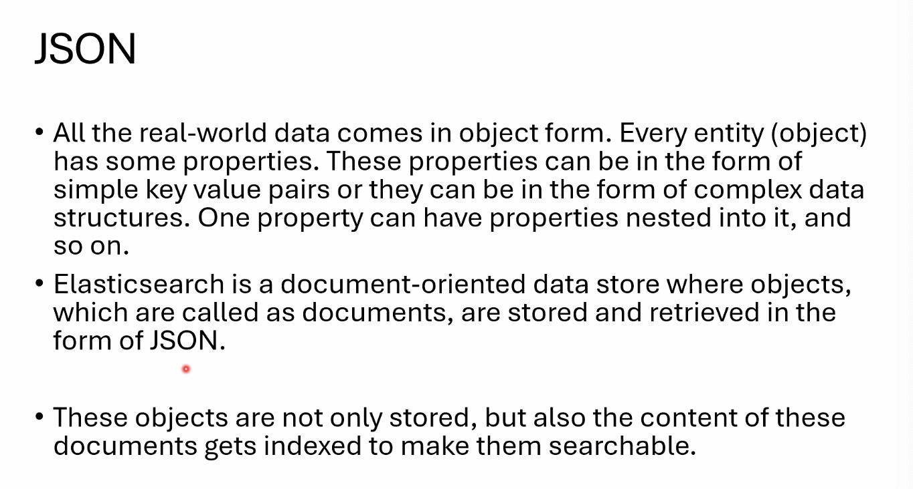

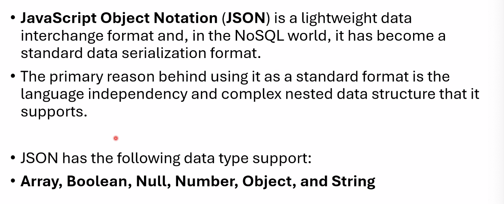

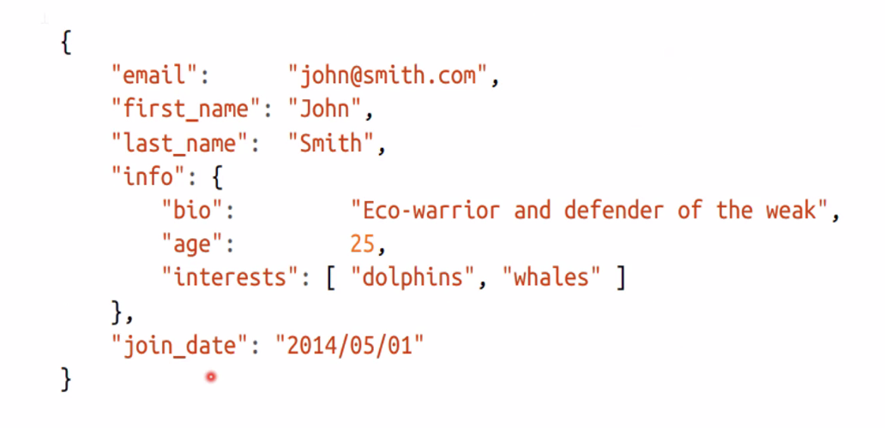

✅ Elasticsearch security features have been automatically configured!

✅ Authentication is enabled and cluster connections are encrypted.

ℹ️  Password for the **elastic** user (reset with `bin/elasticsearch-reset-password -u elastic`):

**UTv7ZjE9k64Det5V9e3p**

ℹ️  HTTP CA certificate SHA-256 fingerprint:

**6da34ce4fabf3fc4cceb4df6ddade6401fbf2edcf5a9d8464f25ded169139a5f**

ℹ️  Configure Kibana to use this cluster:

• Run Kibana and click the configuration link in the terminal when Kibana starts.

• Copy the following enrollment token and paste it into Kibana in your browser (valid for the next 30 minutes):

**eyJ2ZXIiOiI4LjE0LjAiLCJhZHIiOlsiMTAuMTIwLjE3Ny4xMjo5MjAwIl0sImZnciI6IjZkYTM0Y2U0ZmFiZjNmYzRjY2ViNGRmNmRkYWRlNjQwMWZiZjJlZGNmNWE5ZDg0NjRmMjVkZWQxNjkxMzlhNWYiLCJrZXkiOiJMZGZZQTVrQnJJRGYxNTlxRmM3NjpSS19iTkduMVI3QVI0d3JXQkZicUt3In0=**

ℹ️  Configure other nodes to join this cluster:

• On this node:

⁃ Create an enrollment token with `bin/elasticsearch-create-enrollment-token -s node`.

⁃ Uncomment the **transport.host** setting at the end of **config/elasticsearch.yml**.

⁃ Restart Elasticsearch.

• On other nodes:

⁃ Start Elasticsearch with `bin/elasticsearch --enrollment-token <token>`, using the enrollment token that you generated.

[https://10.120.177.12:9200](<https://10.120.177.12:9200/>)

## Welcome to the Dev Tools Console!

#

## You can use Console to explore the Elasticsearch API. See the Elasticsearch API reference to learn more:

## https://www.elastic.co/guide/en/elasticsearch/reference/current/rest-apis.html

#

## Here are a few examples to get you started.

## Create an index

PUT /my-index

## Add a document to my-index

POST /my-index/_doc

{

"id": "park_rocky-mountain",

"title": "Rocky Mountain",

"description": "Bisected north to south by the Continental Divide, this portion of the Rockies has ecosystems varying from over 150 riparian lakes to montane and subalpine forests to treeless alpine tundra."

}

## Perform a search in my-index

GET /my-index/_search?q="rocky mountain"

GET _cluster/health

GET _nodes

PUT /employee

PUT employee/_doc/101

{

"fname" : "Lavesh",

"lname" : "Gupta",

"salary" : 123456

}

PUT employee/_doc/102

{

"fname" : "Kunika",

"lname" : "Gupta",

"salary" : 123457

}

POST employee/_doc/

{

"fname" : "Random",

"lname" : "Gupta",

"salary" : 111111111111

}

{

"_index": "employee",

"_id": "WtecBJkBrIDf159qPM4S",

"_version": 1,

"result": "created",

"_shards": {

"total": 2,

"successful": 1,

"failed": 0

},

"_seq_no": 4,

"_primary_term": 1

}

## SEARCH ALL DATA:

GET employee/_search { "query": { "match_all": {} } }

GET employee/_doc/101

{

"_index": "employee",

"_id": "101",

"_version": 2,

"_seq_no": 2,

"_primary_term": 1,

"found": true,

"_source": {

"fname": "Lavesh",

"lname": "Gupta",

"salary": 123456

}

}

✅ Elasticsearch security features have been automatically configured!

✅ Authentication is enabled and cluster connections are encrypted.

ℹ️  Password for the **elastic** user (reset with `bin/elasticsearch-reset-password -u elastic`):

**rNKx2NLgBNfAiE+F40ey**

ℹ️  HTTP CA certificate SHA-256 fingerprint:

**766dbd7dbf8b572e4df2a757a0deee4a2c47a41526d03fb74a40b54722573da3**

ℹ️  Configure Kibana to use this cluster:

• Run Kibana and click the configuration link in the terminal when Kibana starts.

• Copy the following enrollment token and paste it into Kibana in your browser (valid for the next 30 minutes):

**eyJ2ZXIiOiI4LjE0LjAiLCJhZHIiOlsiMTAuMTIwLjE3Ny4xMjo5MjAxIl0sImZnciI6Ijc2NmRiZDdkYmY4YjU3MmU0ZGYyYTc1N2EwZGVlZTRhMmM0N2E0MTUyNmQwM2ZiNzRhNDBiNTQ3MjI1NzNkYTMiLCJrZXkiOiJDaDc0QkprQmo3dWRmOGF1QVBWSDp6dGswX1Y3Z3g4WGhRdEpaVzdkelhBIn0=**

ℹ️  Configure other nodes to join this cluster:

• On this node:

⁃ Create an enrollment token with `bin/elasticsearch-create-enrollment-token -s node`.

⁃ Uncomment the **transport.host** setting at the end of **config/elasticsearch.yml**.

⁃ Restart Elasticsearch.

• On other nodes:

⁃ Start Elasticsearch with `bin/elasticsearch --enrollment-token <token>`, using the enrollment token that you generated.
