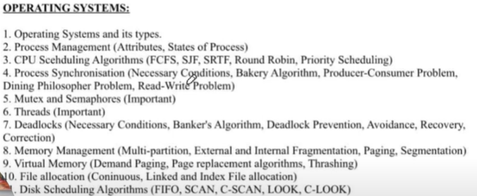
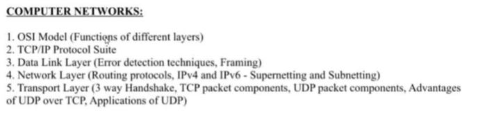
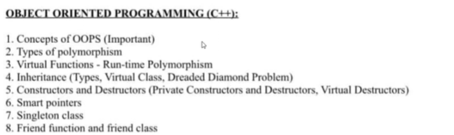
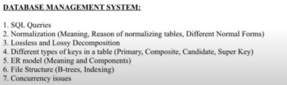

# 1.1.1 Links

| **Topic** | ** Sub-topics** |
| --- | --- |
| Introduction | *What is Computer Networks, Goals, Application, Data Communication, Transmission Mode, Network Criteria**, *Goals and Applications of Networks, Network structure and architecture |
| Types of Networks | *Connection Type, Topology, LAN, WAN, MAN* |
| Network Models | *OSI Model, All Layer Duties, Transmission Media, Switching, ISDN.* |
|  |  |

**Resources to use:**

**Playlists**

| [Complete CN Computer Networks in one shot \| Semester Exam \| Hindi](<https://www.youtube.com/watch?v=q3Z3Qa1UNBA&list=PLmXKhU9FNesSSGSDo9RAS3cGTksoy4WzD&index=11&pp=iAQB>) |
| --- |
| [Computer Networks in 1 Video for Placement \| Interview Questions \| Core Computer Science Resources](<https://www.youtube.com/watch?v=qUBHLZEtS0M&t=309s&pp=ygUgY29tcHV0ZXIgbmV0d29ya3MgZm9yIHBsYWNlbWVudHM%3D>) |
| [Computer Networking Full Course - OSI Model Deep Dive with Real Life Examples](<https://www.youtube.com/watch?v=IPvYjXCsTg8&pp=ygUgY29tcHV0ZXIgbmV0d29ya3MgZm9yIHBsYWNlbWVudHM%3D>) |
| [Computer Networking Tutorial - Bits and Bytes of the Networking \[12 HOURS\]](<https://youtu.be/PhjHXeMNpp8?si=k7nAcJcufRGKgI_8>) |
| [TCP/IP Deep Dive](<https://youtu.be/rmFX1V49K8U?si=9L0_RdhyArDJt08U>) |
| **Theory Resources:** |
| https://github.com/notescs/notes/tree/main/Computer-Networks-for-Interviews |
| https://www.propeers.in/roadmaps/660fc3db80d2621dde5a1b32 |
| https://github.com/donnemartin/system-design-primer?tab=readme-ov-file#communication |
| **Pagination:** |
| [How to design API that display and filter through millions of products.REST API Filters & Pagination](<https://www.youtube.com/watch?v=MbslvX0AMVE&pp=ygUTcmVzdCBhcGkgcGFnaW5hdGlvbg%3D%3D>) |

[Networking Essentials for System Design Interviews w/ Ex Meta Senior Manager](<https://www.youtube.com/watch?v=SHkbPm1Wrno&pp=ygUfY29tcHV0ZXIgbmV0d29ya3MgZm9yIGludGVydmlldw%3D%3D>)

[Networking For Beginners - IP Mac Subnet Switch Router DHCP DNS Gateway Firewall NAT DMZ](<https://www.youtube.com/watch?v=z_CU-IeOEzU&pp=ygUfY29tcHV0ZXIgbmV0d29ya3MgZm9yIGludGVydmlldw%3D%3D>)

[Computer Networking Full Course - Internet Explained Step by Step (Real-Life Examples)](<https://www.youtube.com/watch?v=RY32wSQDekE&pp=ygUfY29tcHV0ZXIgbmV0d29ya3MgZm9yIGludGVydmlldw%3D%3D>)

**Syllabus:**

UNIT-1 : Introduction Concepts:

  1. ,

  1. The OSI reference model, services, Network Topology Design - Delay Analysis, Back Bone Design, Local Access Network Design, Physical Layer Transmission Media, Switching methods, ISDN, Terminal Handling.

  1. *What is Computer Networks, Goals, Application, Data Communication, Transmission Mode, Network Criteria, Connection Type, Topology, LAN, WAN, MAN, OSI Model, All Layer Duties, Transmission Media, Switching, ISDN.*

[Network Interview Questions and Answers for Freshers \| Part 1](<https://www.youtube.com/watch?v=veISCjpS0Mw>)

[Network Interview Questions and Answers for Freshers \| Part 2](<https://www.youtube.com/watch?v=GJoBWikyTvw>)

[Network Interview Questions and Answers for Freshers \| Part 3](<https://www.youtube.com/watch?v=uo6r6oDtosk>)

COMPUTER NETWORKS:

https://whimsical.com/networking-cheatsheet-by-love-babbar-FcLExFDezehhfsbDPfZDBv

[Networking Cheatsheet \[By Love Babbar\] (whimsical.com)](<https://whimsical.com/networking-cheatsheet-by-love-babbar-FcLExFDezehhfsbDPfZDBv>)

https://www.geeksforgeeks.org/last-minute-notes-computer-network/

BIG VIDEOS:

https://youtu.be/q3Z3Qa1UNBA?si=NtegPuAQYgrOV7j0

https://youtu.be/IPvYjXCsTg8?si=dxdXj89rEMWjFXIF

https://youtu.be/qUBHLZEtS0M?si=wGASSgMVm47uLGZL

Tutorials Points: [PlacementPrepGuide/Computer Networks/data_communication_computer_network_tutorial.pdf at main · chaharnishant11/PlacementPrepGuide (github.com)](<https://github.com/chaharnishant11/PlacementPrepGuide/blob/main/Computer%20Networks/data_communication_computer_network_tutorial.pdf>)

[CN roadmap - Google Docs](<https://docs.google.com/document/d/1UJ5AyAjJ2TwDTDVIvUMBaJilyV2u9NgGqaCGy-Gbq-k/edit>)

Compute Networks:

Define network

What do you mean by network topology, and explain types of them

Define bandwidth, node and link ?

Explain TCP model ..

Layers of OSI model

Significance of Data Link Layer

Define gateway, difference between gateway and router ..

What does ping command do ?

What is DNS, DNS forwarder, NIC, ?

What is MAC address ?

What is IP address, private IP address, public IP address, APIPA ?

Difference between IPv4 and IPv6

What is subnet ?

Firewalls

Different type of delays

3 way handshaking

Server-side load balancer

RSA Algorithm

What is HTTP and HTTPS protocol ?

What is SMTP protocol ?

TCP and UDP protocol, prepare differences

What happens when you enter “google.com” (very very famous question)

Hub vs Switch

VPN, advantages and disadvantages of it

LAN

[Most Asked Computer Networks Interview Questions (takeuforward.org)](<https://takeuforward.org/computer-network/most-asked-computer-networks-interview-questions>)

OS, DBMS - Sanchit jain

LLD > HLD

DESIGN PATTERNS - GAURAV SEN

Elevator, chess
