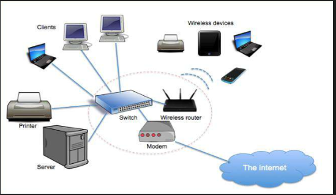
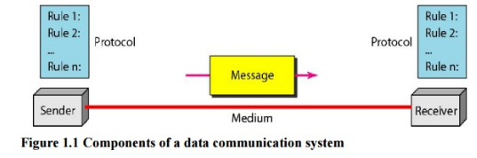
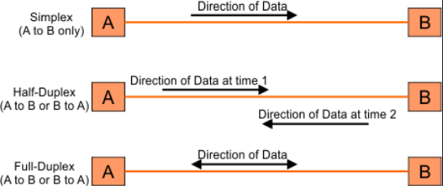
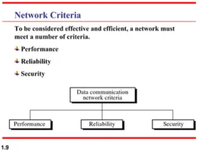

# 1.2.2 Introduction

A computer network is a telecommunications network, which allows autonomous digital devices(nodes) to exchange data between each other using either wired or wireless connections to share resources (h/w or s/w) interconnected by a single technology e.g. internet.

## Data Communication

\* Data communications are the exchange of data between to two devices via some transmission medium.

\* Data communication system has five components

1. Message- information (data) to be communicated e.g. text, audio, video.

2. Sender- device how sends the message (computer, phone, camera etc.)

3. Receiver- device how receives the message (computer, phone, television etc.)

4. Transmission medium – is the physical path by which a message travels from sender to receiver.

5. Protocol \*\*(most imp)\*\* – Which includes Syntax, Semantics, Timing, De facto, De jure. Protocols are rules set by people on how different type of data will be transferred over the internet.

## Transmission Modes:

Data flow between two systems can be categorized into three types –

\* SIMPLEX:

\* The communication is unidirectional as a one-way street, one device always, other can always receive. E.g. radio, mouse.

\* The simplex mode can use the entire capacity of the channel to send data in one direction.

\* HALF-DUPLEX:

\* Each station can both transmit and receive, but not at the same time. E.g. like a one lane road, walkie-talkie etc.

\* When one device is sending, the other can only receive, and vice versa.

\* In a half-duplex transmission, the entire capacity of a channel is taken over by whichever of the two devices is transmitting at the time.

\* Walkie-talkies are both half-duplex systems.

\* FULL-DUPLEX:

\* Both stations can transmit and receive at the same time. Actually, it is two half duplex connections, working in close communication with each other.

\* Telephone network is an example of full-duplex mode, when two people are communicating by a telephone line, both can talk and listen at the same time.

\* The capacity of the channel, must be divided between the two directions

## Network Criteria

A network must be able to meet a certain number of criteria. The most important of these are

  1. Delivery & Accuracy- Must deliver the data to correct destination without any error \*\*\[MOST IMPORTANT\]\*\*

  1. Performance – Can be measured in many ways including transit time, response time, number of users, type of transmission medium, capabilities of connected hardware’s and efficiency of software.

  1. Reliability – Is a measure of frequency of failure and the time taken to resolve from the failure.

  1. Security – Includes protecting data from unauthorized access, protecting data from damage and development.
