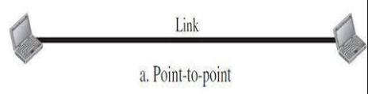
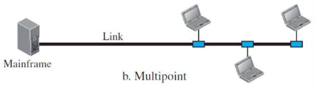
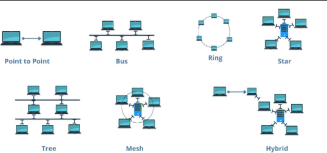
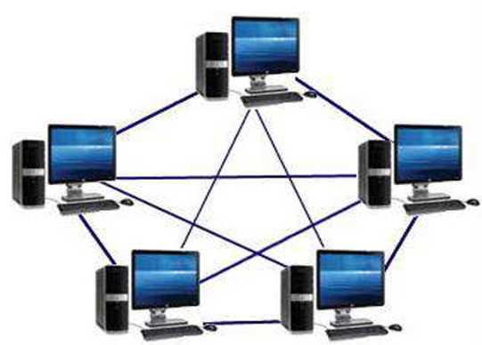
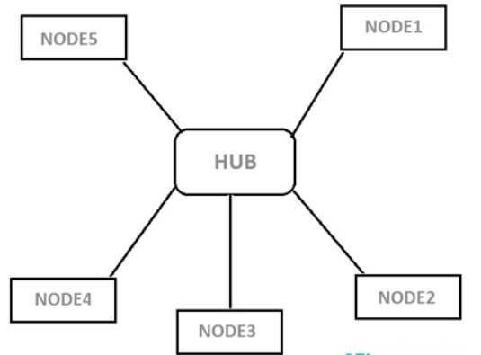
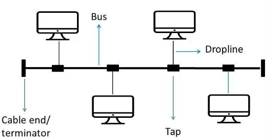
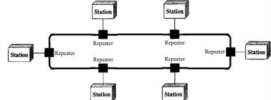

# 1.2.3 Types of Networks

## Types of connections:

1. **Point to point:**

1. A point-to-point connection provides a dedicated link between two devices.

2. Most point-to-point connections use an actual length of wire or cable to connect the two ends, but other options, such as microwave or satellite links, are also possible.

3.

2. **Multipoint:**

1. A multipoint (also called multidrop) connection is one in which more than two specific devices share a single link

2.

## Physical Topology

Refers to the way in which a network is laid out physically. Topology of a network is the geometric representation of the relationship of all the links and linking devices to one another.

### Mesh Topology

\* In a mesh topology, every device has a dedicated point-to-point link to every other device.

\* We need, n (n -1) /2, duplex-mode links, where n is number of nodes.

\* Advantages

1. No traffic problems

2. Robust

3. Privacy or security

4. Fault identification and fault isolation easy.

\* Disadvantage

1. Installation and reconnection are difficult.

2. The sheer bulk of the wiring.

3. Expensive.

### Star Topology:

1. In a star topology, each device has a dedicated point-to-point link only to a central controller, usually called a hub. The devices are not directly linked to one another. •

2. The controller acts as an exchange: If one device wants to send data to another, it sends the data to the controller, which then relays the data to the other connected device.

3. Advantages

1. Less expensive than a mesh topology.

2. Easy to install and reconfigure and less costly.

3. It is robust. If one link fails, only that link is affected.

4. Easy fault identification and fault isolation.

4. Disadvantage

1. Dependency of the whole topology on one single point, the hub.

2. Often more cabling is required in a star than in some other topologies

### Bus Topology

1. A bus topology, is multipoint. One long cable acts as a backbone to link all the devices in a network.

2. Nodes are connected to the bus cable by drop lines and taps.

3. A drop line is a connection running between the device and the main cable.

4. A tap is a connector that either splices into the main cable or punctures the sheathing of a cable to create a contact with the metallic core.

5. Advantages

1. Ease of installation.

2. Uses less cabling than mesh or star topologies.

6. Disadvantage

1. Difficult reconnection and fault isolation.

2. Difficult to add new devices to network.

3. A fault or break in the bus cable stops all transmission

### Ring Topology:

1. In a ring topology, each device has a dedicated point-to-point connection with only the two devices on either side of it.

2. A signal is passed along the ring in one direction, from device to device, until it reaches its destination. Each device in the ring incorporates a repeater.

3. When a device receives a signal intended for another device, its repeater regenerates the bits and passes them along.

4. Advantages

1. A ring is relatively easy to install and reconfigure.

2. Fault isolation is simplified.

5. Disadvantages

1. A break in the ring (such as a disabled station) can disable the entire network.

## LAN, MAN, WAN:

\* Local Area Network (LAN) : • LAN is usually limited to a few kilometers of area. • It may be privately owned and could be a network inside an office on one of the floor of a building or a LAN could be a network consisting of the computers in an entire building.

\* Metropolitan Area Network (MAN) : • MAN is of size between LAN and WAN. • It is larger than LAN but smaller than WAN. • It may comprise the entire network in a city like Mumbai

\* Wide Area Network (WAN) : • WAN is made of all the networks in a (geographically) large area. • The network in the entire state of UP could be a WAN.
