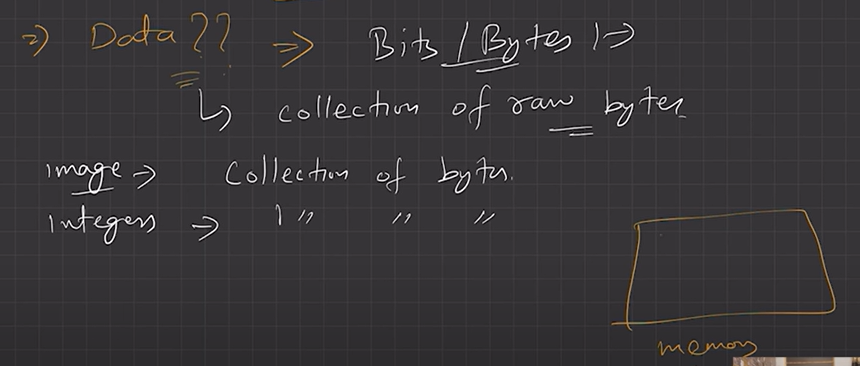
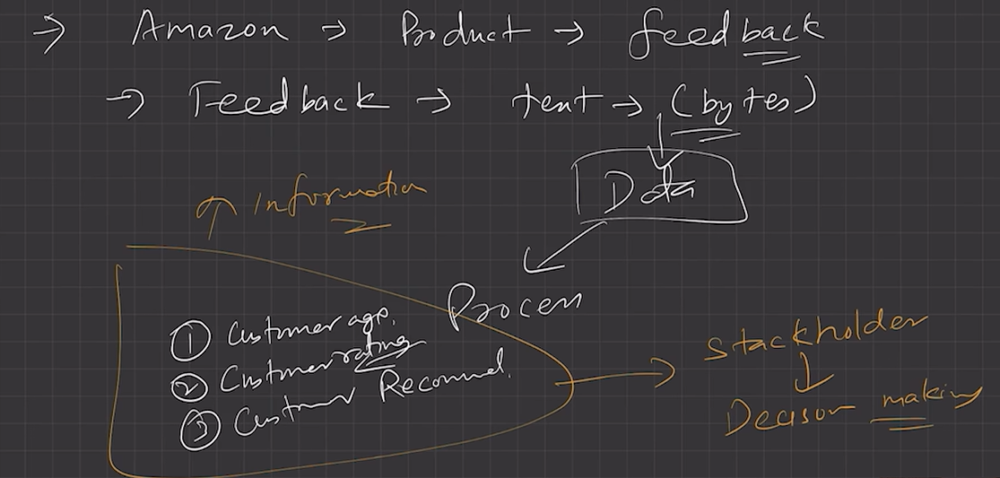
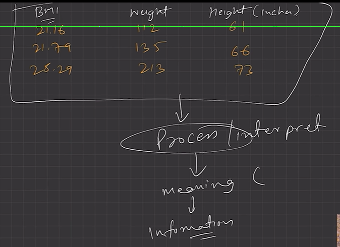
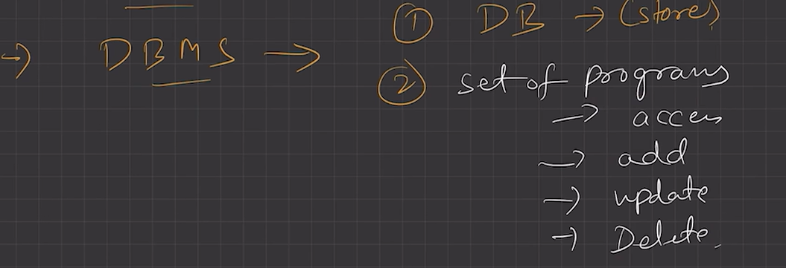
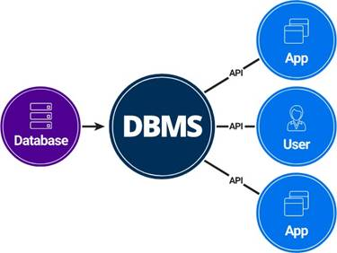
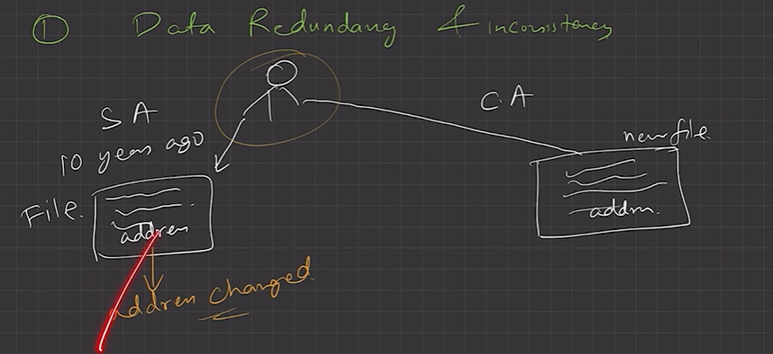

# 2.1.1 LEC-1: Introduction to DBMS

**LEC-1: Introduction to DBMS**

  1. **What is Data?**

    1. Data is a collection of raw, unorganized facts and details like text, observations, figures, symbols, and descriptions of things etc.

In other words, **data does not carry any specific purpose and has no significance by itself.**

  1. Moreover, data is measured in terms of bits and bytes – which are basic units of information in the context of computer storage and processing.

  1. Data can be recorded and doesn’t have any meaning unless processed.

  1. **Types of Data**

    1. **Quantitative**

      1. Numerical form

      1. Weight, volume, cost of an item.

    1. **Qualitative**

      1. Descriptive, but not numerical.

      1. Name, gender, hair color of a person.

  1. What is **Information**?

    1. Information Is **processed, organized, and structured data.**

    1. It provides **context of the data and enables decision making.**

    1. Processed data that make **sense **to us.

    1. Information is extracted from the data, by **analyzing and interpreting **pieces of data.

E.g., you have data of all the people living in your locality, its Data, when you analyze and interpret the data and come to some conclusion that:

  1. There are 100 senior citizens.

  1. The sex ratio is 1.1.

  1. Newborn babies are 100. These are information.

  1. **Data vs Information**

    1. Data is a collection of facts, while information puts those facts into context.

    1. While data is raw and unorganized, information is organized.

    1. Data points are individual and sometimes unrelated. Information maps out that data to provide a big-picture view of how it all fits together.

    1. Data, on its own, is meaningless. When it’s analyzed and interpreted, it becomes meaningful information.

    1. Data does not depend on information; however, information depends on data.

    1. Data typically comes in the form of graphs, numbers, figures, or statistics. Information is typically presented through words, language, thoughts, and ideas.

    1. Data isn’t sufficient for **decision-making**, but you can make decisions based on information.

  1. What is **Database**?

    1. Database is an electronic place/system where data is stored in a way that it can be **easily accessed, managed, and updated.**

    1. To make real use of  Data, we need **Database management systems. (DBMS)**

  1. What is **DBMS**?

  1. A database-management system (DBMS) is a collection of **interrelated data **and **a set of programs to access those data**. The collection of data, usually referred to as the **database**, contains information relevant to an enterprise. The primary goal of a DBMS is to provide a way to **store and retrieve database information **that is both convenient and efficient.

  1. A DBMS is the database itself, along with all the software and functionality. It is used to perform different operations, like **addition**, **access**, **updating**, and **deletion **of the data.

​Contrained access provided by DBMS

  1. **DBMS vs File Systems**

    1. **File-processing systems **has major **disadvantages**.

      1. Data Redundancy and inconsistency

  1. Difficulty in accessing data

  1. Data isolation

  1. Integrity problems

  1. Atomicity problems

  1. Concurrent-access anomalies

  1. Security problems

  1. Above 7 are also the **Advantages of DBMS **(answer to “**Why to use DBMS?**”)
