# 2.1.2 LEC-2: DBMS Architecture

1. **View of Data (Three Schema Architecture)**

  1. The major purpose of DBMS is to provide users with an **abstract view **of the data. That is, the system hides certain details of how the data is stored and maintained.

  1. Only those things which are relevant to user is shared, internal complexities are hidden.

  1. To simplify user (end user) interaction with the system, abstraction is applied through several levels of abstraction.

  1. The **main objective **of three level architecture is to enable multiple users to access the same data with a personalized view while storing the underlying data only once.

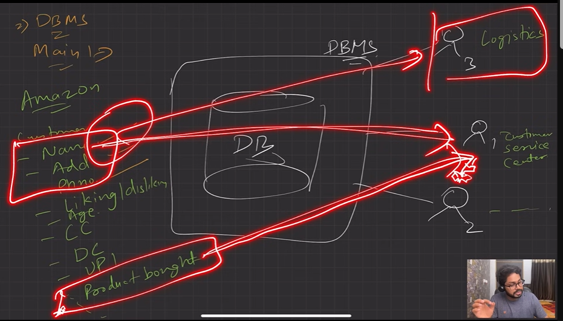

[What is Data Abstraction in DBMS? - GeeksforGeeks](<https://www.geeksforgeeks.org/what-is-data-abstraction-in-dbms/>)

[Data Abstraction in DBMS - Naukri Code 360](<https://www.naukri.com/code360/library/data-abstractions-in-dbms>)

  1. Three Schema Architecture (View of Data)

" Schema means design."

  1. **Physical level / Internal level**

    1. The lowest level of abstraction describes how the data are stored.

    1. Low-level data structures used.

    1. It has **Physical schema **which describes physical storage structure of DB.

    1. Talks about: Storage allocation (N-ary tree etc), Data compression G encryption etc.

    1. **Goal**: We must define algorithms that allow efficient access to data. Fast access to data must be there.

At physical level data for course and student is going to look the same in form of bits/bytes/strings.

  1. **Logical level / Conceptual level:**

    1. The **conceptual schema **describes the design of a database at the conceptual level, describes ***what ***data are stored in DB, and what ***relationships ***exist among those data.

    1. User at logical level does not need to be aware about physical-level structures.

    1. **DBA**, who must decide what information to keep in the DB use the logical level of abstraction.

    1. **Goal**: ease to use.

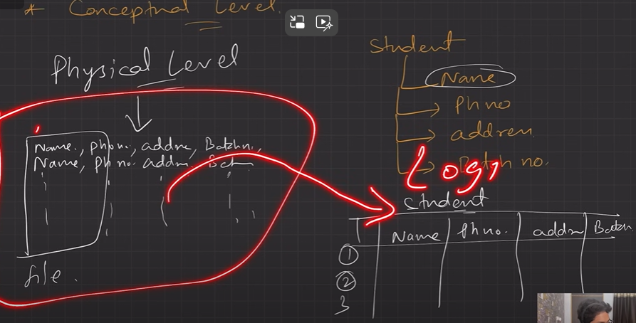

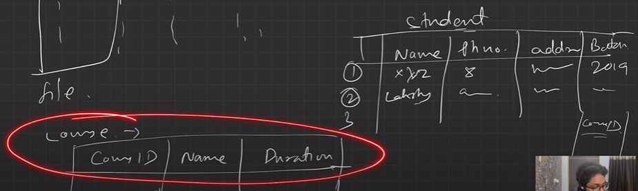

**At logical level you define the relation between student and course data like "student apply for course"**

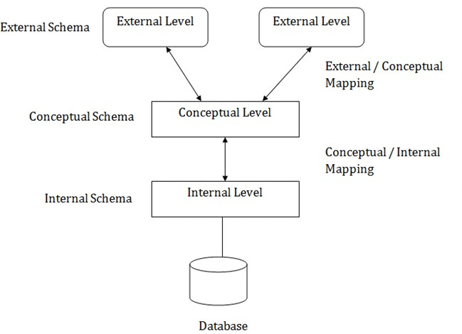

  1. **View level / External level: (End User)**

    1. Highest level of abstraction aims to simplify users’ interaction with the system by providing different view to different **end**-user.

    1. Each **view schema **describes the database part that a particular user group is interested and hides the remaining database from that user group.

    1. At the external level, a database contains several schemas that sometimes called as **subschema**. The subschema is used to describe the different view of the database.

    1. At views also provide a **security **mechanism to prevent users from accessing certain parts of DB.

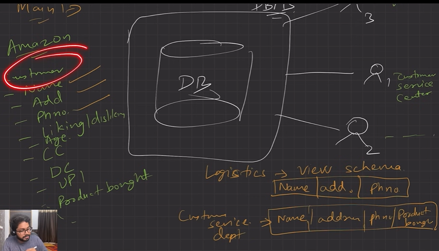

  1. **Instances ( Instance of DB) and Schemas**

    1. The collection of information stored in the DB at a particular moment is called an **instance **of DB.

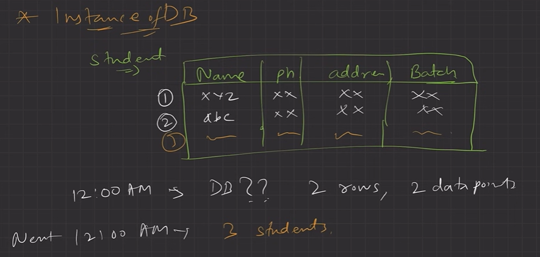

  1. The overall design of the DB is called the DB **schema**. Generally, Logical Schema

  1. Schema is **structural **description of data. Schema **doesn’t change frequently**. Data may change frequently.

  1. **DB schema **corresponds to the variable declarations (along with type) in a program.

  1. We have 3 types of **Schemas**: **Physical, Logical**, several **view schemas **called subschemas.

  1. Logical schema is most **important **in terms of its effect on application programs, as programmers construct apps by using logical schema.

class Student{

string name;

string address;

int age;

int StudID;

}

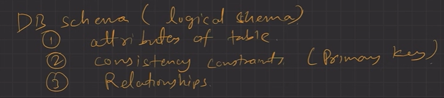

  1. **Physical data independence**, physical schema change should not affect logical schema/application programs.

  1. **Data Models:**

    1. Provides a way to describe the **design **of a DB at **logical level.**

    1. Underlying the structure of the DB is the Data Model; a collection of conceptual tools for describing the **data, data relationships, data semantics (meaning) & consistency constraints (eg: bank_balance > 10k, name != NULL)**.

    1. E.g., **ER **model, **Relational **Model, **object-oriented **model, **object-relational **data model etc.

  1. **Database Languages**: (Language to use DBMS and interact with it)

    1. **Data definition language (DDL) **to specify the database schema.

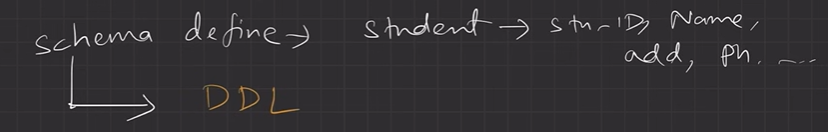

  1. **Data manipulation language (DML) **to express database queries and updates.

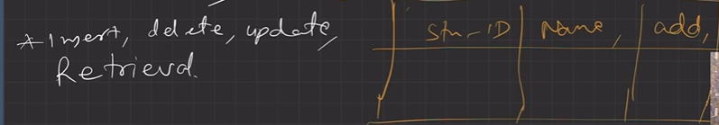

  1. **Practically**, both language features are present in a single DB language, e.g., SQL language.

  1. DDL

    1. We specify consistency constraints (phone number = 10 digits), which must be checked, every time DB is updated.

  1. DML

    1. Data manipulation involves

      1. **Retrieval **of information stored in DB.

      1. **Insertion **of new information into DB.

      1. **Deletion **of information from the DB.

      1. **Updating **existing information stored in DB.

    1. **Query language**, a part of DML to specify statement requesting the retrieval of information.

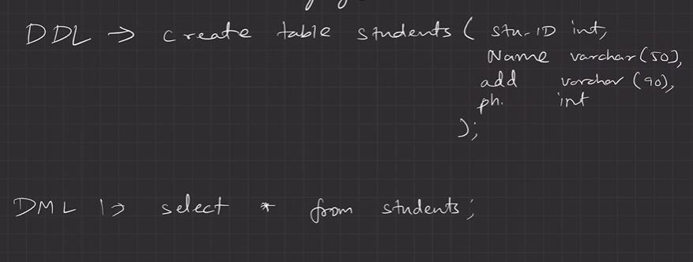

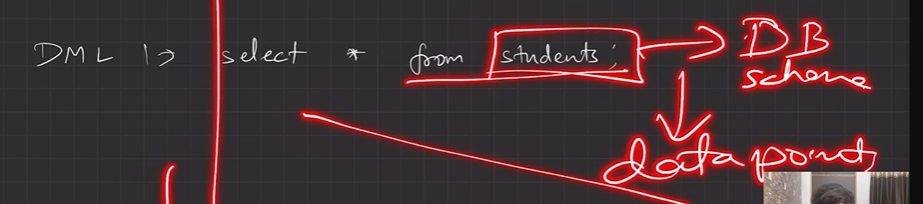

  1. **How is Database accessed from Application programs?**

    1. Apps (written in host languages, C/C++, Java) interacts with DB.

    1. E.g., Banking system’s module generating payrolls access DB by executing DML statements from the host language.

    1. API is provided to send DML/DDL statements to DB and retrieve the results.

      1. Open Database Connectivity (**ODBC**), Microsoft “C”.

      1. Java Database Connectivity (**JDBC**), Java.

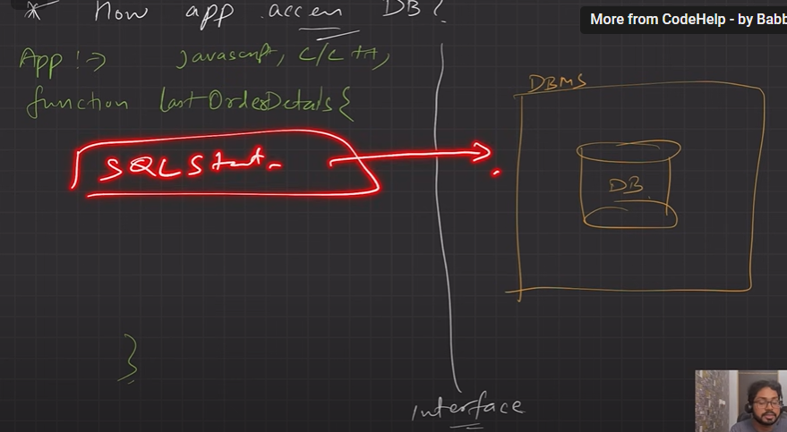

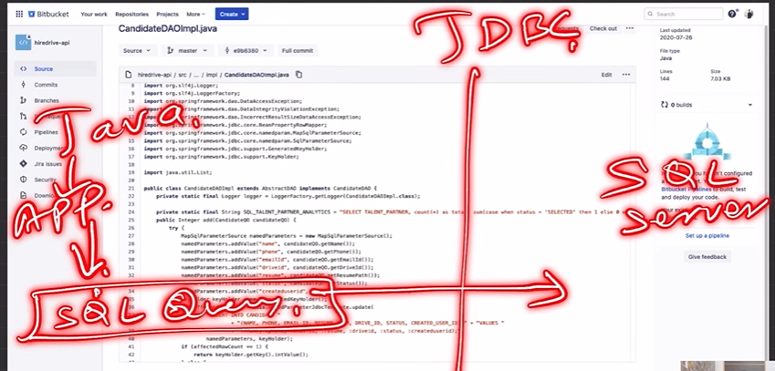

  1. **Database Administrator (DBA)**

    1. A person who has **central control **of both the data and the programs that access those data. (works on logical level)

    1. **Functions **of DBA

      1. Schema Definition

      1. Storage structure and access methods.

      1. Schema and physical organization modifications.

      1. Authorization control.

      1. Routine maintenance

        1. Periodic backups.

        1. Security patches.

        1. Any upgrades.

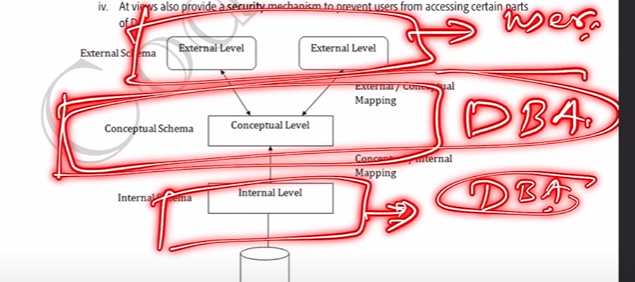

  1. **DBMS Application Architectures**: Client machines, on which remote DB users work, and server machines on which DB system runs.

    1. **T1 **Architecture

      1. The client, server & DB all present on the same machine

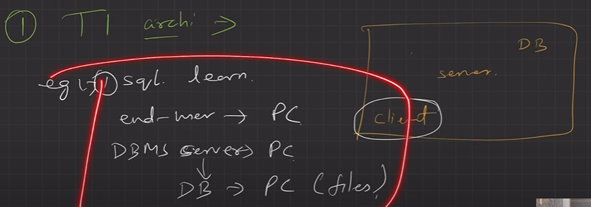

  1. **T2 **Architecture

    1. App is partitioned into 2-components.

    1. Client machine, which invokes DB system functionality at server end through query language statements.

    1. API standards like **ODBC **& **JDBC **are used to interact between client and server.

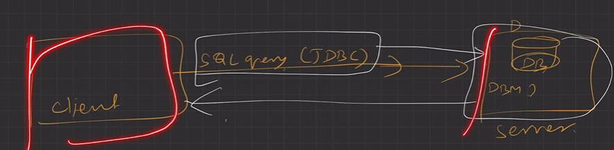

  1. **T3 **Architecture

    1. App is partitioned into 3 logical components.

    1. Client machine is just a frontend and doesn’t contain any direct DB calls.

    1. Client machine communicates with App server, and App server communicated with DB system to access data.

    1. **Business **logic, what action to take at that condition is in App server itself.

    1. T3 architecture are best for **WWW **Applications.

    1. **Advantages**:

      1. **Scalability **due to distributed application servers.

      1. **Data integrity**, App server acts as a middle layer between client and DB, which minimize the chances of data corruption.

      1. **Security**, client can’t directly access DB, hence it is more secure.

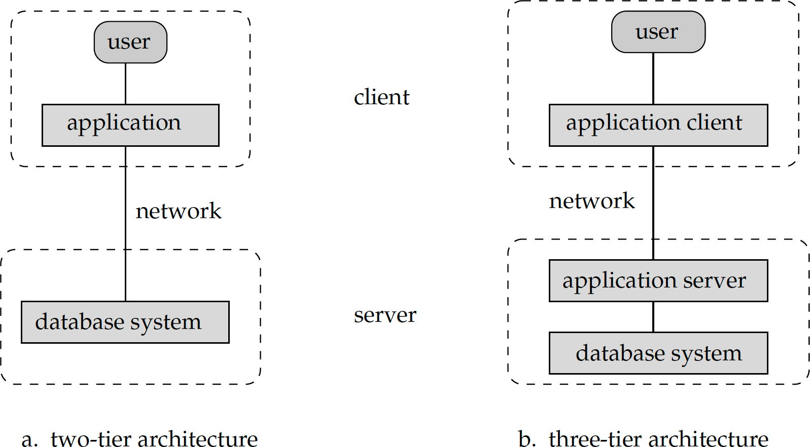
