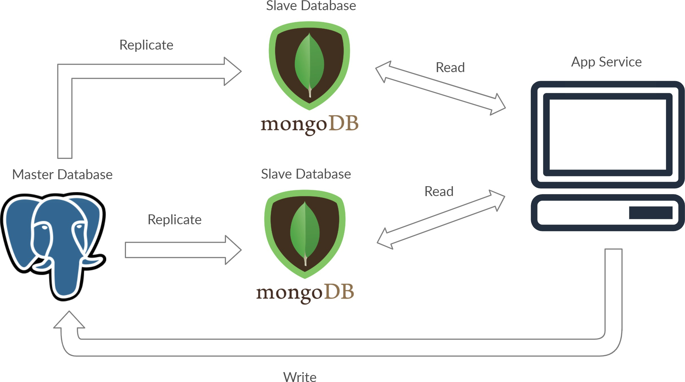
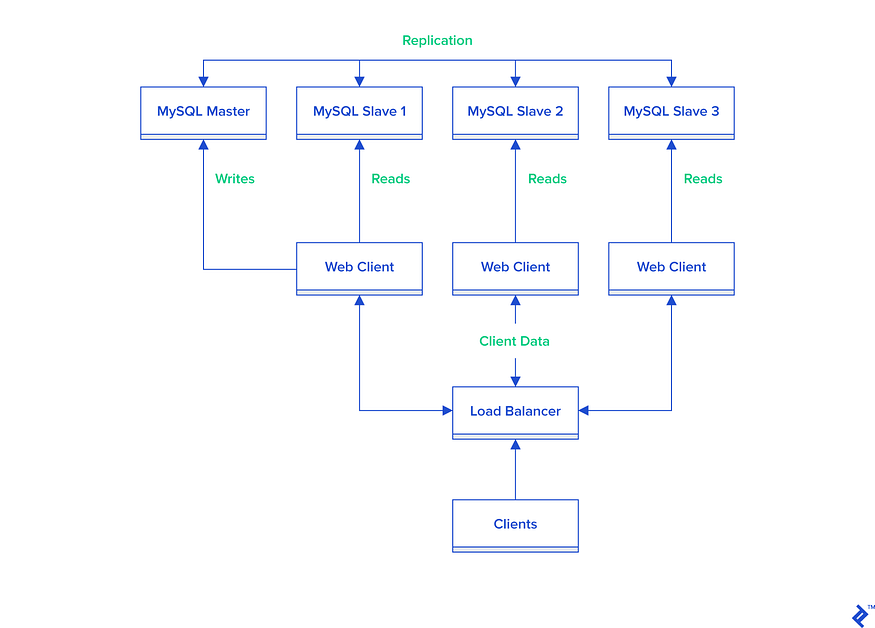
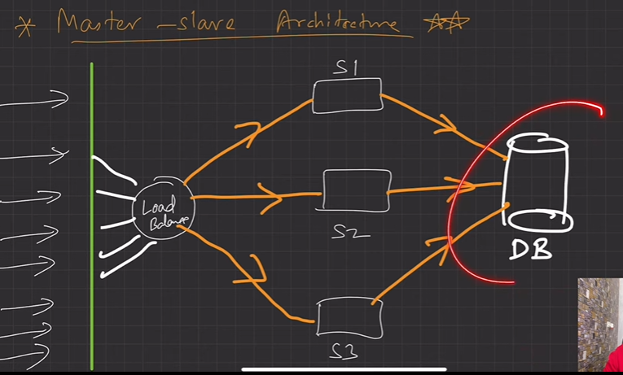
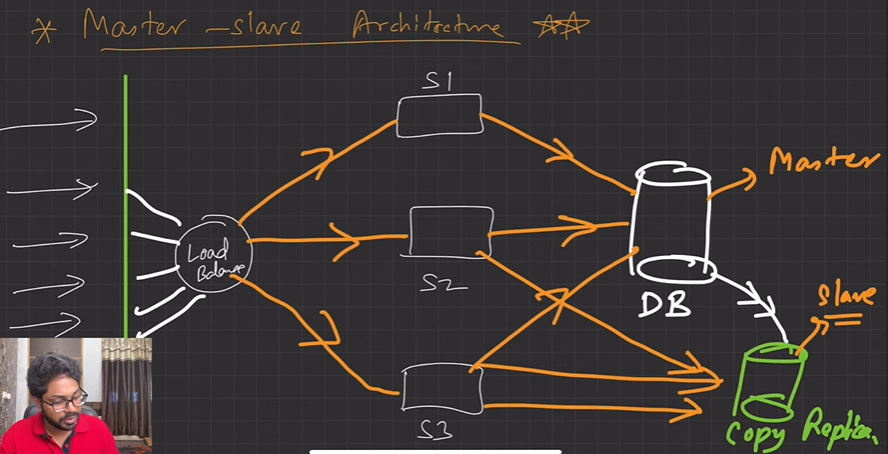
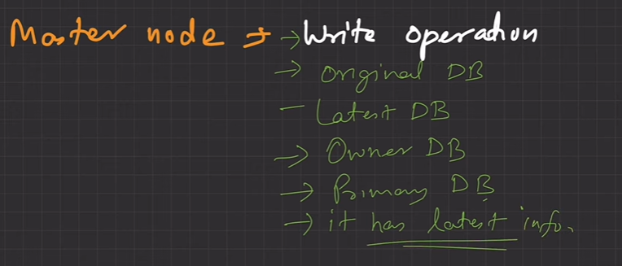
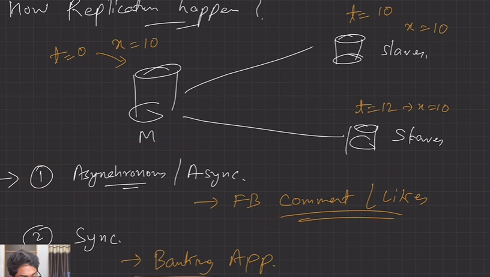
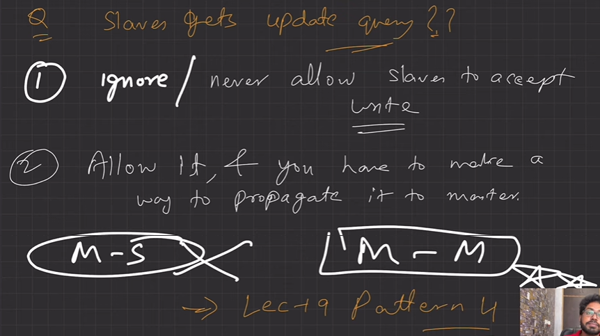
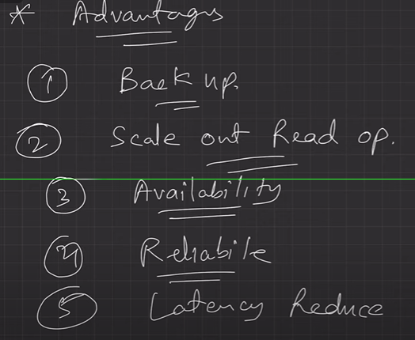

# 2.10.1 LEC-21: The Master-Slave Database Concept

**Master-slave replication database**

*Important concept to "scale out" database. "Scale up" is costly. *

Replicas can be mongodb while master can be sql but to make replica proper interfacing codee would be required for proper replication*.*

  1. Master-Slave is a general way to optimise IO in a system where number of requests goes way high that a single DB server is not able to handle it efficiently.

  1. Its a Pattern 3 in LEC-19 (Database Scaling Pattern). ***(Command Query Responsibility Segregation)***

  1. The true or latest data is kept in the Master DB thus write operations are directed there. Reading ops are done only from slaves. The master-slave is a database architecture divided into a master database and slave databases. The slave database serves as the backup for the master database. The **master database is used for the write operations**, while **read operations may be spread on multiple slave databases**.

  1. This architecture serves the purpose of safeguarding site r***eliability, availability, reduce latency etc . ***If a site receives a lot of traffic and the only available database is one master, it will be overloaded with reading and writing requests. Making the entire system slow for everyone on the site.

  1. DB ***replication ***will take care of distributing data from Master machine to Slaves machines. This can be ***synchronous or asynchronous ***depending upon the system’s need. Master-slave replication can be either synchronous or asynchronous. The difference is simply the timing of propagation of changes. If the changes are made to the master and slave at the same time, it is synchronous. If changes are queued up and written later, it is asynchronous.

Normal Architecture:

Here DB is the single point of failure.

Solution: Add another DB, to remove single point of failure.

Master DB: All latest updates are updated in master DB, and then replicated to slave DBs. Slave DBs read the latest values from MasterDB.

(Lec 19 Pattern 3)

HOW REPLICATION HAPPEN?

In synchronous replication, any change is reported as success only if the replication is completed.

**Advantages:**

  1. Produce reliable backups:

The slave database can be shut down without affecting the operations of the master database, because the snapshots of the live data will be replicated onto the slave database, even after a failure in master databases.

  1. Scale out read operations, and load:

Master-Slave architecture can be used for scaling out your application by distributing your data load across multiple databases.

  1. Increase availability, reliability, performance:

as the number of slaves connecting to a master increases, the load, although minimal, also increases, as each slave uses a client connection to the master. Also, as each slave must receive a full copy of the master binary log, the network load on the master may also increase and create a bottleneck. If we are using a large number of slaves connected to one master, and that master is also busy processing requests (for example, as a part of a scale-out solution), then we may want to improve the performance of the replication process. **One way to improve the performance of the replication process is to create a deeper replication structure that enables the master to replicate to only one slave, and for the remaining slaves to connect to this primary slave for their individual replication requirements.**

**Disadvantages:**

  - **Write operations to master are hard to scale** — Write requests to master can hardly be scaled. One of the only few options to scale the writing requests is to increase the compute capacity(CPU and ROM) of the master database.

  - **Asynchronous replication fails at times** — Asynchronous means two or more operations taking place in a system that is independent and does not rely upon or affect each other. This asynchronous replication followed in the master-slave database is not very reliable as the changes committed to the master may not be reflected in the slave nodes if there is a failure in the master node.

  - **No automatic failover** — In case a master fails, a slave should be pushed to take the place of the master. No automatic failover replacement ensues.

  - **Binary log has to be read each time data is copied** — Each slave adds load to the master as the binary log has to be read before copying data to the slave nodes.
