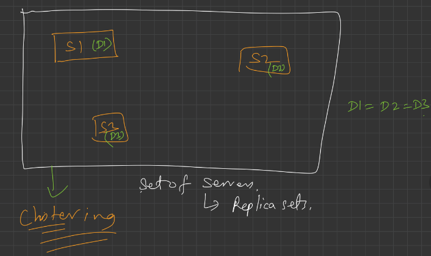

# 2.11.1 LEC-17: Clustering in DBMS

  1. **Database Clustering **(making **Replica-sets**) is the process of combining more than one servers or instances connecting a single database. Sometimes one server may not be adequate to manage the amount of data or the number of requests, that is when a Data Cluster is needed. Database clustering, SQL server clustering, and SQL clustering are closely associated with SQL is the language used to manage the database information.

  1. Replicate the same dataset on different servers. This set of replicas is called cluster.

  1. **Advantages**

    1. **Data Redundancy: **Clustering of databases helps with data redundancy, as we store the same data at multiple servers. Don’t confuse this data redundancy as repetition of the same data that might lead to some anomalies. The redundancy that clustering offers is required and is quite certain due to the synchronization. In case any of the servers had to face a failure due to any possible reason, the data is available at other servers to access.

**If S1 is shutdown, still our website is robust since we have another server S2 having same database. This means clustering adds a layer of abstraction since the user doesn't know from which server the data is coming from. **

  1. **Load balancing: **or scalability doesn’t come by default with the database. It has to be brought by clustering regularly. It also depends on the setup. Basically, what load balancing does is allocating the workload among the different servers that are part of the cluster. This indicates that more users can be supported and if for some reasons if a huge spike in the traffic appears, there is a higher assurance that it will be able to support the new traffic. One machine is not going to get all of the hits. This can provide **scaling **seamlessly as required. This **links directly to high availability. **Without load balancing, a particular machine could get overworked and traffic would slow down, leading to decrement of the traffic to zero.

  1. **High availability: **When you can access a database, it implies that it is available. High availability refers the amount of time a database is considered available. The amount of availability you need greatly depends on the number of transactions you are running on your database and how often you are running any kind of analytics on your data. With database clustering, we can reach extremely high levels of availability due to load balancing and have extra machines. In case a server got shut down the database will, however, be available.

  1. **How does Clustering Work?**

    1. In cluster architecture, all requests are split with many computers so that an individual user request is executed and produced by a number of computer systems. The clustering is serviceable definitely by the ability of load balancing and high-availability. If one node collapses, the request is handled by another node. Consequently, there are few or no possibilities of absolute system failures.

CONTENT DELIVERY NETWORK
