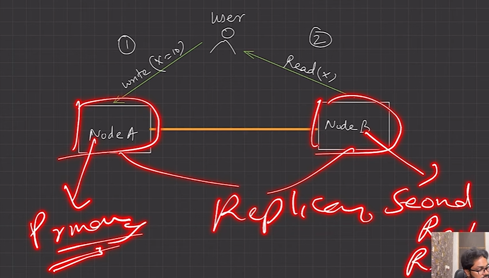
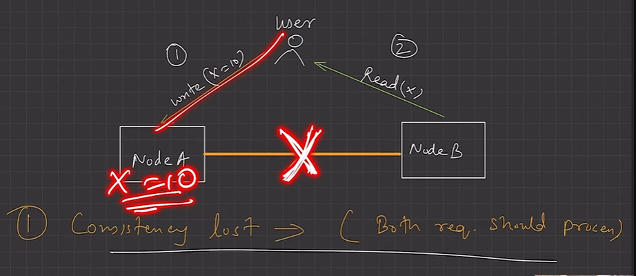
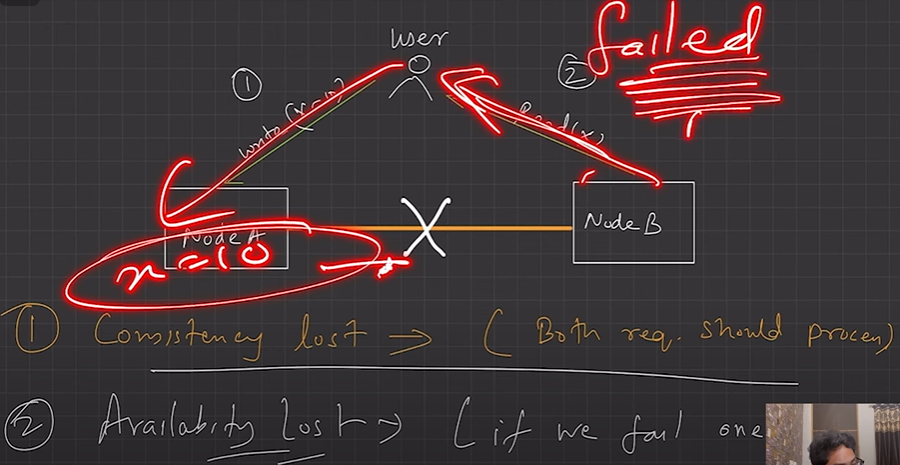
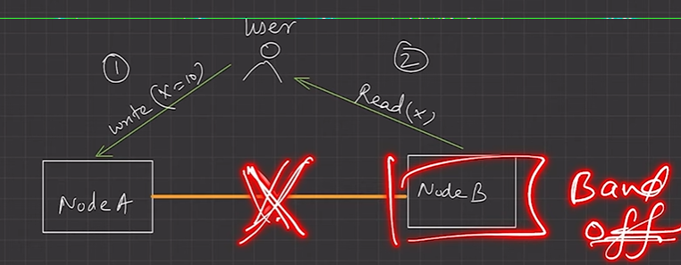
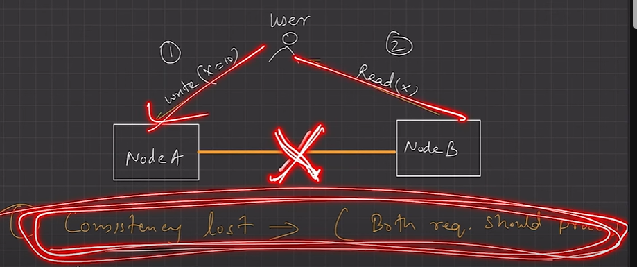
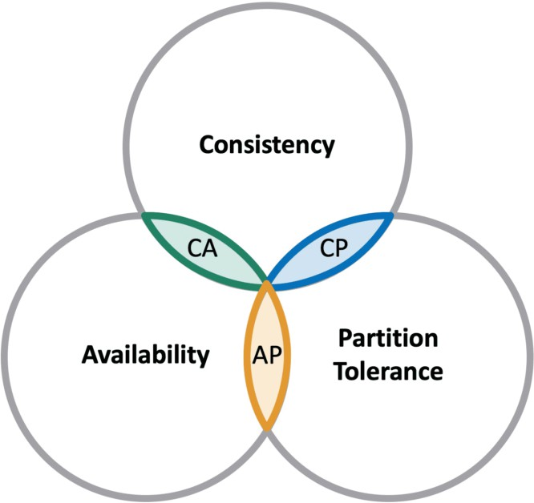
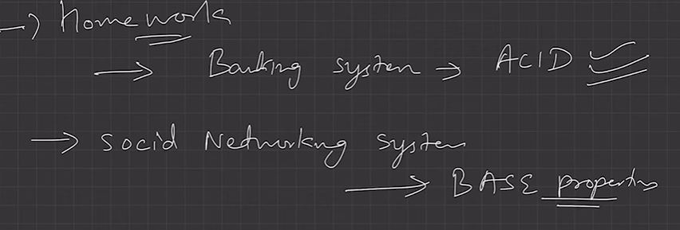

# 2.12.1 LEC-20: CAP Theorem

  1. Basic and one of the most important concept in **Distributed Databases (Cloud System).**

  1. **Useful **to know this to design efficient distributed system for your given business logic.

  1. Let’s first breakdown CAP

    1. **Consistency**: In a consistent system, all nodes see the same data simultaneously. If we perform a read operation on a consistent system, it should return the value of the most recent write operation. The read should cause all nodes to return the same data. All users see the same data at the same time, regardless of the node they connect to. When data is written to a single node, it is then replicated across the other nodes in the system.

    1. **Availability**: When availability is present in a distributed system, it means that the system remains operational all of the time. Every request will get a response regardless of the individual state of the nodes. This means that the system will operate even if there are multiple nodes down. Unlike a consistent system, there’s no guarantee that the response will be the most recent write operation.

    1. **Partition Tolerance**: When a distributed system encounters a partition, it means that there’s a break in communication between nodes. If a system is partition-tolerant, the system does not fail, regardless of whether messages are dropped or delayed between nodes within the system. To have partition tolerance, the system must replicate records across combinations of nodes and networks.

    1. What does the **CAP Theorem **says,

The CAP theorem states that a distributed system can only provide **two of three properties **simultaneously: consistency, availability, and partition tolerance. The theorem formalizes the **tradeoff between consistency and availability when there’s a partition.**

**Single node/ non-distributed then CAP theorem not valid as partition is not possible due to absence of multiple nodes. **

**If suppose a partition is there, then to have availability we allow both read and write operations, then consistency is lost because no replication is there so node A will have x =10 while node B have previous value of x. **

  1. **CAP Theorem NoSQL Databases: **NoSQL databases are great for distributed networks. They allow for horizontal scaling, and they can quickly scale across multiple nodes. When deciding which NoSQL database to use, it’s important to keep the CAP theorem in mind.

    1. **CA Databases: **

      1. **CA databases enable consistency and availability across all nodes. Unfortunately, CA databases can’t deliver fault tolerance. **

      1. In any distributed system, partitions are bound to happen, which means this type of database isn’t a very practical choice. That being said, you still can find a CA database if you need one. Some relational databases, such as MySQL or PostgreSQL, allow for consistency and availability. You can deploy them to nodes using replication.

      1. RDBMS databases are often at the CA side of the triangle. This is only the case in a **single node setup**. Even with master (write) - slave (read) setup, the system is not CA (or if it is termed "CA" for some reason, and cannot recover from network partitions, then a split-bran scenario may happen, a new master is elected for the partition, and chaos ensues, possibly breaking the consistency of the system).

  1. **CP Databases: **

    1. CP databases enable consistency and partition tolerance, but not availability. When a partition occurs, the system has to turn off inconsistent nodes until the partition can be fixed. MongoDB is an example of a CP database. It’s a NoSQL database management system (DBMS) that uses documents for data storage. It’s considered schema-less, which means that it doesn’t require a defined database schema.

  1. It’s commonly used in big data and applications running in different locations. The CP system is structured so that there’s only one primary node that receives all of the write requests in a given replica set. Secondary nodes replicate the data in the primary nodes, so if the primary node fails, a secondary node can stand-in.

  1. In banking system Availability is not as important as consistency, so we can opt it (MongoDB).

  1. **AP Databases: (Eventually Consistent DB)**

    1. AP databases enable availability and partition tolerance, but not consistency. In the event of a partition, all nodes are available, but they’re not all updated. For example, if a user tries to access data from a bad node, they won’t receive the most up-to-date version of the data.

    1. When the partition is eventually resolved, most AP databases will sync the nodes to ensure consistency across them. Apache Cassandra is an example of an AP database. It’s a NoSQL database with no primary node, meaning that all of the nodes remain available. Cassandra allows for eventual consistency because users can re-sync their data right after a partition is resolved.

  1. For apps like Facebook, we value availability more than consistency, we’d opt for AP Databases like Cassandra or Amazon DynamoDB.

ACID V/S BASE PROPERTY

The major difference between ACID and BASE is that ACID are immediately consistent while BASE are eventually consistent.

BASE MODEL:-

Basically Available :- This property are usually consisting of the Availability of data at all time to users by using AP (Available and Partition tolerant) model of database in this consistency is sacrificed for a period of time but eventually the system become consistent when nodes replicates.

Soft State :- This is the state of DB in inconsistent state usually the time between various nodes to replicate themselves.

Eventually consistent :- Database become consistent in this state.
