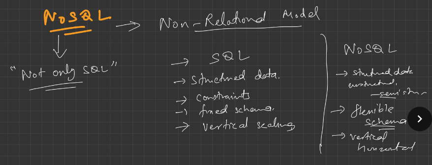
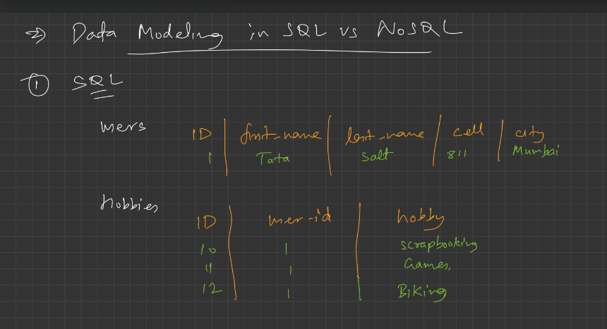
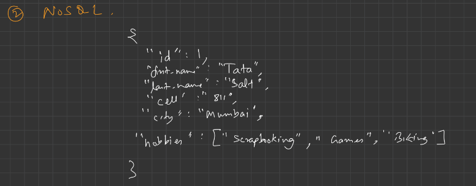
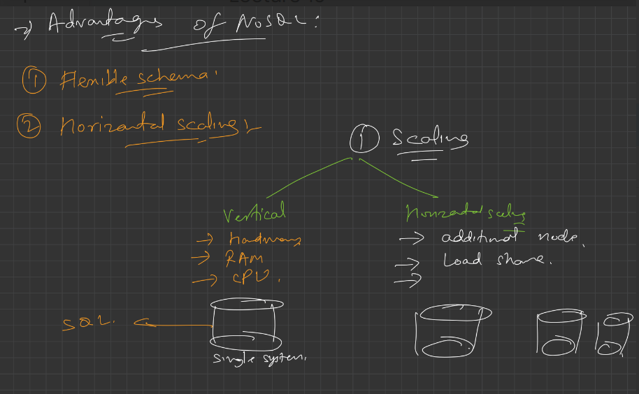
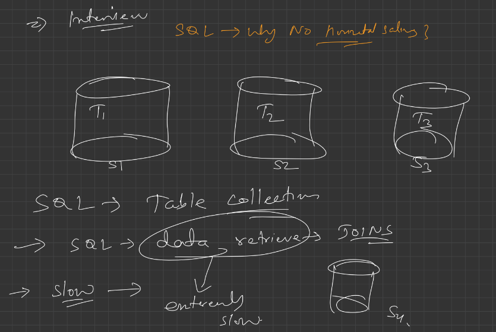
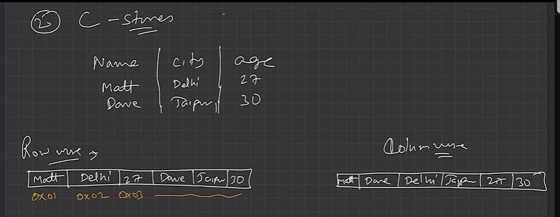
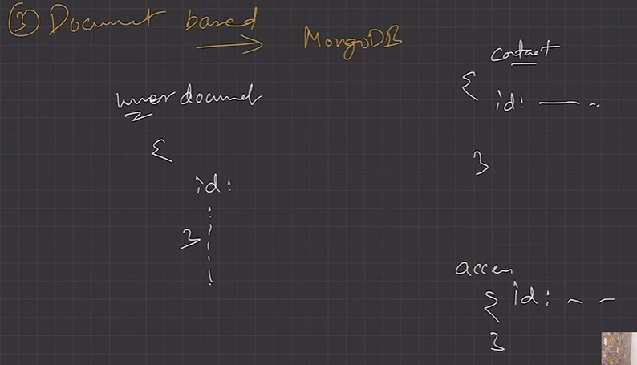
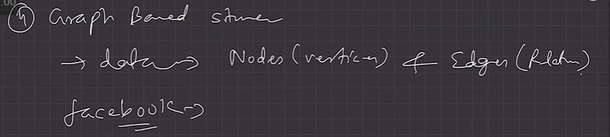

# 2.13.1 LEC-15: NoSQL

  1. **NoSQL databases **(aka "not only SQL") are non-tabular databases and store data differently than relational tables. NoSQL databases come in a variety of types based on their data model. The main types are document, key-value, wide-column, and graph. They provide **flexible schemas **and **scale **easily with **large amounts of data **and **high user loads**.

    1. They are schema free.

    1. Data structures used are not tabular, they are more flexible, has the ability to adjust dynamically. (Structured, unstructured, semi-structured)

    1. Can handle huge amount of data **(big data).**

    1. Most of the NoSQL are open sources and has the capability of horizontal scaling.

    1. **It just stores data in some format other than relational.**

  1. **History behind NoSQL**

    1. NoSQL databases emerged in the late 2000s as the cost of storage dramatically decreased. Gone were the days of needing to create a complex, difficult-to-manage data model in order to avoid data duplication. Developers (rather than storage) were becoming the primary cost of soiware development, so NoSQL databases optimised for developer productivity.

    1. Data becoming unstructured more, hence structuring (defining schema in advance) them had becoming costly.

    1. NoSQL databases allow developers to store huge amounts of unstructured data, giving them a lot of flexibility.

    1. Recognising the need to rapidly adapt to changing requirements in a soiware system. Developers needed the ability to iterate quickly and make changes throughout their sofware stack — all the way down to the database. NoSQL databases gave them this flexibility.

    1. Cloud computing also rose in popularity, and developers began using public clouds to host their applications and data. They wanted the ability to distribute data across multiple servers and regions to make their applications resilient, to scale out instead of scale up, and to intelligently geo-place their data. Some NoSQL databases like MongoDB provide these capabilities.

  1. **NoSQL Databases Advantages**

    1. **Flexible Schema**

      1. RDBMS has pre-defined schema, which become an issue when we do not have all the data with us or we need to change the schema. It's a huge task to change schema on the go.

  1. **Horizontal Scaling**

    1. Horizontal scaling, also known as scale-out, refers to bringing on additional nodes to share the load. This is difficult with relational databases due to the difficulty in spreading out related data across nodes. With non-relational databases, this is made simpler since collections are self-contained and not coupled relationally. This allows them to be distributed across nodes more simply, as queries do not have to “join” them together across nodes.

    1. Scaling horizontally is achieved through **Sharding **OR **Replica-sets**.

  1. **High Availability**

    1. NoSQL databases are highly available due to its auto replication feature i.e. whenever any kind of failure happens data replicates itself to the preceding consistent state.

    1. If a server fails, we can access that data from another server as well, as in NoSQL database data is stored at multiple servers.

**Apply joins on data from multiple SQL server is slow. **

**JOIN OPERATION IS TIME COSTLY. VERY SLOW. **

  1. **Easy insert and read operations.**

    1. Queries in NoSQL databases can be faster than SQL databases. Why? Data in SQL databases is typically normalized, so queries for a single object or entity require you to join data from multiple tables. As your tables grow in size, the joins can become expensive. However, data in NoSQL databases is typically stored in a way that is optimized for queries. The rule of thumb when you use MongoDB is data that is accessed together should be stored together. Queries typically do not require joins, so the queries are very fast.

    1. But difficult delete or update operations. But insert and read are fast.

  1. **Caching **mechanism**.**

  1. **NoSQL **use case is more for **Cloud **applications.

  1. **When to use NoSQL?**

    1. Fast-paced Agile development

    1. Storage of structured and semi-structured data

    1. Huge volumes of data

    1. Requirements for scale-out architecture

    1. Modern application paradigms like micro-services and real-time streaming.

  1. **NoSQL DB Misconceptions**

    1. Relationship data is best suited for relational databases.

      1. A common misconception is that NoSQL databases or non-relational databases don’t store relationship data well. NoSQL databases can store relationship data — they just store it differently than relational databases do. In fact, when compared with relational databases, many find modelling relationship data in NoSQL databases to be easier than in relational databases, because related data doesn’t have to be split between tables. NoSQL data models allow related data to be nested within a single data structure.

If needed we can establish relation between 2 JSON objects.

  1. NoSQL databases don't support ACID transactions. - mongoDB supports ACID transactions

    1. Another common misconception is that NoSQL databases don't support ACID transactions. Some NoSQL databases like MongoDB do, in fact, support ACID transactions.

  1. **Types of NoSQL Data Models**

    1. **Key-Value Stores**

      1. The simplest type of NoSQL database is a key-value store. Every data element in the database is stored as a key value pair consisting of an attribute name (or "key") and a value. In a sense, a key-value store is like a relational database with only two columns: the key or attribute name (such as "state") and the value (such as "Alaska").

{

id: value

name: name_value

hobby: \[a,b,c\]

}

  1. **Use cases **include shopping carts, user preferences, and user profiles.

  1. e.g., Oracle NoSQL, Amazon DynamoDB, MongoDB also supports Key-Value store, Redis.

  1. A key-value database associates a value (which can be anything from a number or simple string to a complex object) with a key, which is used to keep track of the object. In its simplest form, a key-value store is like a dictionary/array/map object as it exists in most programming paradigms, but which is stored in a persistent way and managed by a Database Management System (DBMS).

  1. Key-value databases use compact, efficient index structures to be able to quickly and reliably locate a value by its key, making them ideal for systems that need to be able to find and retrieve data in constant time.

  1. There are several use-cases where choosing a key value store approach is an optimal solution:

    1. Real time random data access, e.g., user session attributesin an online application such as gaming or finance.

    1. Caching mechanism for frequently accessed data or configuration based on keys.

    1. Application is designed on simple key-based queries.

  1. **Column-Oriented / Columnar / C-Store / Wide-Column**

    1. The data is stored such that each row of a column will be next to other rows from that same column.

    1. While a relational database stores data in rows and reads data row by row, a column store is organised as a set of columns. This means that when you want to run analytics on a small number of columns, you can read those columns directly without consuming memory with the unwanted data. Columns are oien of the same type and benefit from more efficient compression, making reads even faster. Columnar databases can quickly aggregate the value of a given column (adding up the total sales for the year, for example). **Use cases **include analytics.

    1. e.g., Cassandra, RedShii, Snowflake.

  1. **Document Based Stores**

    1. This DB store data in documents similar to JSON (JavaScript Object Notation) objects. Each document contains pairs of fields and values. The values can typically be a variety of types including things like strings, numbers, booleans, arrays, or objects.

    1. **Use cases **include e-commerce platforms, trading platforms, and mobile app development across industries.

    1. Supports ACID properties hence, suitable for Transactions.

    1. e.g., MongoDB, CouchDB.

  1. **Graph Based Stores**

    1. A graph database focuses on the relationship between data elements. Each element is stored as a node (such as a person in a social media graph). The connections between elements are called links or relationships. In a graph database, connections are first-class elements of the database, stored directly. In relational databases, links are implied, using data to express the relationships.

    1. A graph database is optimised to capture and search the connections between data elements, overcoming the overhead associated with JOINing multiple tables in SQL.

  1. Very few real-world business systems can survive solely on graph queries. As a result graph databases are usually run alongside other more traditional databases.

  1. **Use cases **include fraud detection, social networks, and knowledge graphs.

  1. **NoSQL Databases Dis-advantages**

    1. **Data Redundancy**

      1. Since data models in NoSQL databases are typically optimised for queries and not for reducing data duplication, NoSQL databases can be larger than SQL databases. Storage is currently so cheap that most consider this a minor drawback, and some NoSQL databases also support compression to reduce the storage footprint.

      1. Update & Delete operations are **costly**.

      1. All type of NoSQL Data model doesn’t fulfil all of your application needs

        1. Depending on the NoSQL database type you select, you may not be able to achieve all of your use cases in a single database. For example, graph databases are excellent for analysing relationships in your data but may not provide what you need for everyday retrieval of the data such as range queries. When selecting a NoSQL database, consider what your use cases will be and if a general purpose database like MongoDB would be a beUer option.

      1. Doesn’t support ACID properties in general.

      1. Doesn’t support data entry with consistency constraints.

  1. **SQL vs NoSQL**

|  | **SQL Databases** | **NoSQL Databases** |
| --- | --- | --- |
| **Data Storage Model** | Tables with fixed rows and columns | Document: JSON documents, Key-value: key-value pairs, Wide- column: tables with rows and dynamic columns, Graph: nodes and edges |
| **Development History** | Developed in the 1970s with a focus on reducing data duplication | Developed in the late 2000s with a focus on scaling and allowing for rapid application change driven by agile and DevOps practices. |
| **Examples** | Oracle, MySQL, Microsoft SQL Server, and PostgreSQL | Document: MongoDB and CouchDB, Key-value: Redis and DynamoDB, Wide-column: Cassandra and HBase, Graph: Neo4j and Amazon Neptune |
| **Primary Purpose** | General Purpose | Document: general purpose, Key- value: large amounts of data with simple lookup queries, Wide- column: large amounts of data with predictable query patterns, Graph: analyzing and traversing relationships between connected data |
| **Schemas** | Fixed | Flexible |
| **Scaling** | Vertical (Scale-up) | Horizontal (scale-out across commodity servers) |
| **ACID Properties** | Supported | Not Supported, except in DB like MongoDB etc. |
| **JOINS** | Typically Required | Typically not required |
| **Data to object mapping** | Required object-relational mapping | Many do not require ORMs. MongoDB documents map directly to data structures in most popular programming languages. |
