# 2.14.2 BASICS

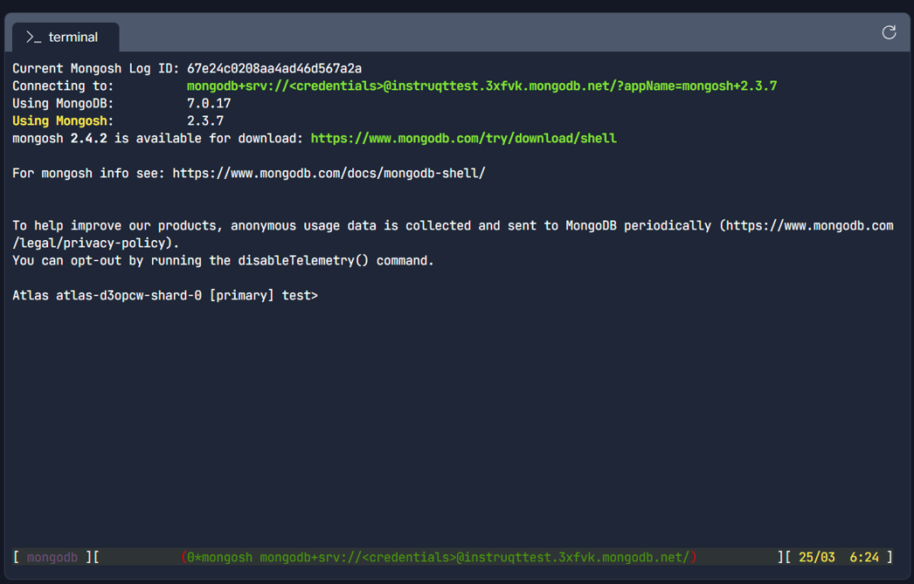

db.help()

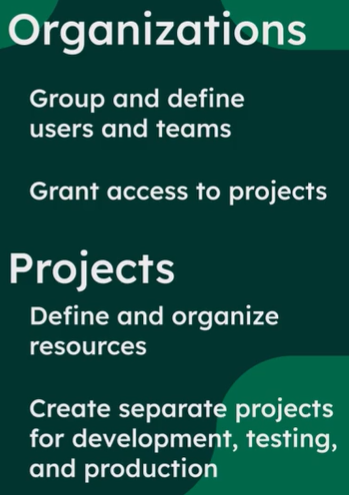

By default, mongoDB is made like no users and IP addrresses can access the mongoDB cluster outside of ATLAS

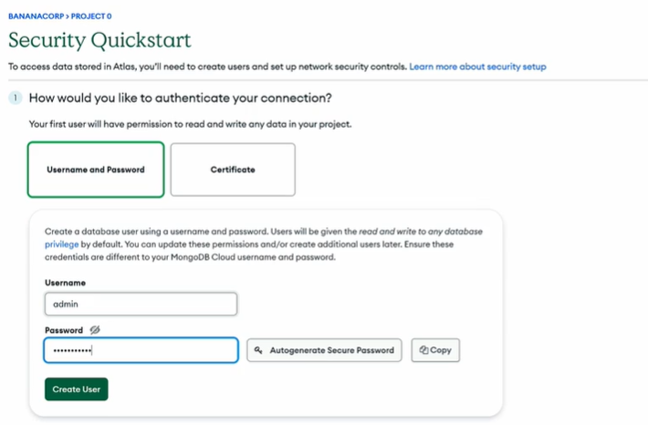

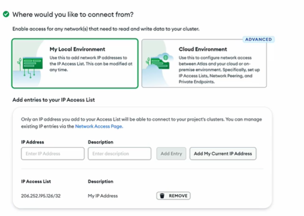

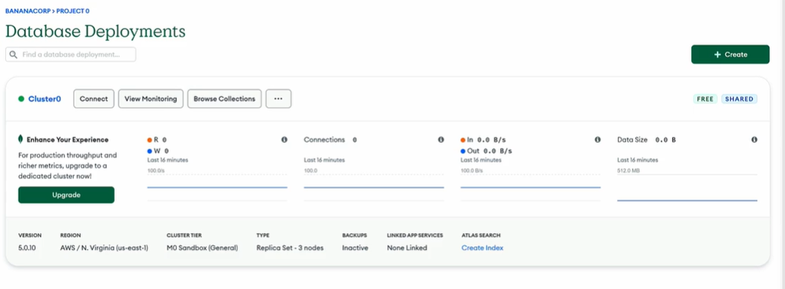

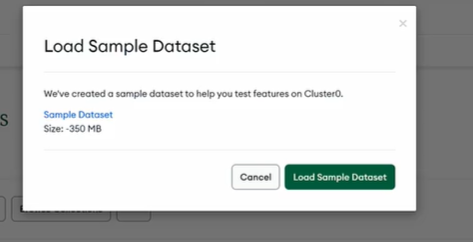

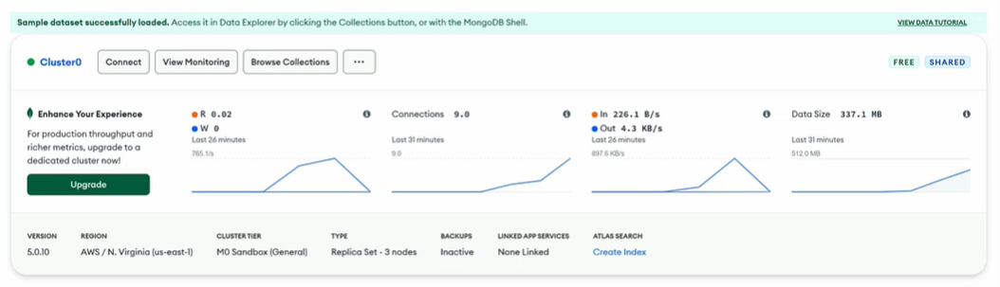

Deploy an Atlas Cluster

In this lab, you will deploy an Atlas cluster to your Atlas account by using the CLI.

Lab Instructions

In the [terminal](<https://play.instruqt.com/embed/mongodb/tracks/creating-and-deploying-an-atlas-cluster/challenges/deploy-atlas-cluster/assignment#tab-0>) tab, use the following command to create a MongoDB Atlas cluster in your Atlas project, MDB_EDU and in your Atlas organization, MY_MDB_ORG. Then follow the instructions in the terminal.

shell

atlas setup --clusterName myAtlasClusterEDU --provider AWS --currentIp --skipSampleData --username myAtlasDBUser --password myatlas-001 --projectId 67e250f98d0ece155d1f91fc | tee atlas_cluster_details.txt

When you get the following output in the terminal, press Enter or type Y.

? Do you want to set up your first free database in Atlas with default settings (it's free forever)? Yes

Please be patient, as it takes about 20–30 seconds for the cluster to be created.

The setup process will leave you connected in mongosh to your cluster. Click the Check button to continue to the next lab.

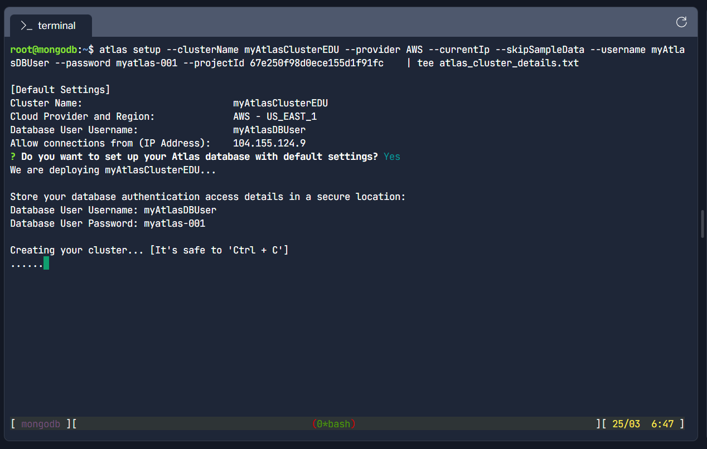

Note

The MongoDB university labs that use your Atlas cluster require the Atlas project and cluster as configured above, and if not present, will provision and deploy a new organization MY_MDB_ORG with a new project "MDB_EDU" with a free tier cluster "myAtlasClusterEDU" with the sample data loaded that adheres to the following, if not already present:

- Organization name: "MY_MDB_ORG"

- Project name: "MDB_EDU"

- Cluster name: "myAtlasClusterEDU"

- Database user: "myAtlasDBUser"

- Password: "myatlas-001"

- Permissions: "readWriteAnyDatabase"

The lab checks require this configuration otherwise you will not be able to successfully complete the lab.

We advise that you create a separate Atlas account for use with MongoDB University if your current Atlas account doesn't allow the permissions necessary to create a new project or new cluster in your organization.

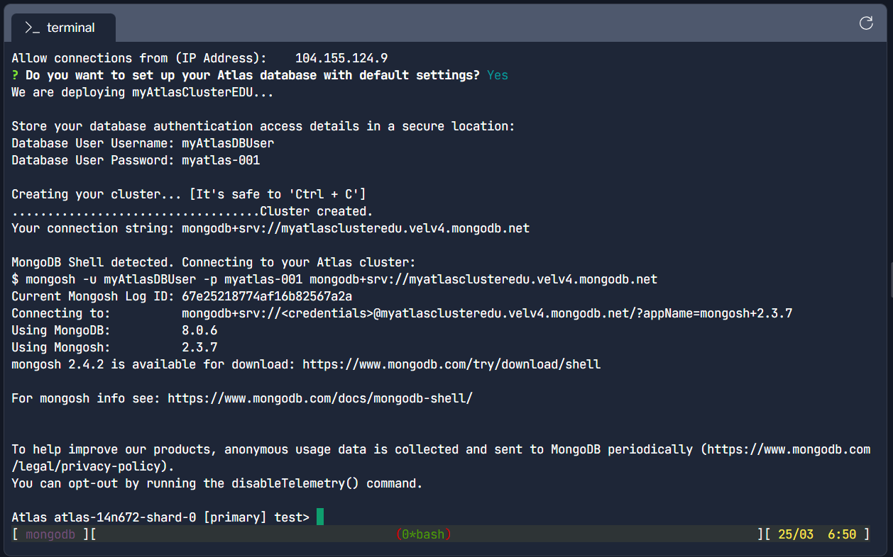

Load the Sample Dataset Into Your Atlas Cluster

In this lab, you will load the sample dataset into your Atlas cluster by using the CLI.

Lab Instructions

In the terminal tab, use the following command to load the sample data into the Atlas cluster that you just deployed:

shell

copy

run

atlas clusters sampleData load myAtlasClusterEDU

This loading process will continue without any further action required by you.

Once you get output that is similar to the following, click the Next button to complete the lab. Note that the following job identifier value is an example; you will have a different job ID.

shell

root@mongodb:/app# atlas clusters sampleData load myAtlasClusterEDU

Sample Data Job 63777f4360b9402aa143eb0f created.

The Atlas sample dataset is designed to provide a variety of data for you to explore best practices in schema design and, more practically, to ensure that you have data in your database to support your learning of MongoDB.

Thank you Lavesh and please don't forget to rate this lab!

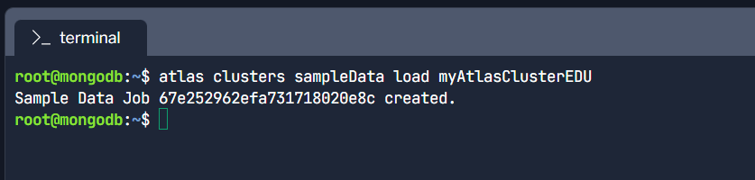

You created a free Atlas account and deployed a free tier Atlas cluster by doing the following:

  - Chose a shared cluster.

  - Chose a major cloud provider to host your cluster.

  - Used the region recommended by MongoDB as the location of database deployment.

  - Prepared to connect to your cluster by adding a database user and password and an IP address to the IP Access list

Finally, you successfully loaded sample data into your cluster and found a document in a collection by using Data Explorer.

Lesson 01: Creating and Deploying an Atlas Cluster

  - [MongoDB Docs: Get Started with Atlas](<https://www.mongodb.com/docs/atlas/getting-started/?_ga=2.56158050.810066485.1665291537-836515500.1666025886>)

  - [MongoDB Docs: Deploy a Free Cluster](<https://www.mongodb.com/docs/atlas/tutorial/deploy-free-tier-cluster/?_ga=2.56158050.810066485.1665291537-836515500.1666025886>)

  - [MongoDB Docs: Load Sample Data](<https://www.mongodb.com/docs/atlas/sample-data/?_ga=2.56158050.810066485.1665291537-836515500.1666025886>)

MongoDB is a General Purpose Document Database

Stores data as documents which are similar to JSON objects. Documents map to "Objects" in code.

Documents can be used to model data of any structure or shape (key-value, time series, text, geospatial etc. ). Nesting lists multiple times.

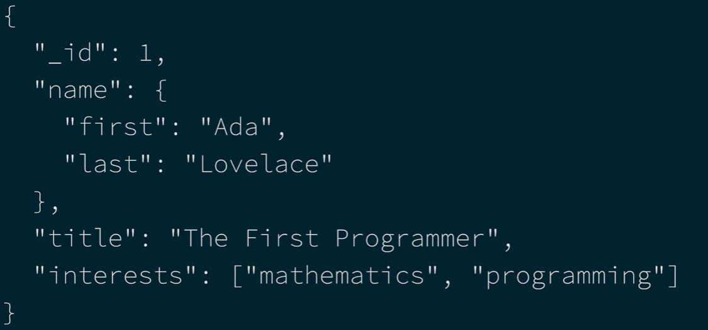

One format to query and model data for any application.

Drivers provided in all major programming languages.

Document: Basic unit of data in MongoDB

Collection: Grouping of Documents. All documents in a collection need not have same structure because mongodb offers flexible schema.

Database: A container for collections

Review the contents of the terminal tab. This tab is already connected to an Atlas cluster using mongosh. The connection information is shown in the terminal window.

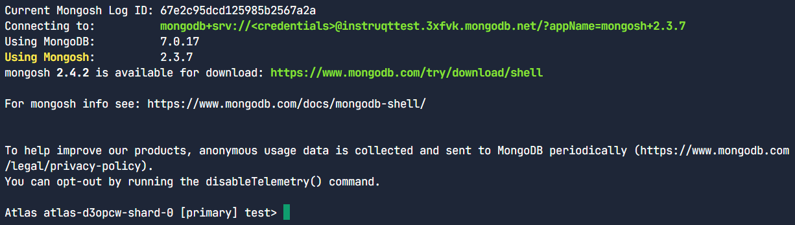

## MongoDB Document Model

- Documents are similar to JSON objects.

Example:

{
"_id": 1,
"name": "AC3 Phone",
"colors": \["black", "silver"\],
"price": 200,
"available": true

}

- Documents are displayed as JSON. Stored as BSON (binary JSON, extension of JSON).

- BSON add supports for additional data types not supported in JSON.

- BSON suuports all JSON data types (string, object, boolean, null) as well as Dates, Numbers, object ID's

- Object ID is a special data type in mongoDB to create unique identifiers for the required _id field

- In a database, every document requires an _id field which acts as a primary key.

- If an inserted document doesn't include the _id field, MongoDB automatically generates an ObjectId for the _id field.

- MongoDB supports flexible schema model and polymorphic data (a datatype where the data can take multiple different shapes). Documents may contain different fields and fields may contain different types. Different from relational database where we define table schema before adding data.

| Flexible Schema 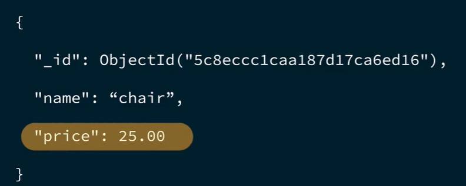 | 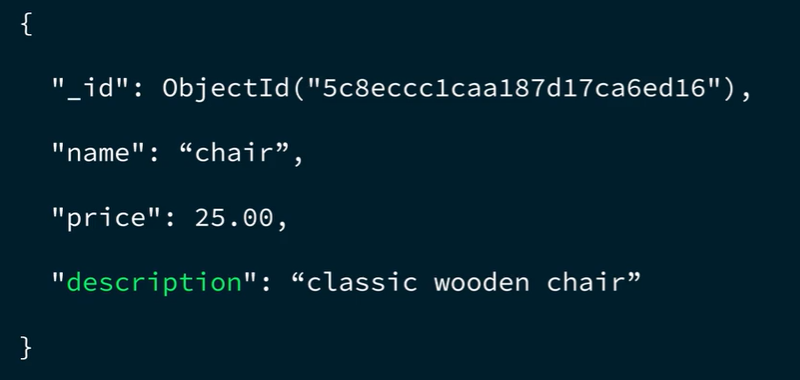 |
| --- | --- |

- MongoDb also offers **optional Schema Validation** to set constrains on the structure of documents

Document Structure

The values in a document can be any data type, including strings, objects, arrays, booleans, nulls, dates, ObjectIds, and more. Here's the syntax for a MongoDB document, followed by an example:

Syntax:

{
"key": value,
"key": value,
"key": value
}

- 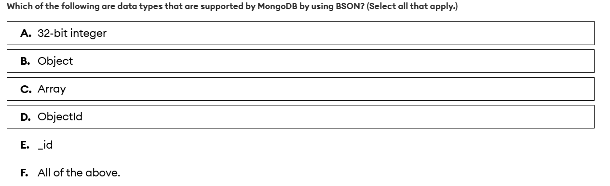

- _id is a required field in every MongoDB document, but it's not a data type. If an inserted document does not include an _id field, MongoDB will automatically create the _id field and populate it with a value of type ObjectId.

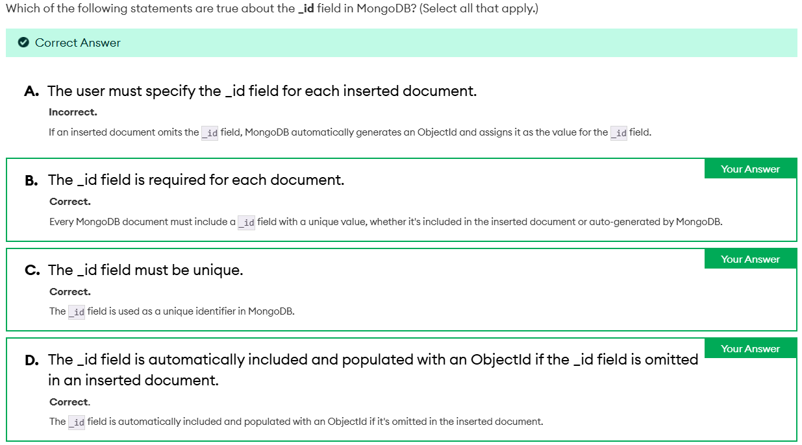

If we need to insert a document with a new schema, we don't need to update all the previous stored documents to the new Schema.

Document inside of a collection:

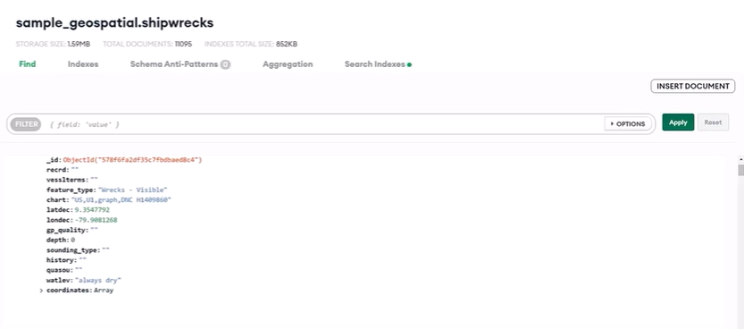

Managing Databases and Collections:

Lesson 02: The MongoDB Document Model

  - [MongoDB Docs: Documents](<https://www.mongodb.com/docs/manual/core/document/?_ga=2.64483046.810066485.1665291537-836515500.1666025886>)

  - [MongoDB Docs: BSON Types](<https://www.mongodb.com/docs/manual/reference/bson-types/?_ga=2.64483046.810066485.1665291537-836515500.1666025886>)

  - [Explaining BSON with Examples](<https://www.mongodb.com/basics/bson?_ga=2.64483046.810066485.1665291537-836515500.1666025886>)

  - [JSON and BSON](<https://www.mongodb.com/json-and-bson?_ga=2.64483046.810066485.1665291537-836515500.1666025886>)

Lesson 03: Managing Databases, Collections, and Documents in Atlas Data Explorer

  - [MongoDB Docs: Create, View, and Drop Databases](<https://www.mongodb.com/docs/atlas/atlas-ui/databases/?_ga=2.64483046.810066485.1665291537-836515500.1666025886>)

  - [MongoDB Docs: Databases and Collections](<https://www.mongodb.com/docs/manual/core/databases-and-collections/?_ga=2.97437654.810066485.1665291537-836515500.1666025886>)

## MONGODB DATA MODELLING

- Data that is accesses together should be stored together.
