# 2.2.1 LEC-3: Entity-Relationship Model

  1. **Data Model**: Collection of conceptual tools for **describing data, data relationships, data semantics, and consistency constraints.**

  1. ER Model:

    1. **Data models like ER work on logical/conceptual level. **

    1. It is a **high level and powerful data model** based on a perception of a **real **world that consists of a collection of basic objects, called **entities **and of **relationships **among these objects.

    1. Graphical representation of ER Model is **ER diagram, **which acts as a **blueprint **of DB.

  1. **Entity**: An Entity is a “**thing**” or “**object**” in the real world that is **distinguishable **from all other objects. Entities have some "limited" attributes, to describe its property.

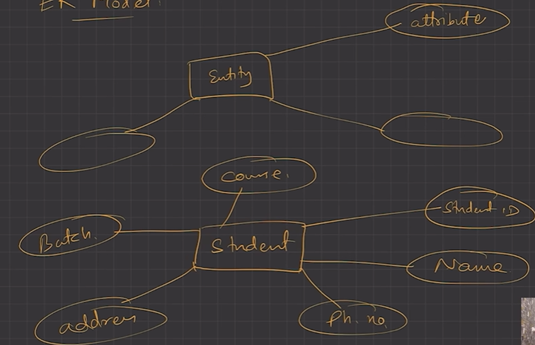

  1. It has **physical existence**.

  1. Each student in a college is an entity.

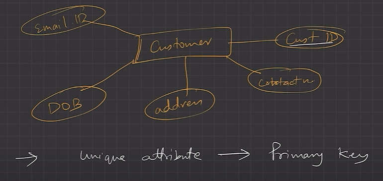

  1. Entity can be **uniquely **identified. (By a primary attribute, aka Primary Key)

  1. **Strong Entity**: Can be uniquely identified. Independent existence.

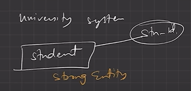

  1. **Weak Entity**: Can’t be uniquely identified., depends on some other strong entity.

    1. It doesn’t have sufficient attributes, to select a uniquely identifiable attribute.

    1. Loan -> Strong Entity, Payment -> Weak, as instalments are sequential number counter can be generated separate for each loan.

    1. **Weak entity depends on strong entity for existence.**

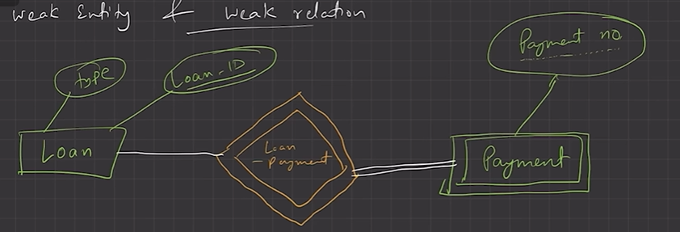

**Payment method can't exist without loan. So it is weak. Payment no. is weak primary key. **

  1. **Entity set**

    1. It is a set of entities of the **same **type that share the **same **properties, or attributes.

    1. E.g., Student is an entity set.

    1. E.g., Customer of a bank

  1. **A****tt****ributes**

    1. An entity is represented by a set of attributes.

    1. Each entity has a value for each of its attributes.

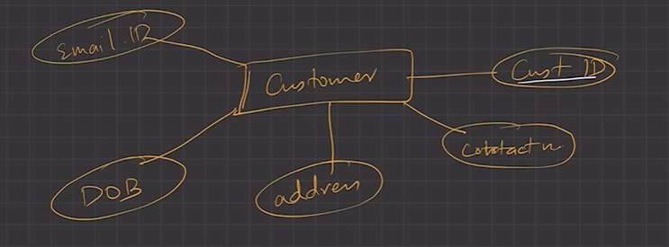

  1. For each attribute, there is a set of **permi****tt****ed values**, called the **domain**, or **value **set, of that attribute.

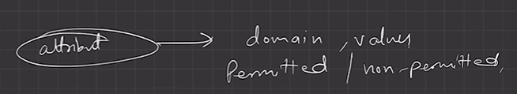

  1. E.g., Student Entity has following attributes

    1. Student_ID

    1. Name

    1. Standard

    1. Course

    1. Batch

    1. Contact number

    1. Address

  1. Types of attribute

    1. **Simple**

      1. attribute which can’t be divided further.

      1. E.g., Customer’s account number in a bank, Student’s Roll number etc.

    1. **Composite**

      1. Can be  divided into subparts (that is, other attribute).

      1. E.g., Name of a person, can be divided into first-name, middle-name, last-name.

      1. If user wants to refer to an entire attribute or to only a component of the attribute.

      1. Address can also be divided, street, city, state, PIN code.

    1. **Single-valued**

      1. Only one value attribute.

      1. e.g., Student ID, loan-number for a loan.

    1. **Multi-valued**

      1. Attribute having more than one value.

      1. e.g., phone-number, nominee-name on some insurance, dependent-name

      1. Limit constraint may be applied, upper or lower limits.

    1. **Derived**

      1. Value of this type of attribute can be derived from the value of other related attributes.

      1. e.g., Age, loan-age, membership-period etc.

    1. **NULL Value**

      1. An attribute takes a null value when an entity does not have a value for it.

      1. It may indicate “not applicable”, value doesn’t exist. e.g., person having no middle-name (NA)

      1. It may indicate “unknown”.

        1. Unknown can indicate missing entry, e.g., name value of a customer is NULL, means it is missing as name must have some value.

        1. Not known, salary attribute value of an employee is null, means it is not known yet.

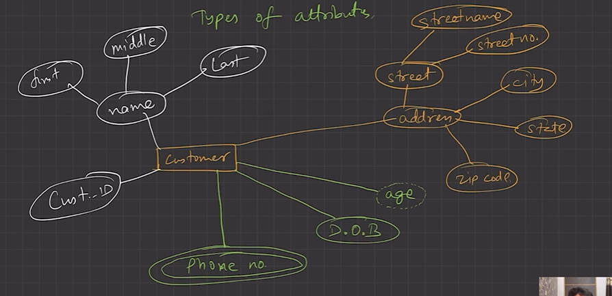

**Composite attribute = address, name**

**Single valued = Cust_ID**

Multi-valued = Phone number

derived attribute = age

  1. Relationships

    1. **Association **among two or more entities.

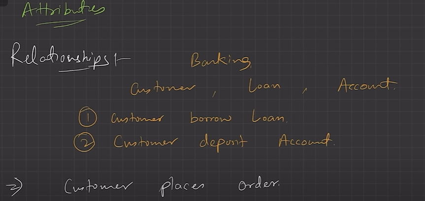

  1. e.g., Person has vehicle, Parent has Child, Customer borrow loan etc.

  1. **Strong Relationship**, between two independent entities.

  1. **Weak Relationship**, between weak entity and its owner/strong entity.

1.    e.g., Loan <installment-payments> Payment.

  1. **Degree of Relationship**

    1. Number of entities participating in a relationship.

    1. **Unary**, Only one entity participates. e.g., Employee manages employee.

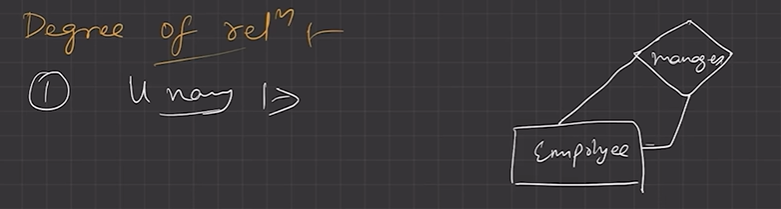

  1. **Binary**, two entities participates. e.g., Student takes Course.

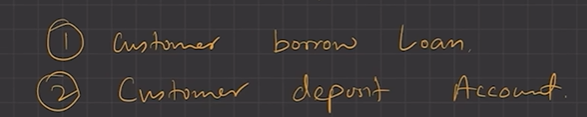

  1. **Ternary **relationship, three entities participates. E.g, Employee works-on branch, employee works-on job.

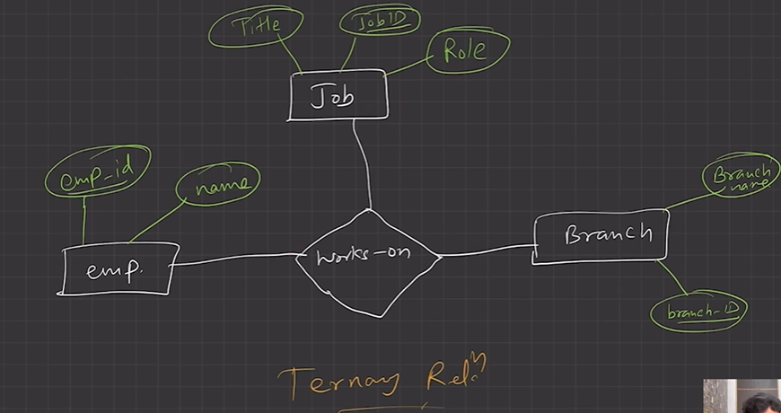

  1. Binary are **common**.

**Relationship between entities in ER Diagram: **

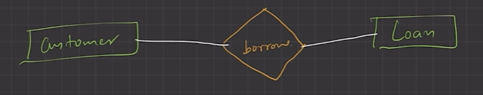

**Relationships Constraints**

  1. **Mapping Cardinality / Cardinality Ratio**

    1. Number of entities to which another entity can be associated via a relationship.

    1. **One to one, **Entity in A associates with at most one entity in B, where A G B are entity sets. And an entity of B is associated with at most one entity of A.

      1. E.g., Citizen has Aadhar Card.

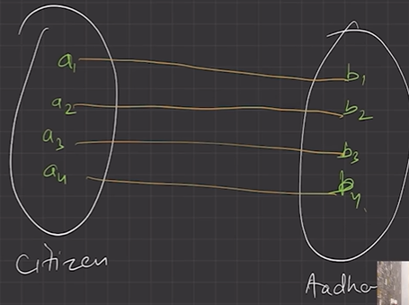

    1. **One to many, **Entity in A associated with N entity in B. While entity in B is associated with at most one entity in A.

      1. e.g., Citizen has Vehicle. (1:N)

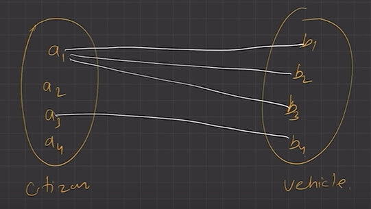

    1. **Many to one, **Entity in A associated with at most one entity in B. While entity in B can be associated with N entity in A.

      1. e.g., Course taken by Professor.

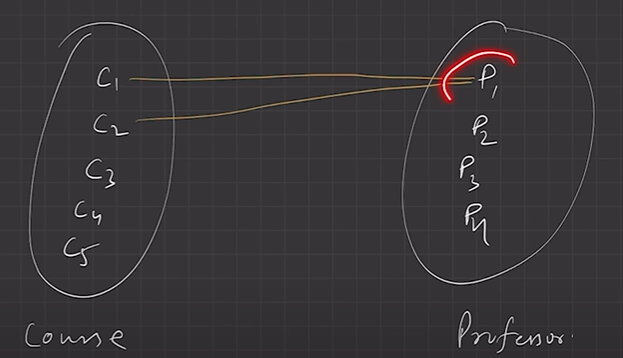

  1. **Many to many, **Entity in A associated with N entity in B. While entity in B also associated with N entity in A.

    1. Customer buys product.

    1. Student attend course.

  1. **Participation Constraints**

    1. Aka, **Minimum cardinality constraint.**

    1. **Types**, Partial G Total Participation.

    1. **Partial Participation, **not all entities are involved in the relationship instance.

    1. **Total Participation**, each entity must be involved in at least one relationship instance.

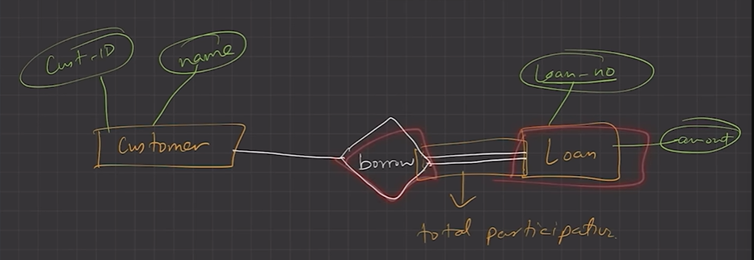

  1. e.g., Customer borrow loan, loan has total participation as it can’t exist without customer entity. And customer has partial participation.

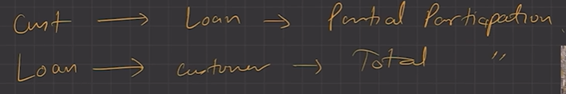

  1. **Weak entity has total participation constraint, but strong may not have total participation constraint .**

  1. **ER Notations**

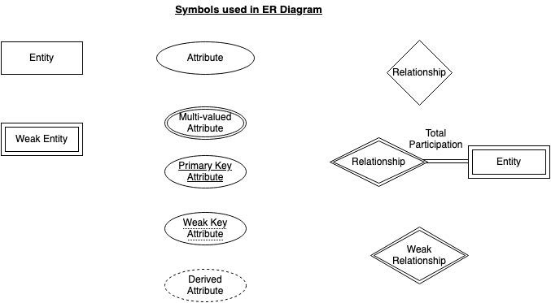
