# 2.2.2 LEC-4: Extended ER Features

**LEC-4: Extended ER Features**

  1. **Basic ER Features **studied in the **LEC-3, **can be used to model most DB features but when complexity increases, it is better to use some Extended ER features to model the DB Schema.

  1. **Specialisation**

    1. In ER model, we may require to subgroup an entity set into other entity sets that are distinct in some way with other entity sets.

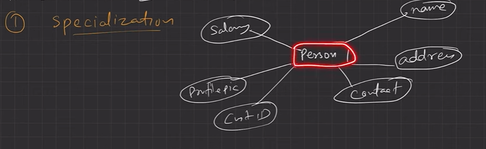

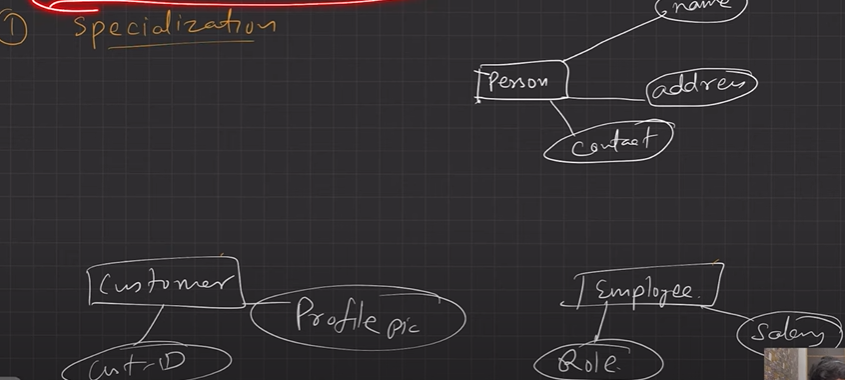

Extended ER Functionality:

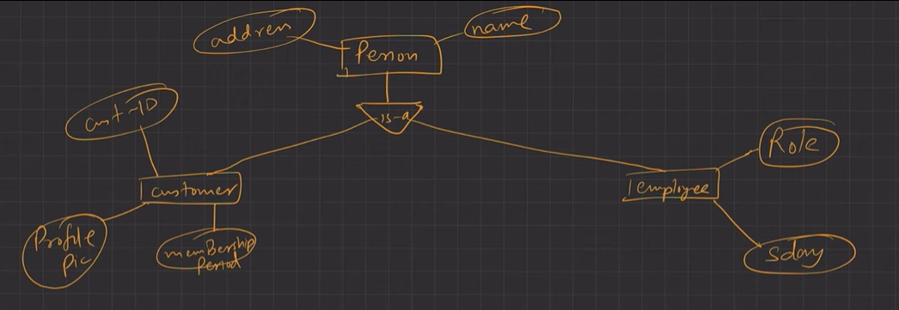

  1. **Specialization **is **splitting **up the entity set into further **sub entity sets **on the basis of their **functionalities**, **specialties **and **features**.

  1. It is a **Top-Down **approach.

  1. e.g., **Person **entity set can be divided into **customer**, **student**, **employee**. Person is **superclass **and other specialized entity sets are **subclasses**.

    1. We have **“is-a” **relationship between superclass and subclass.

    1. Depicted by **triangle **component.

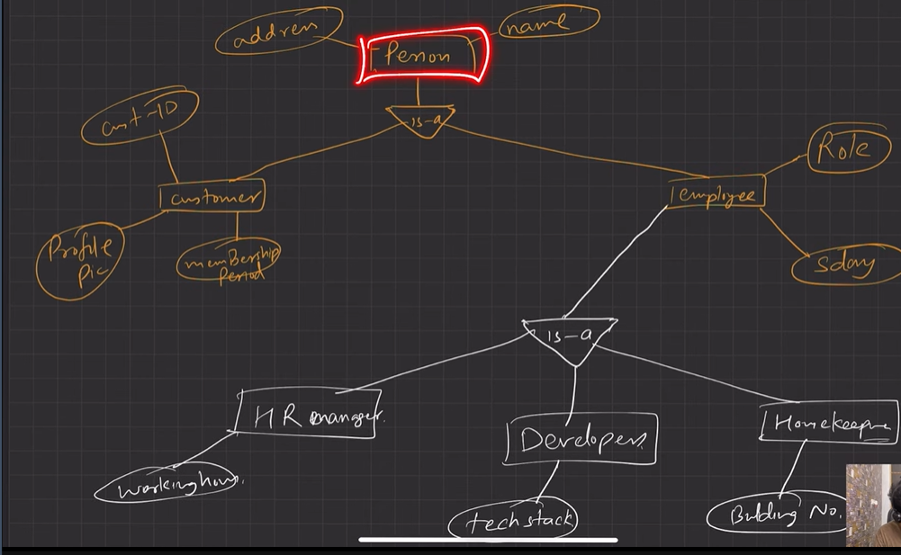

  1. **Why **Specialisation?

    1. Certain attributes may only be applicable to a few entities of the parent entity set.

    1. DB designer can show the distinctive features of the sub entities.

    1. To group such entities we apply Specialisation, to overall **refine **the DB blueprint.

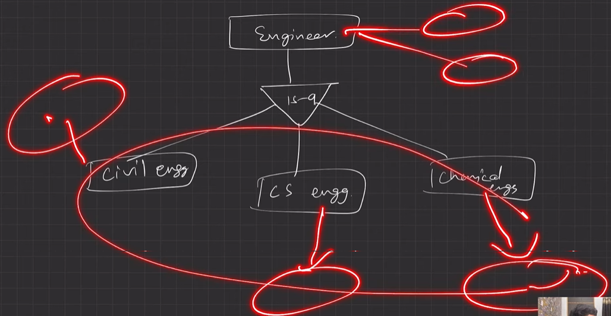

"Civil engineer", "CS Engg" have some of their specialised attributes as well as common attributes which are given to "engineer"

  1. **Generalisation**

    1. It is just a **reverse **of Specialization.

    1. DB Designer, may encounter certain properties of two entities are overlapping. Designer may consider to make a new generalized entity set. That generalized entity set will be a super class.

    1. **“is-a” **relationship is present between subclass and super class.

    1. e.g., **Car**, **Jeep **and **Bus **all have some common attributes, to avoid data repetition for the common attributes. DB designer may consider to Generalize to a new entity set “**Vehicle**”.

    1. It is a **Bottom-up **approach.

    1. **Why **Generalisation?

      1. Makes DB more **refined **and **simpler**.

      1. Common attributes are not **repeated**.

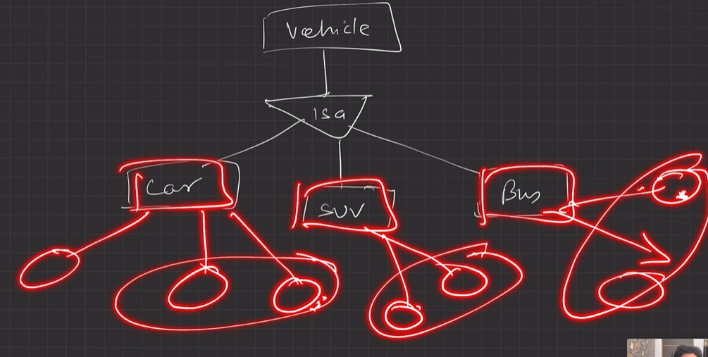

**Common attributes of car, suv, bus are generalised and added to vehicle entity. **

  1. **Attribute Inheritance**

    1. **Both **Specialisation and Generalisation, has attribute inheritance.

    1. The attributes of higher level entity sets are inherited by lower level entity sets.

    1. E.g., **Customer & Employee **inherit the attributes of **Person**.

  1. **Participation Inheritance**

    1. If a parent entity set participates in a relationship then its child entity sets will also participate in that relationship.

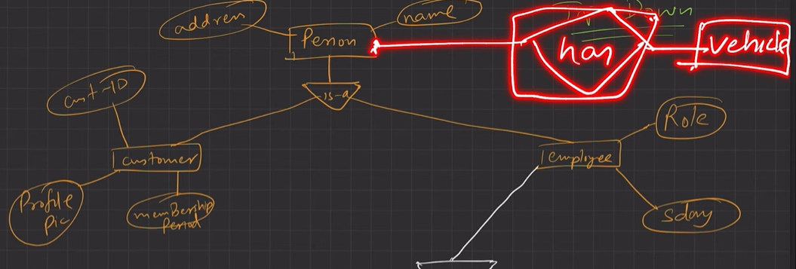

**Customer has vehicle ---> participation inheritance from "person has vehicle"**

  1. **Aggregation**

    1. **How to show relationships among relationships? **- Aggregation is the technique.

    1. **Abstraction **is applied to treat relationships as higher-level entities. We can call it Abstract entity.

    1. **Avoid redundancy **by aggregating relationship as an entity set itself.

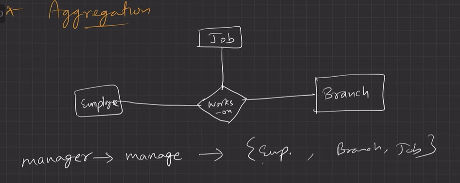

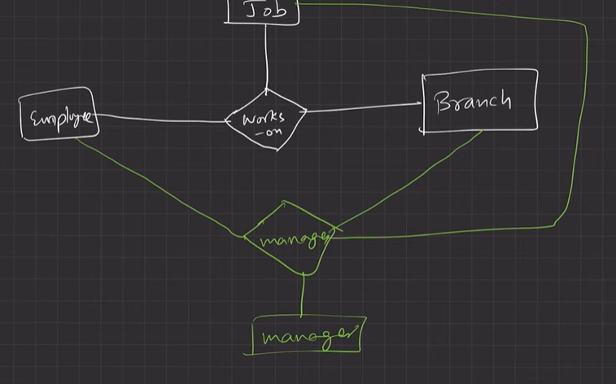

this shows that manager manages employee, manager manages job, manager manages branch.

this is redundancy since we wanted the manager to manage the combination and not the quaternary relation that we have made.

use aggregation

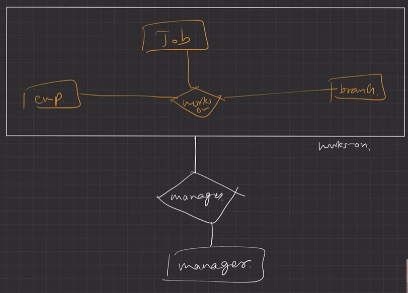

eg;

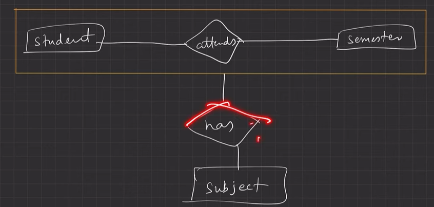
