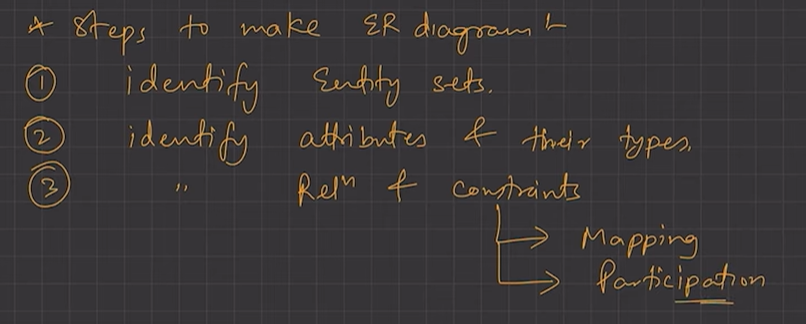
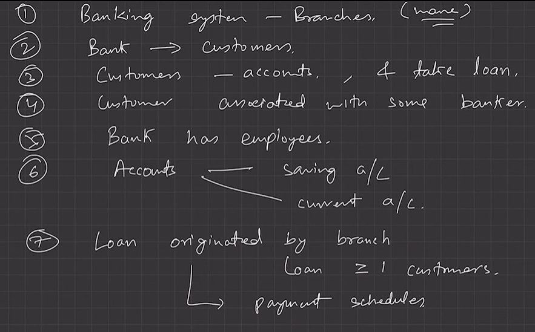
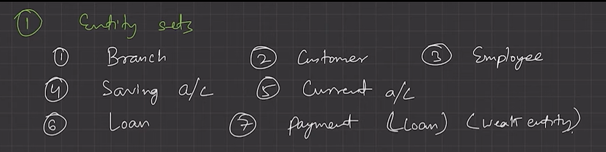
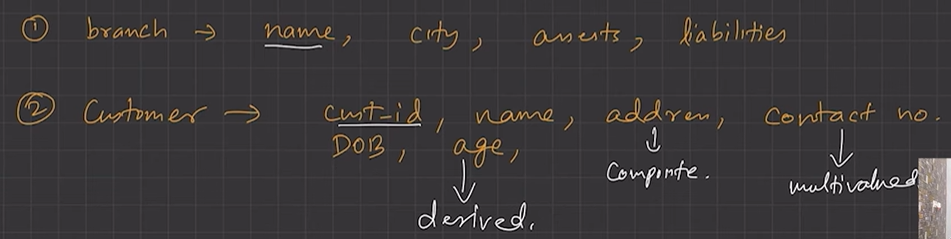
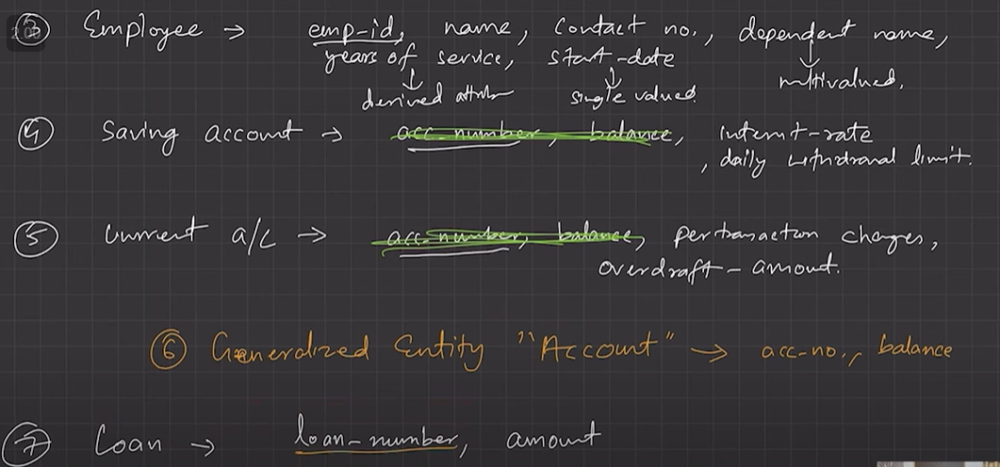
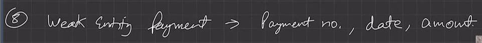
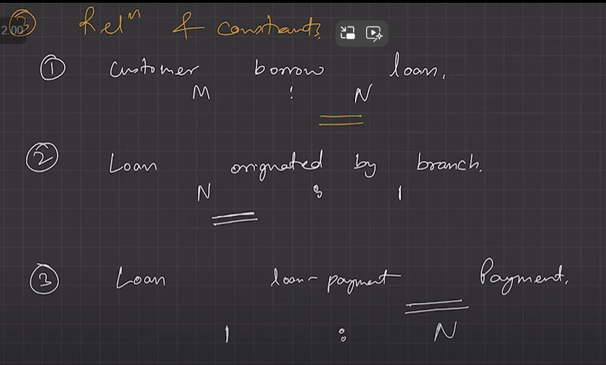
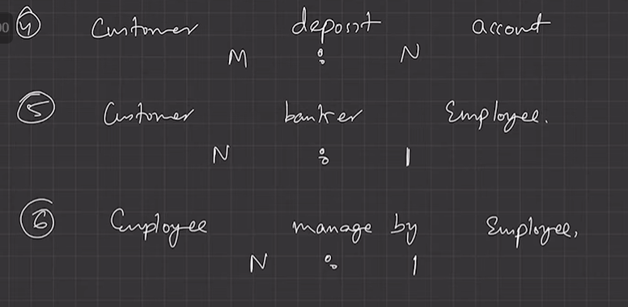
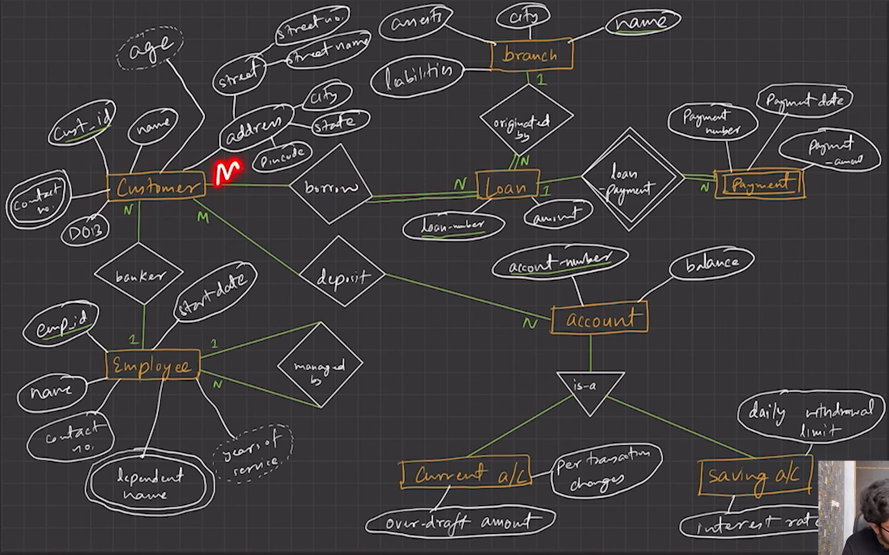

# 2.2.3 LEC 5 - How to make ER Diagram?

ER Diagram is used  to make conceptual schema.

Steps:

ER MODEL OF BANKING SYSTEM:

  1. Requirement Specification/Engineering

  1. Identify Entity Sets-

General saving a/c and current a/c into  a/c

RELATIONSHIP & CONSTANTS:

ER DIAGRAM:

