# 2.3.1 LEC-7: Relational Model

  1. Relational Model (RM) is another DATA MODEL which organizes the data in the form of **relations **(**tables**).

  1. A relational DB consists of **collection of tables**, each of which is assigned a **unique name.**

  1. A **row **in a table represents a relationship among a set of values, and table is collection of such relationships.

  1. **Tuple**: A single row of the table representing a single data point / a unique record.

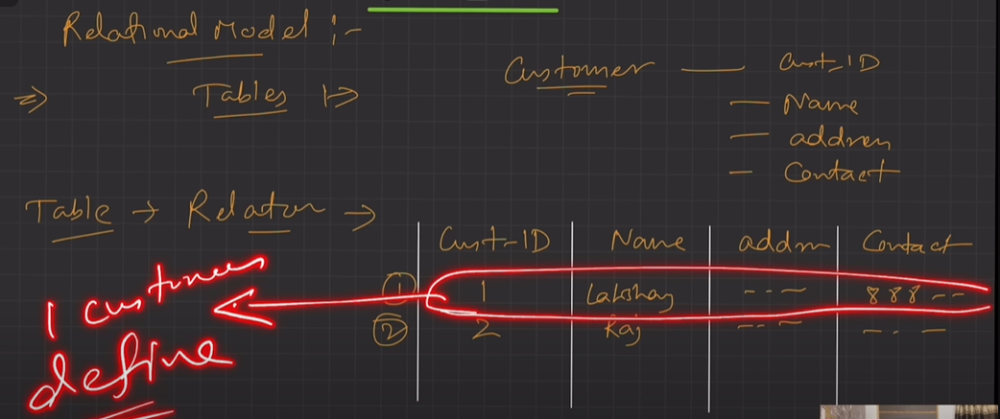

  1. **Columns**: represents the attributes of the relation. Each aUribute, there is a permitted value, called **domain of the a****U****ribute.**

  1. **Relation Schema**: defines the design and structure of the relation, contains the name of the relation and all the columns/attributes.

  1. Common RM based DBMS systems, aka RDBMS: Oracle, IBM, **MySQL**, MS Access.

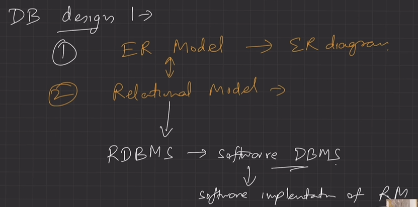

  1. **Degree of table: **number of attributes/columns in a given table/relation.

  1. **Cardinality**: Total no. of tuples in a given relation.

  1. **Relational Key**: Set of attributes which can uniquely identify an each tuple.

  1. Important **properties **of a **Table **in Relational Model

    1. The name of relation is distinct among all other relation.

    1. The values have to be atomic. Can’t be broken down further.

    1. The name of each attribute/column must be unique.

    1. Each tuple must be unique in a table. (no redundancy)

    1. The sequence of row and column has no significance.

    1. Tables must follow integrity constraints - it helps to maintain data consistency across the tables.

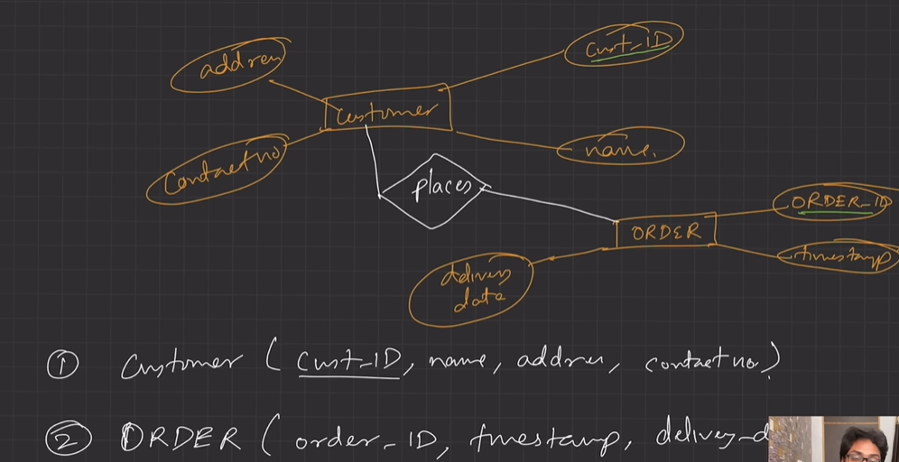

**Customer (X,Y,Z) is relational schema of Customer entity.**

  1. **Relational Model Keys**

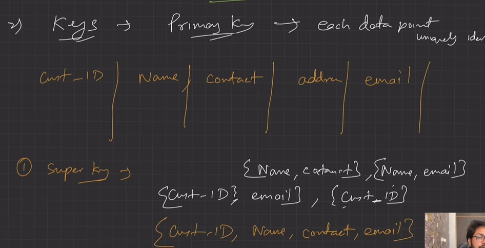

  1. Super Key (**SK**): Any P&C of attributes present in a table which can uniquely identify each tuple.

  1. Candidate Key (**CK**): minimum subset of super keys, which can uniquely identify each tuple. It contains no redundant attribute.

    1. **CK value shouldn’t be NULL.**

  1. Primary Key (**PK**):

    1. Selected out of CK set, has the least no. of attributes.

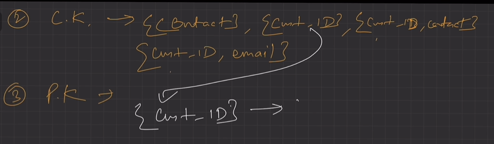

  1. Alternate Key (**AK**)

    1. All CK except PK.

  1. Foreign Key (**FK**)

    1. It creates relation between two tables.

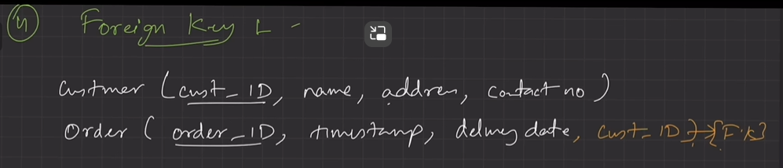

  1. A relation, say r1, may include among its attributes the PK of an other relation, say r2. This attribute is called FK from r1 referencing r2.

  1. The relation r1 is aka **Referencing (Child) relation **of the FK dependency, and r2 is called **Referenced (Parent) relation **of the FK.

  1. FK helps to cross reference between two different relations.

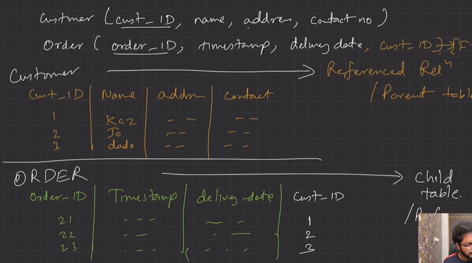

  1. **Composite **Key: PK formed using at least 2 attributes.

  1. **Compound **Key: PK which is formed using 2 FK.

  1. **Surrogate **Key:

    1. Synthetic PK.

    1. Generated automatically by DB, usually an integer value.

    1. May be used as PK.

    1. use surr_no as new PK

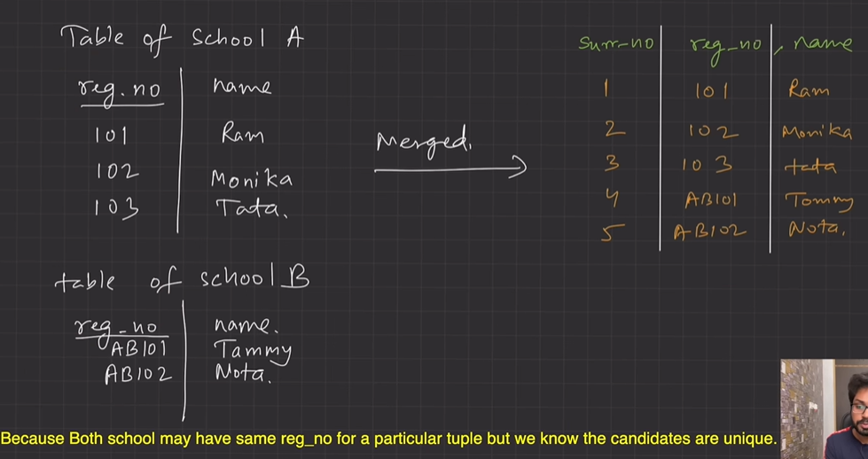

  1. Ek table ki primary key ko dusri table ka attribute bana diya and foregin key bol diya.

  1. **Integrity Constraints **

    1. CRUD Operations must be done with some integrity policy so that DB is always consistent.

    1. Introduced so that we do not accidentally corrupt the DB.

    1. **Domain Constraints**

      1. Restricts the value in the attribute of relation, specifies the Domain.

      1. Restrict the Data types of every aUribute.

      1. E.g., We want to specify that the enrolment should happen for candidate birth year < 2002.

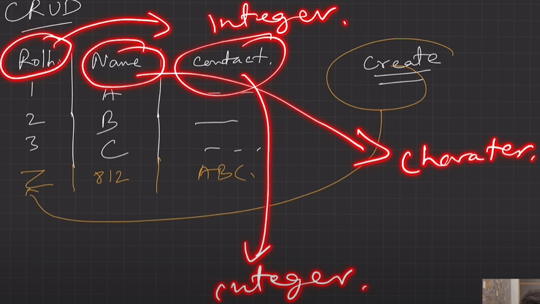

  1. **Entity Constraints**

    1. Every relation should have PK. PK != NULL.

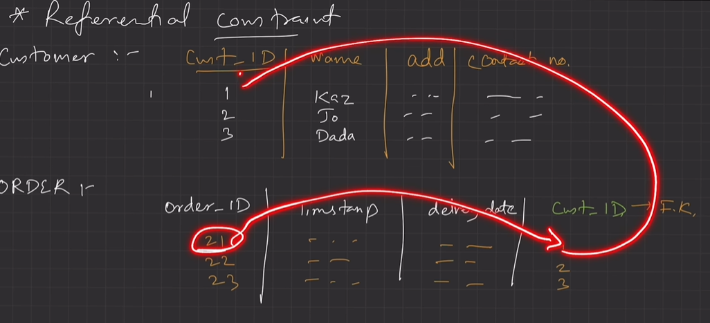

  1. **Referential Constraints \[IMP. FOR INTERVIEW\]**

    1. Specified between two relations & helps maintain consistency among tuples of two relations.

    1. It requires that the value appearing in specified attributes of any tuple in referencing relation also appear in the specified attributes of at least one tuple in the referenced relation.

    1. If FK in referencing table refers to PK of referenced table then every value of the FK in referencing table must be NULL or available in referenced table.

    1. FK must have the matching PK for its each value in the parent table or it must be NULL.

    1. Insert constraint: Value can't be inserted in child table if value is not present in parent table.  Tuple can't be inserted in child table if its foreign key's corresponding value is not present in parent table.

  1. **Delete constraint: Value can't be deleted from parent table if the value is lying in the child table. **

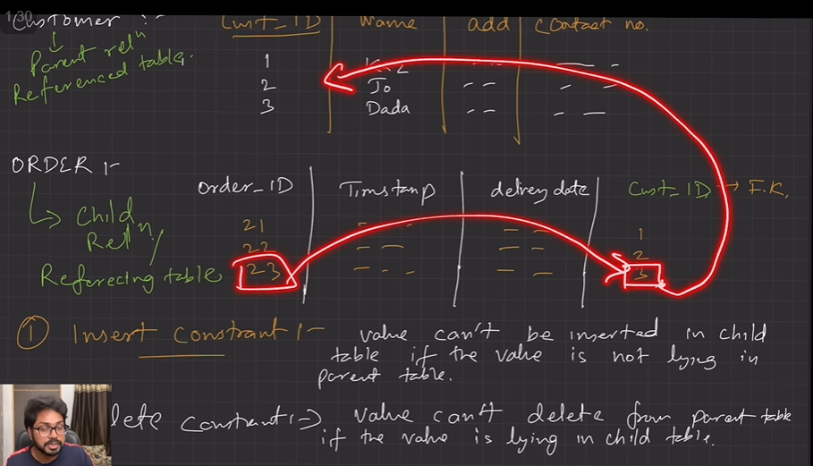

**ON DELETE CASCADE:**

**When deleting an entry in parent table, also delete the corresponding entry from the child table. **

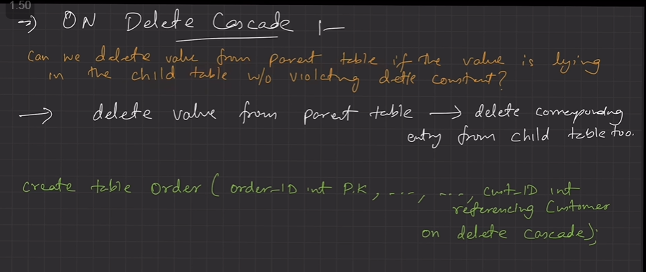

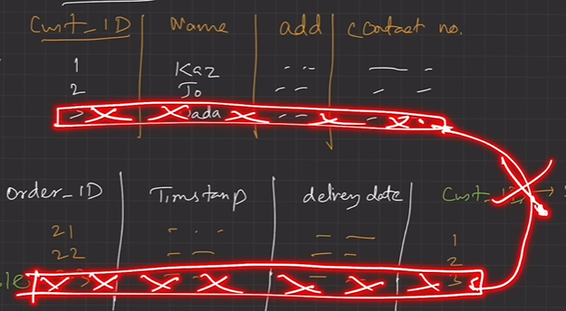

**ON DELETE NULL:**

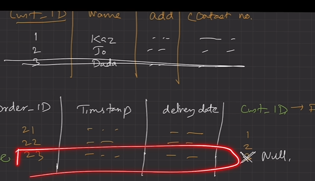

  1. **Key Constraints: **The six types of key constraints present in the Database management system are:-

  1. NOT NULL: This constraint will restrict the user from not having a NULL value. It ensures that every element in the database has a value.

  1. UNIQUE: It helps us to ensure that all the values consisting in a column are different from each other.

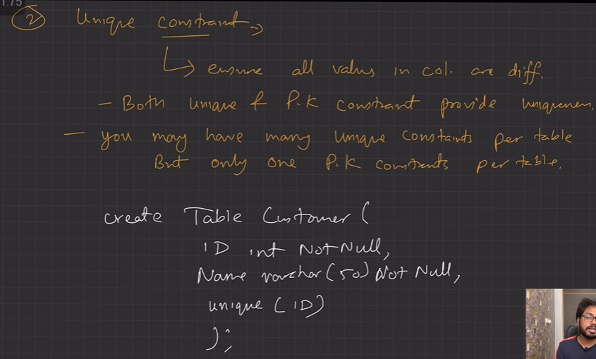

  1. DEFAULT: it is used to set the default value to the column. The default value is added to the columns if no value is specified for them.

  1. CHECK: It is one of the integrity constraints in DBMS. It keeps the check that integrity of data is maintained before and aier the completion of the CRUD.

  1. PRIMARY KEY: This is an attribute or set of attributes that can uniquely identify each entity in the entity set. The primary key must contain unique as well as not null values.

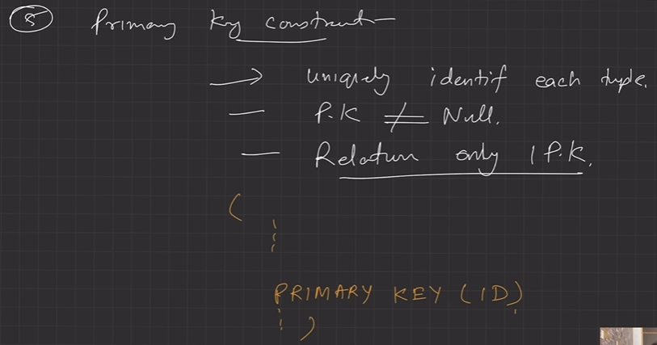

  1. FOREIGN KEY: Whenever there is some relationship between two entities, there must be some common attribute between them. This common attribute must be the primary key of an entity set and will become the foreign key of another entity set. This key will prevent every action which can result in loss of connection between tables.

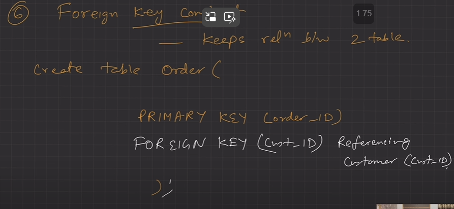
