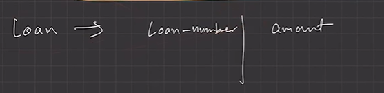
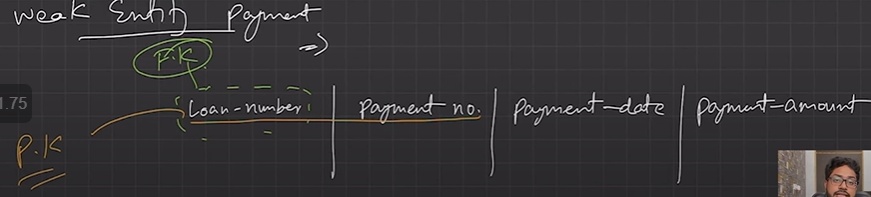
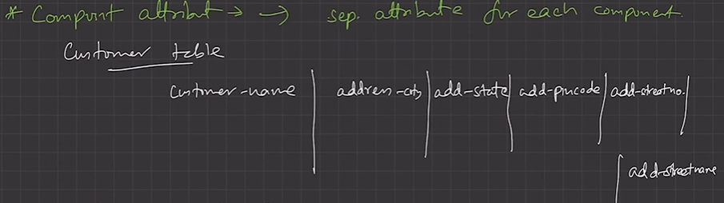
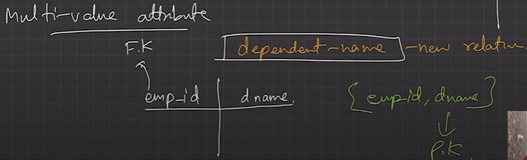
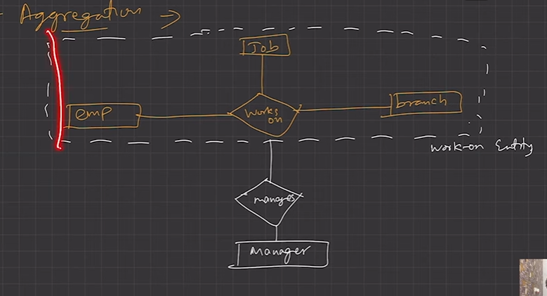
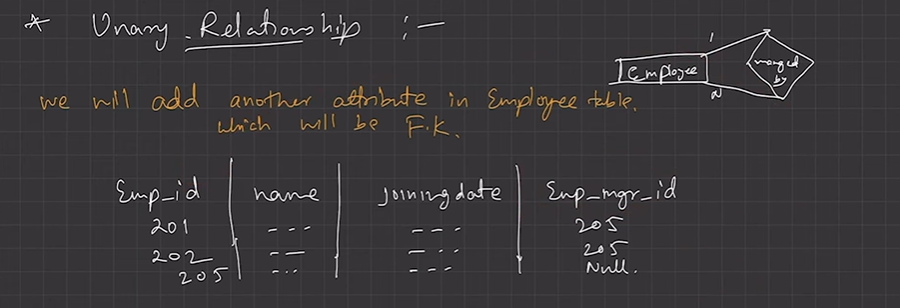
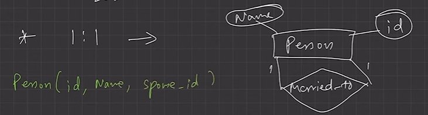
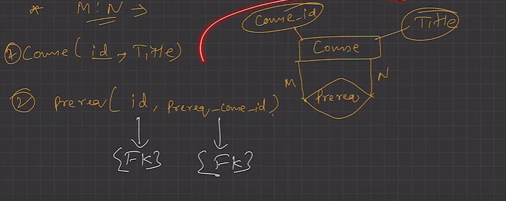
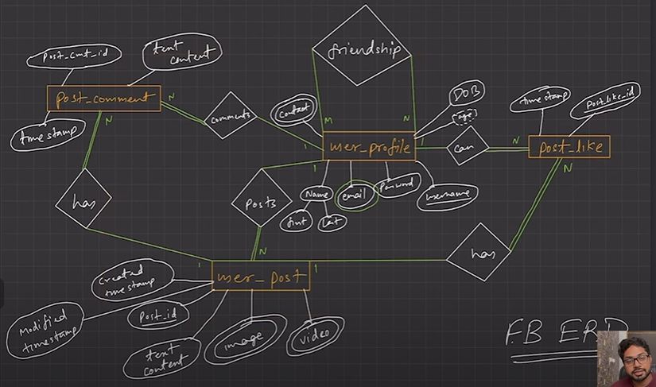
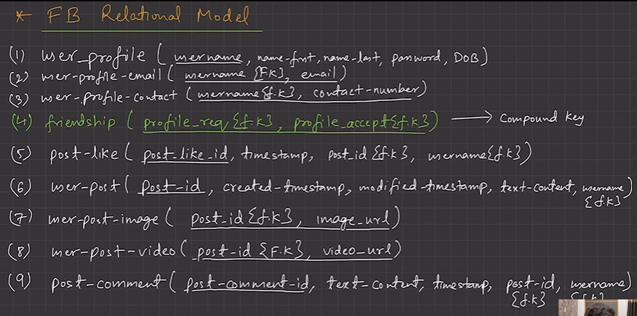

# 2.3.2 LEC-8: Transform - ER Model to Relational Model

  1. Both **ER**-Model and **Relational **Model are abstract logical representation of real world enterprises. Because the two models implies the similar design principles, **we can convert ER design into Relational design**.

  1. Converting a DB representation from an ER diagram to a table format is the way we arrive at Relational DB-design from an ER diagram.

  1. ER diagram **notations to relations**:

    1. **Strong Entity**

      1. Becomes an **individual table **with entity name, attributes becomes columns of the relation.

      1. Entity’s Primary Key (PK) is used as Relation’s PK.

      1. **FK **are added to establish relationships with other relations.

  1. **Weak Entity**

    1. A table is formed with all the attributes of the entity.

    1. PK of its corresponding Strong Entity will be added as **FK**.

    1. **PK **of the relation will be a composite PK, {FK + Partial discriminator Key}.

  1. **Single Values A****t****tributes**

    1. Represented as **columns **directly in the tables/relations.

  1. **Composite A****t****tributes**

    1. Handled by **creating a separate attribute** itself in the original relation for each composite aUribute.

    1. e.g., **Address**: {street-name, house-no}, is a composite attribute in customer relation, we add address-street- name G address-house-name as new columns in the attribute and ignore “address” as an attribute.

  1. **Multivalued A****t****tribute**

    1. **New tables **(named as original attribute name) are created for each multivalued aUribute.

    1. PK of the entity is used as column **FK **in the new table.

    1. Multivalued attribute’s similar name is added as a column to define multiple values.

    1. **PK **of the new table would be {FK + multivalued name}.

      1. e.g., For Strong entity **Employee**, **dependent-name **is a multivalued aUribute.

        1. New table named dependent-name will be formed with columns emp-id, and dname.

        1. PK: {emp-id, name}

        1. FK: {emp-id}

  1. **Derived A****t****tributes**: Not considered in the tables.

  1. **Generalization**

    1. **Method-1****: **Create a table for the higher level entity set. For each lower-level entity set, create a table that includes a column for each of the attributes of that entity set plus a column for each attribute of the primary key of the higher-level entity set.

For e.g., Banking System generalization of Account - saving G current.

  1. Table 1: account (account-number, balance)

  1. Table 2: savings-account (account-number, interest-rate, daily-withdrawal-limit)

  1. Table 3: current-account (account-number, overdraft-amount, per-transaction-charges)

  1. **Method-2: **An alternative representation is possible, if the generalization is disjoint and complete—that is, if no entity is a member of two lower-level entity sets directly below a higher-level entity set, and if every entity in the higher level entity set is also a member of one of the lower-level entity sets. Here, do not create a table for the higher-level entity set. Instead, for each lower-level entity set, create a table that includes a column for each of the attributes of that entity set plus a column for each attribute of the higher-level entity sets.

Tables would be:

  1. Table 1: savings-account (account-number, balance, interest-rate, daily-withdrawal-limit)

  1. Table 2: current-account (account-number, balance, overdraft-amount, per-transaction-charges)

  1. **Drawbacks of Method-2: **If the second method were used for an overlapping generalization, some values such as balance would be stored twice unnecessarily. Similarly, if the generalization were not complete—that is, if some accounts were neither savings nor current accounts—then such accounts could not be represented with the second method.

  1. **Aggregation **

    1. Table of the relationship set is made.

    1. Attributes includes primary keys of entity set and aggregation set’s entities.

    1. Also, add descriptive attribute if any on the relationship.

composite primary key

Unary relationship:

1:N Mapping

1:1 Mapping:

M:N Mapping

Converting Facebook ER model to Relational Model:

