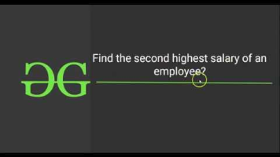

# 2.4.1 Links

[SQL - Complete Course in 3 Hours \| SQL One Shot using MySQL](<https://www.youtube.com/watch?v=hlGoQC332VM&pp=ygUQc3FsIGluIG9uZSB2aWRlbw%3D%3D>)

[Lecture 9: Complete SQL in 1 VIDEO](<https://www.youtube.com/watch?v=D_wNQR3LeeM>)

[Lecture 10: Common SQL Queries for Interviews](<https://www.youtube.com/watch?v=vIq9zkpGWc8&t=10s>)

[SQL Course in 2024 \| Placements \| Semester Exams \| Jobs](<https://youtube.com/playlist?list=PLrL_PSQ6q062H5CetdplYW7xQKeq8XaR0&si=vKb5M3eqcePJQii4>)

[(9) DATA KE DAKU - YouTube](<https://www.youtube.com/@DATAKEDAKU-singh>)

[SQL Tutorial - GeeksforGeeks](<https://www.geeksforgeeks.org/sql-tutorial/>)

[SQL Joins - Beginner to PRO Masterclass with 10 Examples](<https://www.youtube.com/watch?v=xkYpNfpmbGY&pp=ygUJc3FsIGpvaW5z>)

[FAQ's on SQL Queries](<https://www.youtube.com/playlist?list=PLUDwpEzHYYLu1Sxfwtvbr8kzd7uNd8jIS>)

[Top 50 SQL Interview Questions](<https://www.youtube.com/playlist?list=PLqM7alHXFySGweLxxAdBDK1CcDEgF-Kwx>)

[Solve SQL \| HackerRank](<https://www.hackerrank.com/domains/sql>)

InterViewbit

Leetcode

Data ke Daaku

[\[FOR 2025\] Practical SQL Hands-On Masterclass with MySQL | Day-by-Day Guide](<https://www.youtube.com/watch?v=Zk23ruZgs3w>)

[Structured Query Language (SQL)](<https://www.youtube.com/playlist?list=PLxCzCOWd7aiHqU4HKL7-SITyuSIcD93id>)
