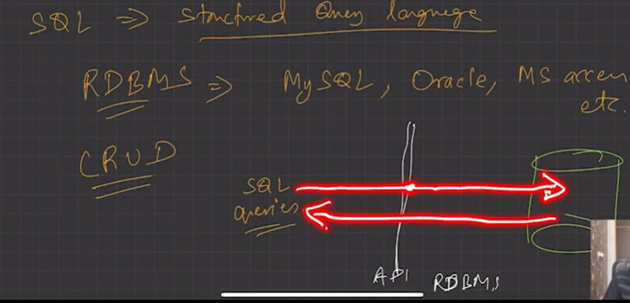
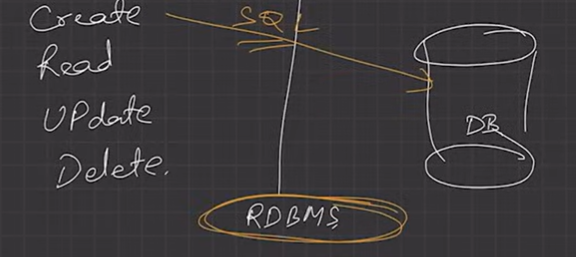
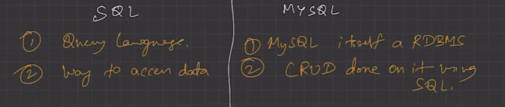
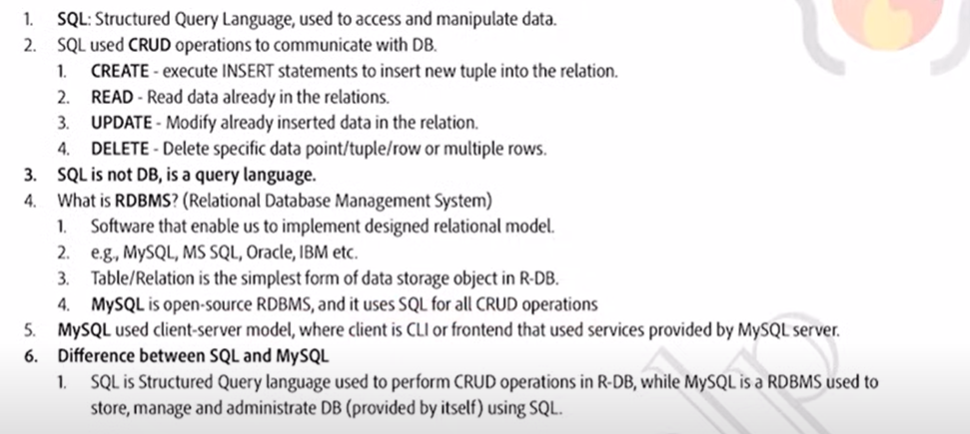
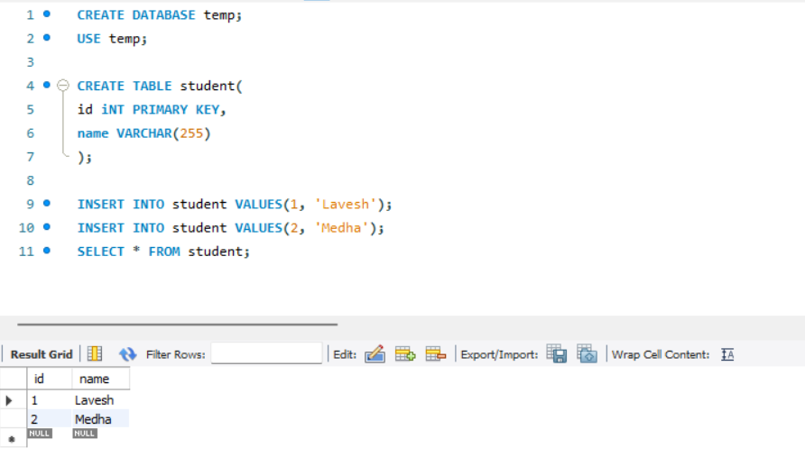

# 2.4.3 Intro

SQL (Structured Query Language) is a domain-specific language used to manage and manipulate relational databases.

A database is a structured collection of data that is organized and stored for easy retrieval and management.

CREATE, READ, UPDATE, DELETE - CRUD

RDBMS HAS TABLES DATA IN DB

MYSQL IS OPEN SOURCE RDBMS.

MYSQL WORKBENCH -

1 Tier Architecture because of user can easily interact with Database or architecture without any Restriction.
