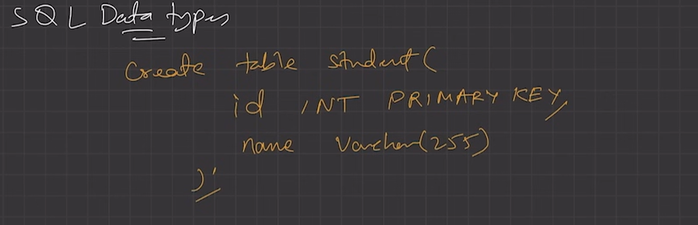
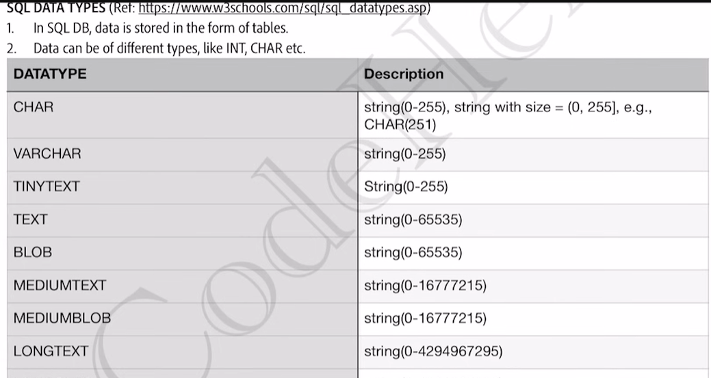
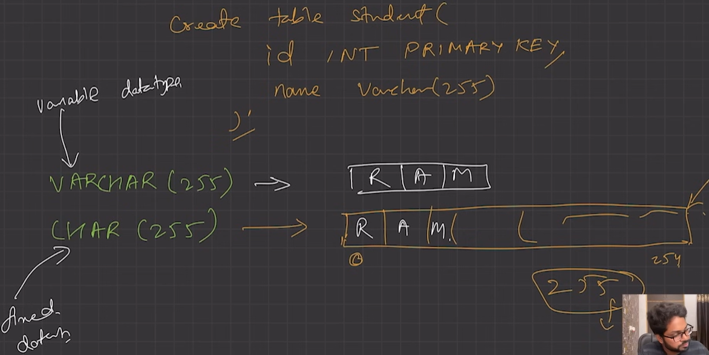
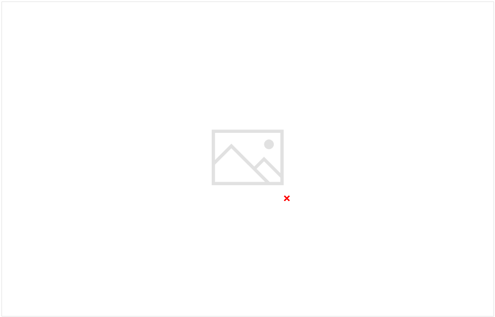
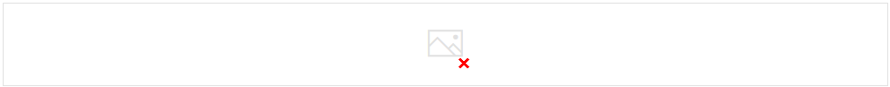

# 2.4.4 SQL Data Types

IN SQL data is stored in form of tables.

  1. NUMERIC DATA TYPE

    1. EXACT NUMERIC -

| **BigInt** |  | 263 -1 (9,223,372,036,854,775,807) |
| --- | --- | --- |
| **Int** |  | 231-1 (2,147,483,647) |
| **smallint** |  | 215-1 (32,767) |
| **tinyint** |  | 28-1 (255) |
| **bit** |  | 1 |
| **decimal** |  | 1038-1 |
| **numeric** |  | 1038-1 |
| **money ** |  | 922,337,203,685,477.5807 |
| **smallmoney** |  | 214,748.3647 |

    1. APPROXIMATE NUMERIC -

| **Data Type** | **From** | **To** |
| --- | --- | --- |
| **Float** | -1.79E+308 | 1.79E+308 |
| **Real** | -3.40E+38 | 3.40E+38 |

  1. STRING DATATYPE:

    1. CHARACTER STRING -

| **Data Type** | **Description** |
| --- | --- |
| **char** | The maximum length of 8000 characters.(Fixed-Length non-Unicode Characters) |
| **varchar** | The maximum length of 8000 characters.(Variable-Length non-Unicode Characters) |
| **varchar(max)** | The maximum length of 231 characters(SQL Server 2005 only).(Variable Length non-Unicode data) |
| **text** | The maximum length of 2,127,483,647 characters(Variable Length non-Unicode data) |

    1. UNICODE CHARACTER STRING -

| **Data Type** | **Description** |
| --- | --- |
| **nchar** | The maximum length of 4000 characters(Fixed-Length Unicode Characters) |
| **Nvarchar** | The maximum length of 4000 characters.(Variable-Length Unicode Characters) |
| **nvarchar(max)** | The maximum length of 231 characters(SQL Server 2005 only).(Variable Length Unicode data) |

    1. SERVER STRING -

| **Datatypes** | **Description** |
| --- | --- |
| **Binary** | The maximum length of 8000 bytes(Fixed-Length binary data) |
| **varbinary** | The maximum length of 8000 bytes(Variable Length binary data) |
| **varbinary(max)** | The maximum length of 231 bytes(SQL Server 2005 only).(Variable Length binary data) |
| **text** | Maximum Length of 2,147,483,647 bytes(Variable Length binary data) |

MYSQL DATAYPES:

| **Datatype** | **Properties** |
| --- | --- |
| **Numeric data types** | These are used to store numeric values. Examples include INT, BIGINT, DECIMAL, and FLOAT. |
| **Character data types** | These are used to store character strings. Examples include CHAR, VARCHAR, and TEXT. |
| **Date and time data types** | These are used to store date and time values. Examples include [DATE](<https://www.geeksforgeeks.org/sql-date-functions/>), TIME, and TIMESTAMP |
| **Binary data types** | These are used to store binary data, such as images or audio files. Examples include BLOB and BYTEA. |
| **Boolean data type** | This data type is used to store logical values. The only possible values are TRUE and FALSE. |
| **Interval data types** | These are used to store intervals of time. Examples include INTERVAL YEAR, INTERVAL MONTH, and INTERVAL DAY. |
| **Array data types** | These are used to store arrays of values. Examples include ARRAY and JSON. |
| **XML data type** | This data type is used to store [XML data](<https://www.geeksforgeeks.org/xml-basics/>). |
| **Spatial data types** | These are used to store geometric or geographic data. Examples include POINT, LINE, and POLYGON. |

VARCHAR is variable size array, however the CHAR is fixed size array (predefined size).

BLOB = Binary Large Object

BOOLEAN implemented using TINYINT

SIGNED / UNSIGNED -

By default everything is SIGNED.

ADVANCED DATA TYPES:

