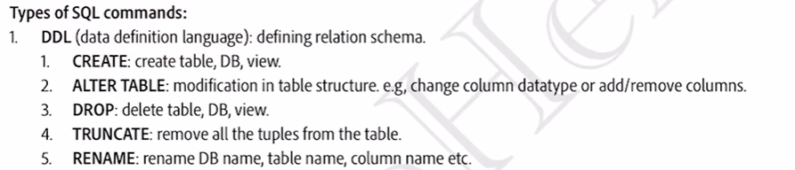
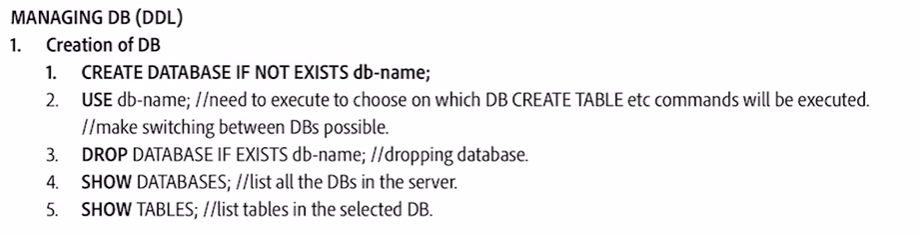
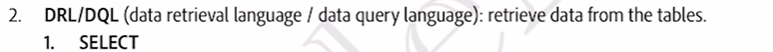
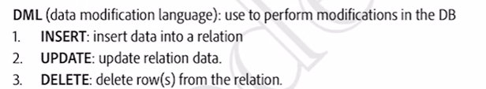
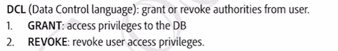
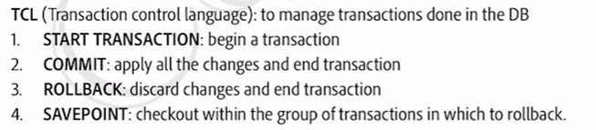

# 2.4.6 SQL Commands

**Data Definition Language (DDL): Used to define and modify the structure of a database **

**Data Manipulation Language (DML): Used to access, manipulate, and modify data in a database **

**Data Control Language (DCL): Used to manage user access to database data, granting or revoking privileges to individuals or groups. **

**Transaction Control Language (TCL): Used to oversee transactions within a database **

**Data Query Language (DQL): Utilized for querying and extracting essential information from a database's data.**

**DDL (Data Definition Language)**

[DDL](<https://www.geeksforgeeks.org/features-of-structured-query-language-sql>)** or Data Definition Language** actually consists of the SQL commands that can be used to define the database schema. It simply deals with descriptions of the database schema and is used to create and modify the structure of database objects in the database.

DDL is a set of SQL commands used to create, modify, and delete database structures but not data.

| **Command** | **Description** | **Syntax** |
| --- | --- | --- |
| [CREATE](<https://www.geeksforgeeks.org/sql-create>) | Create database or its objects (table, index, function, views, store procedure, and triggers) | **CREATE**TABLE table_name (column1 data_type, column2 data_type, ...); |
| [DROP](<https://www.geeksforgeeks.org/sql-drop-truncate>) | Delete objects from the database | **DROP**TABLE table_name; |
| [ALTER](<https://www.geeksforgeeks.org/sql-alter-add-drop-modify>) | Alter the structure of the database | **ALTER**TABLE table_name ADD COLUMN column_name data_type; |
| [TRUNCATE](<https://www.geeksforgeeks.org/sql-drop-truncate>) | Remove all records from a table, including all spaces allocated for the records are removed | **TRUNCATE**TABLE table_name; |
| [COMMENT](<https://www.geeksforgeeks.org/sql-comments>) | Add comments to the data dictionary | **COMMENT**'comment_text' ON TABLE table_name; |
| [RENAME](<https://www.geeksforgeeks.org/sql-alter-rename>) | Rename an object existing in the database | **RENAME**TABLE old_table_name TO new_table_name; |

CREATE DATABASE

**CREATE DATABASE query in SQL**is used to create a new database in the database management system.

*CREATE DATABASE IF NOT EXISTS database_name;*

We use the **SHOW DATABASES**command and it will return a list of databases that exist in our system.

**SHOW DATABASES**;

**USE **database_name

NOTE:

  - *A ****CREATE DATABASE statement**** is used to create a database.*

  - *A database consists of tables and inside the tables, we store the data.*

  - *The database name is case-insensitive, so we need to create a unique database name.*

  - *Keep the limit of database names to ****128 characters****.*

**DROP DATABASE**

permanently delete an existing database from a database management system (**DBMS**). This operation permanently removes the database and all its associated data, including** tables, views, stored procedures, **and any other objects contained within the [database](<https://www.geeksforgeeks.org/what-is-database/>).

DROP DATABASE database_name;

So, we will once again use the **SHOW DATABASES command**and verify that the dropped database has been deleted or not.

To avoid any error while running the DROP DATABASE command use the [IF EXISTS clause](<https://www.geeksforgeeks.org/sql-exists/>)**, which will delete the database only if it exists in the system.**

*DROP DATABASE IF EXISTS Database_Name;*

DATA DEFINITION LANGUAGE

DATA RETRIEVAL/QUERY LANGUAGE

DATA MODIFICATION LANGUAGE:

DATA CONTROL LANGUAGE

TRANSACTION CONTROL LANGUAGE:

