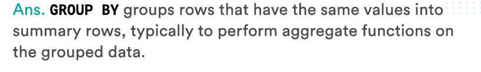
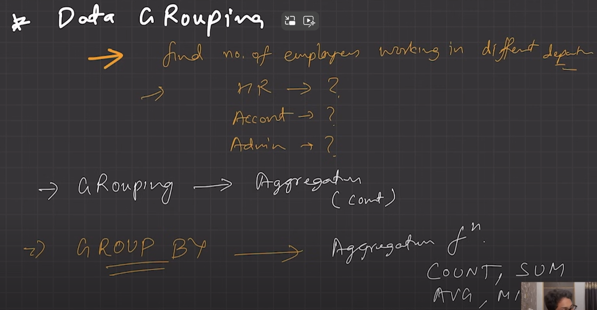
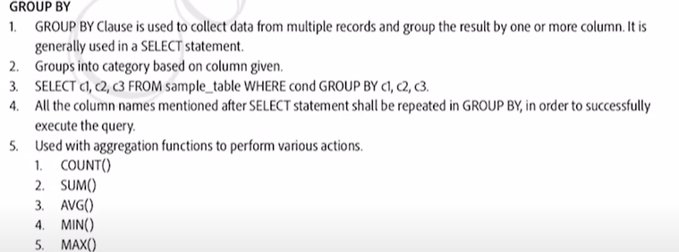
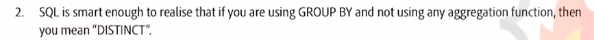
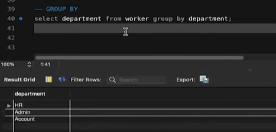
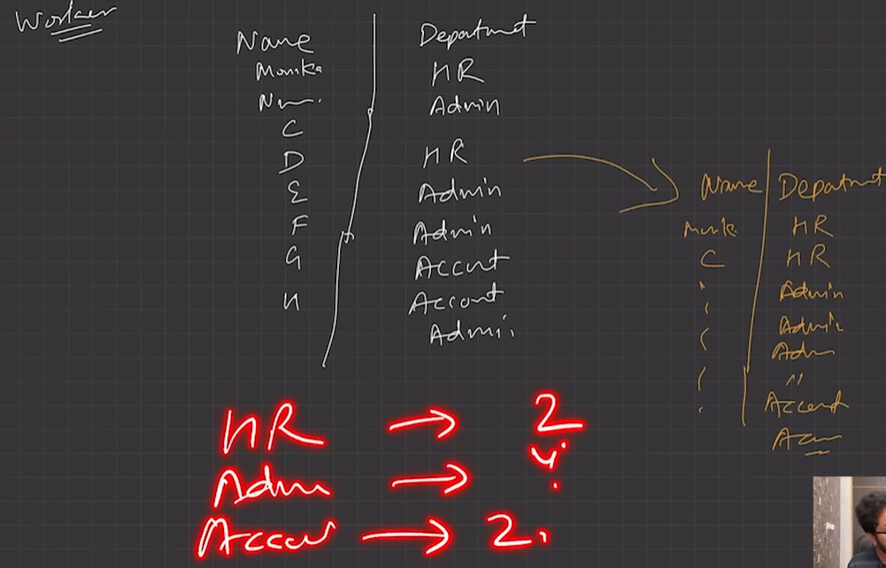
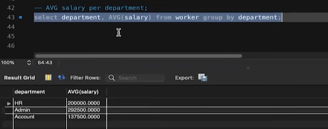
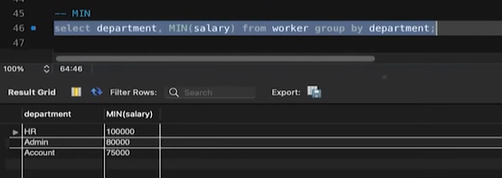
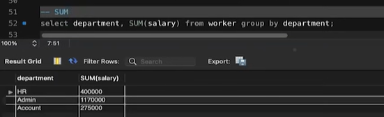

# 2.4.6.4 GROUP BY

Aggregation based on some topic say department, country etc.

GROUP BY keyword used with AGGREGATION FUNCTIONS

When no aggregation applied; same result as DISTINCT; No grouping;

Apply aggregation;

;;,

AVERAGE SALARY PER DEPT:

MIN SALARY:

TOTAL SALARY:

