# 2.4.6.8 DML

INSERT:

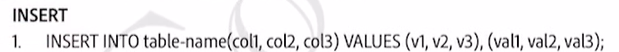

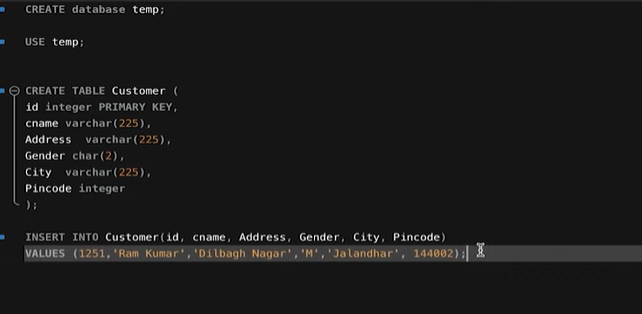

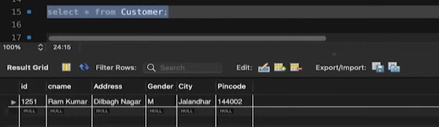

multiple values -

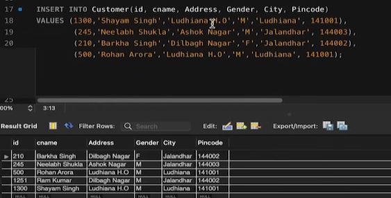

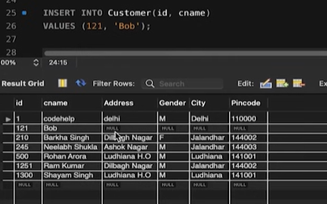

UPDATE:

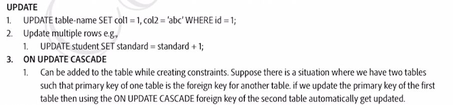

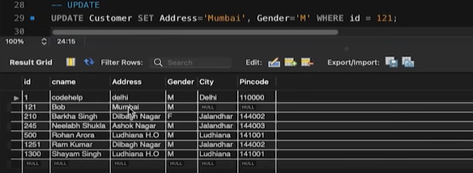

UPDATE MULTIPLE ROWS:

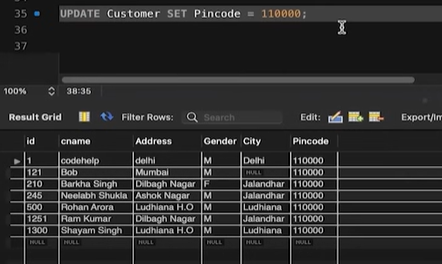

DELETE:

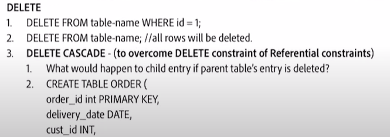

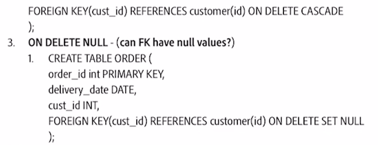

Delete whole table:

Referential constraint in foreign key.  \[IMP FOR INTERVIEW\]

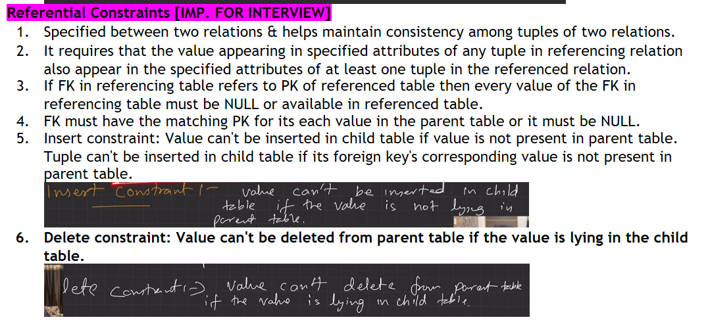

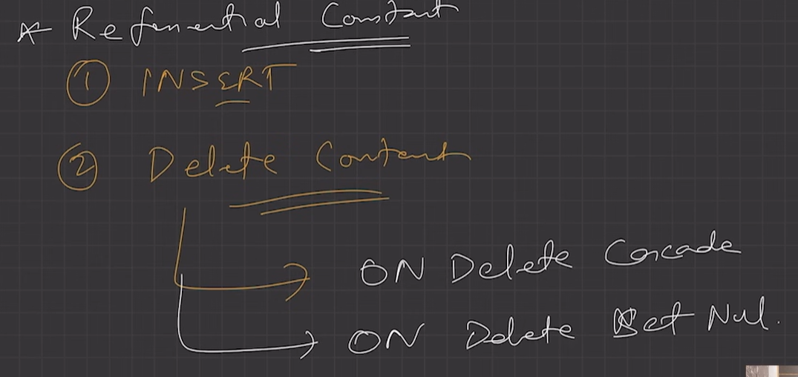

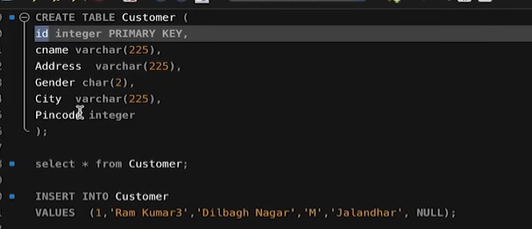

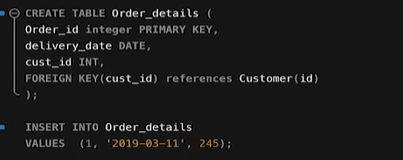

ON DELETE CASCADE:

Integrity constraint that if a customer is deleted than it should be deleted from order table as well, other wise there would be an order of a customer in order table, that doesnt exist in the customer table.

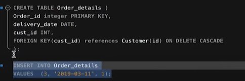

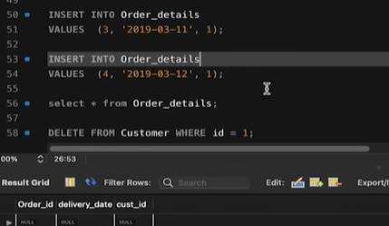

Now deleted from both the tables.

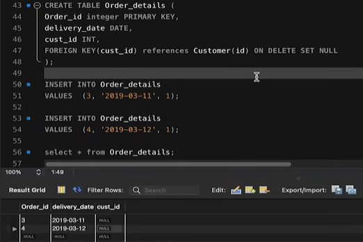

ON DELETE NULL:

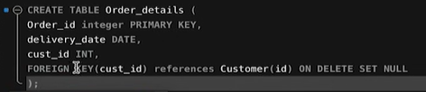

REPLACE:

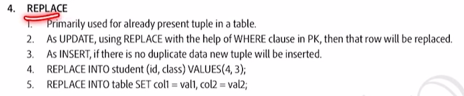

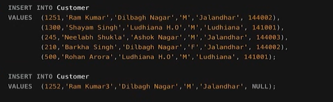

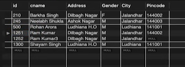

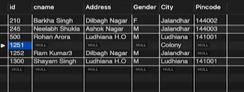

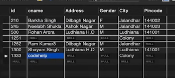

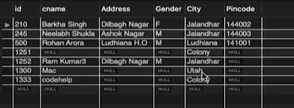

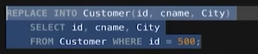

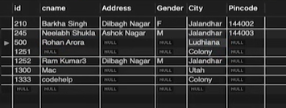

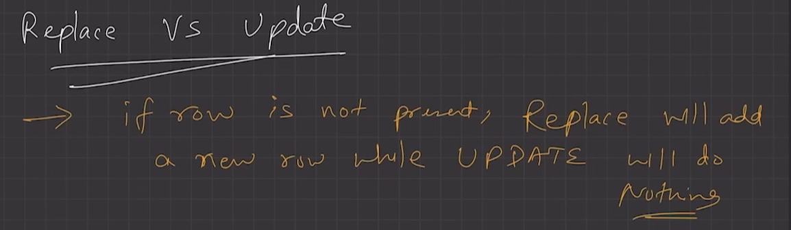
