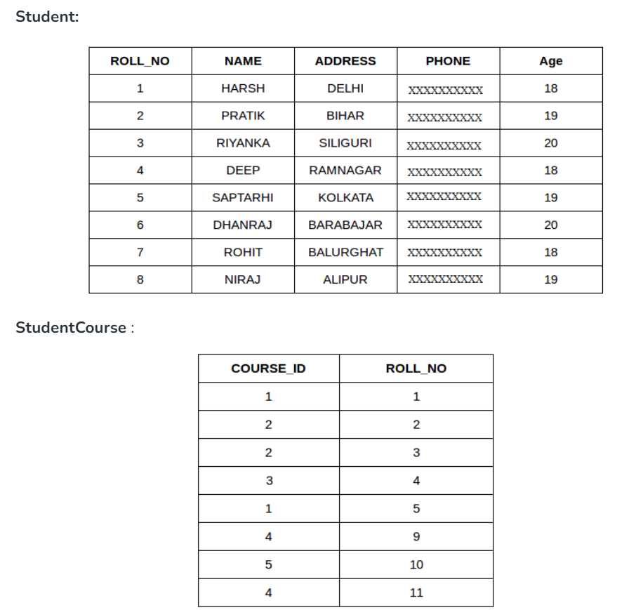
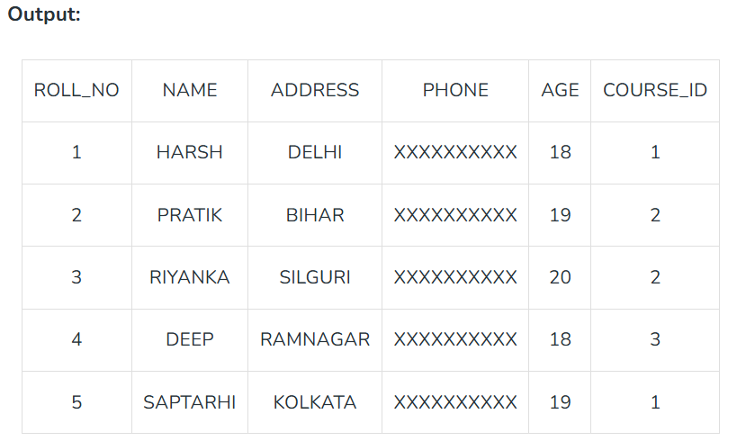
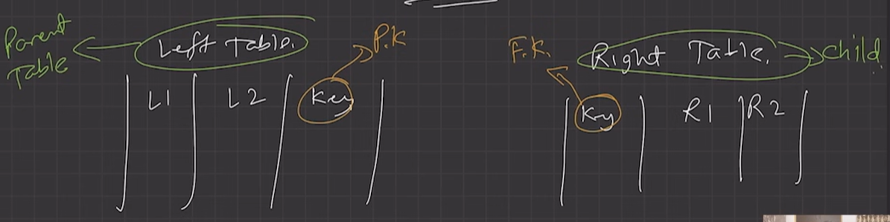
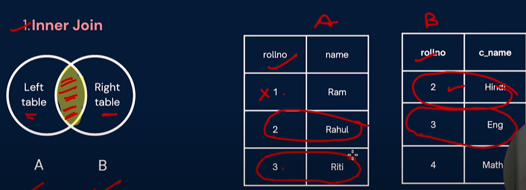
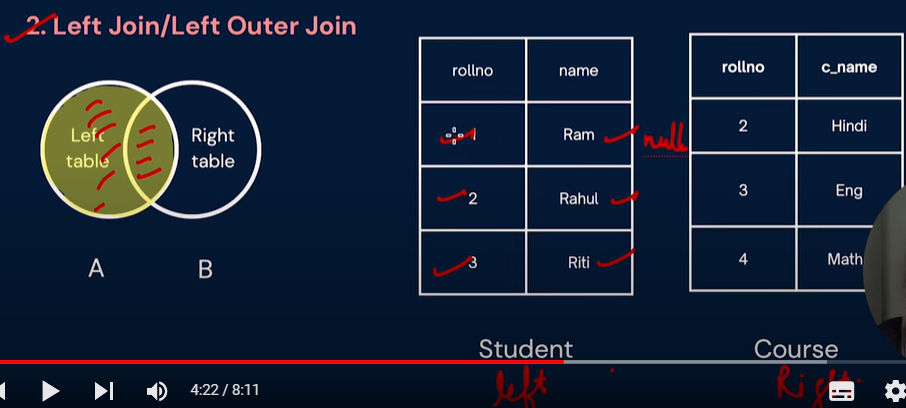
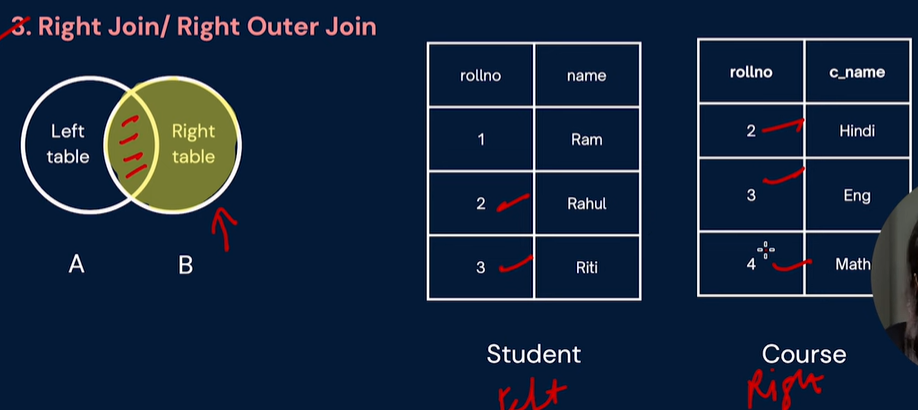
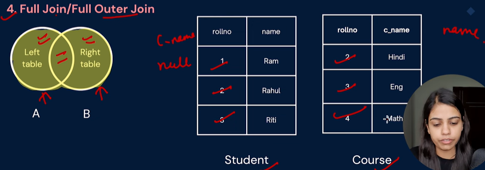
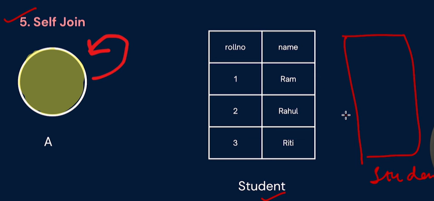
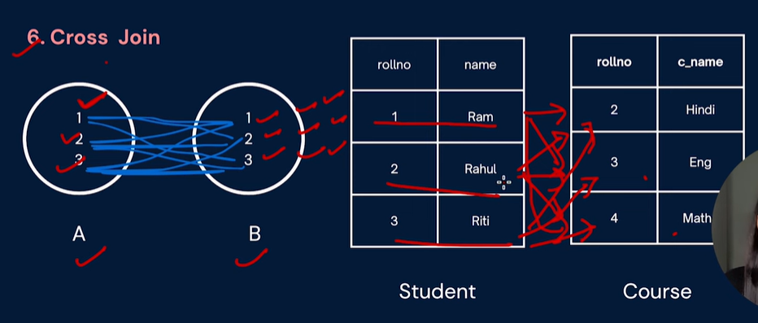

# 2.4.7 SQL JOINS

JOIN combines rows from two or more tables based on a related column to retrieve data from multiple tables.

SQL Join operation combines data or rows from two or more tables based on a common field between them. SQL JOIN clause is used to query and access data from multiple tables by establishing logical relationships between them. It can access data from multiple tables simultaneously using common key values shared across different tables.

Foreign key ka use karke jo relations establish kiye h unka use karke, data fetch kaise karege.

SQL JOIN can also be paired with WHERE clause to filter data retrieval.

INNER JOIN  returns only matching rows from both tables, while LEFT JOIN returns all rows from the left table and matching rows from the right table.

TYPES OF JOINS:

  - INNER JOIN

  - OUTER JOIN

    - LEFT JOIN

  - RIGHT JOIN

Whenever we find that the value is not available, we fill null in it.

  - FULL JOIN

  - SELF JOIN

  - CROSS JOIN

Each row of one table is doing cartesian product with all rows for other table. Number of rows in the final table is n\*n.

  - NATURAL JOIN
