# 2.4.7.1 Inner Join

The INNER JOIN keyword selects all rows from both the tables as long as the condition is satisfied.

It helps us in getting the common rows that have matching values in both tables, according to the given join condition.

This keyword will create the result-set by combining all rows from both the tables where the condition satisfies i.e. value of the common field will be the same.

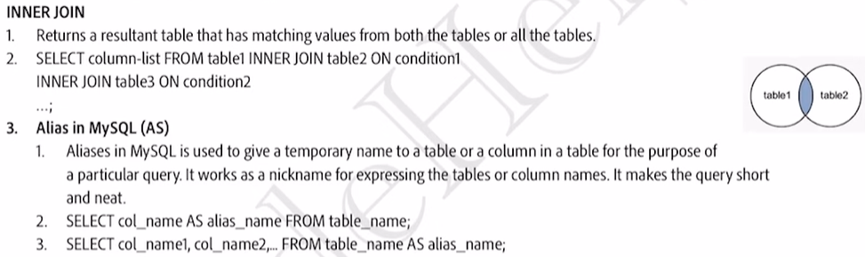

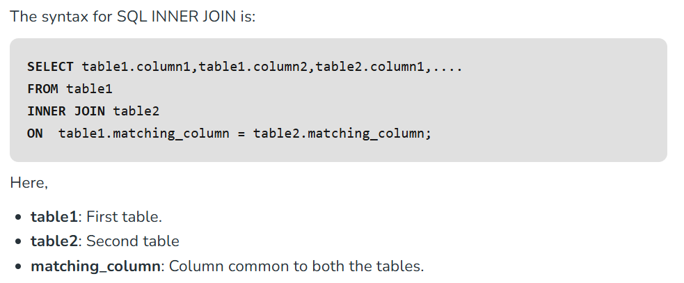

For inner join, we can reverse the order of Table 1 and Table 2 and it will give the same result.

SELECT \*

FROM table2

INNER JOIN table1

ON table1.matching_colum = table2.matching_column

In above query in the output, the matching_column would appear twice.

The INNER JOIN keyword returns only rows with a match in both tables. Which means that if you have a product with no CategoryID, or with a CategoryID that is not present in the Categories table, that record would not be returned in the result.

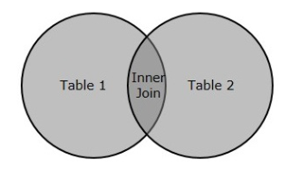

he Inner Join is also referred as Equijoin.

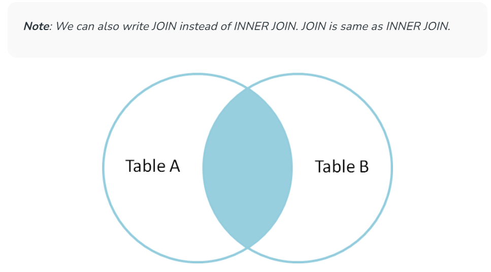

**EXAMPLE 1: **

**Student (ROLL_NO, NAME, ADDRESS, PHONE, AGE)**

**StudentCourse(COURSE_ID, ROLL_NO) **

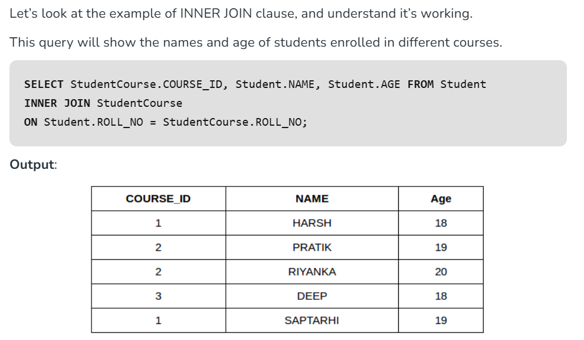

SELECT StudentCourse.COURSE ID, Student. NAME, Student. AGE, **ROLL_NO**

FROM Student

INNER JOIN StudentCourse

ON Student. ROLL NO = StudentCourse. ROLL NO;

You will get an error if you do not specify the table name (because ROLL_NO is present in both tables).

INNER is the default join type for JOIN, so when you write JOIN the parser actually writes INNER JOIN.

**EXAMPLE 2: **

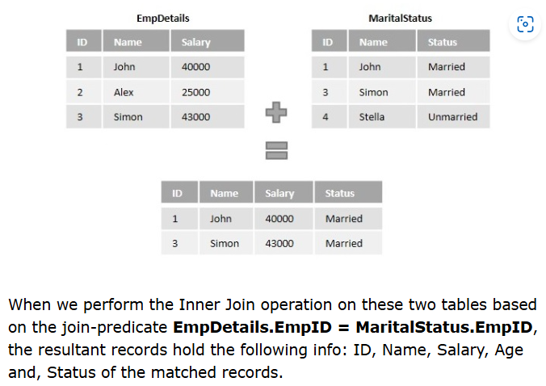

**JOINING MULTIPLE TABLES USING INNER JOINS **

we can also join as many tables as possible, using Inner Join, by specifying the condition (with which these tables are to be joined).

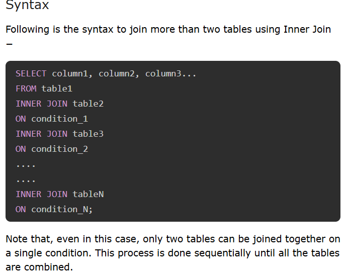

eg:

SELECT OID, DATE, AMOUNT, EMPLOYEE_NAME FROM CUSTOMERS

INNER JOIN ORDERS

ON CUSTOMERS.ID = ORDERS.CUSTOMER_ID

INNER JOIN EMPLOYEE

ON ORDERS.OID = EMPLOYEE.EID;

Inner Join with WHERE Clause

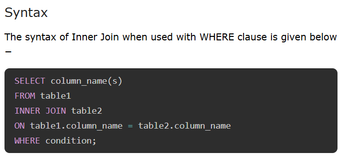

example:

Inner Join uses WHERE clause to apply more constraints on the data to be retrieved. For instance, while retrieving the employee records of an organization, if we only want to check the data of employees that earn more than 25000 in a month, we need to specify a WHERE condition (salary > 25000) to retrieve only those employee records.

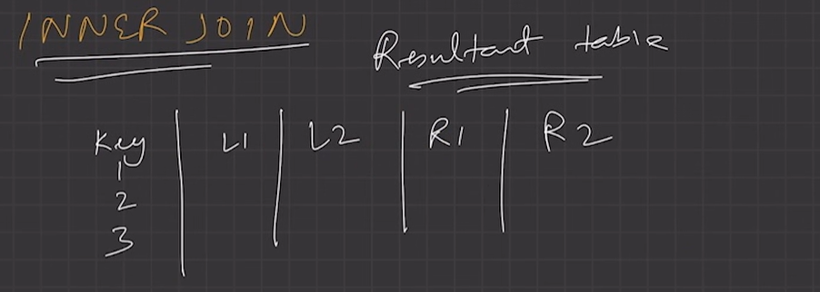

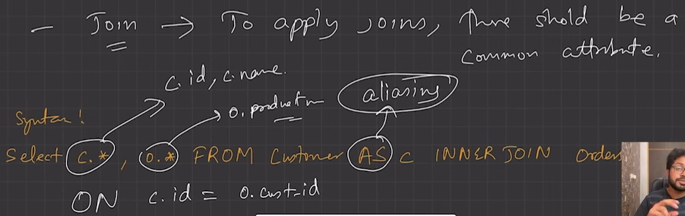

**CAN WE USE INNER JOIN WITHOUT USING JOIN KEYWORD?**

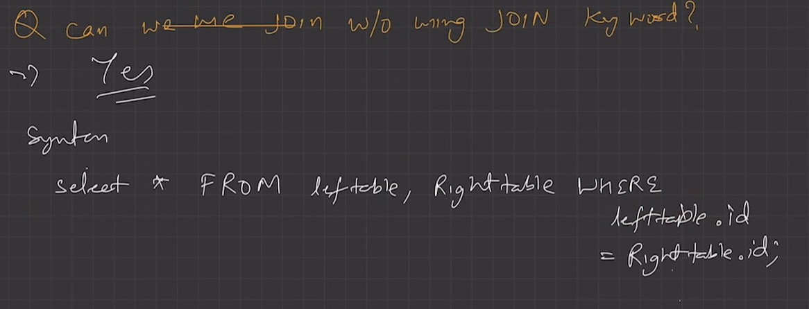

