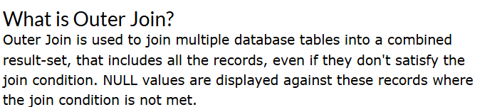
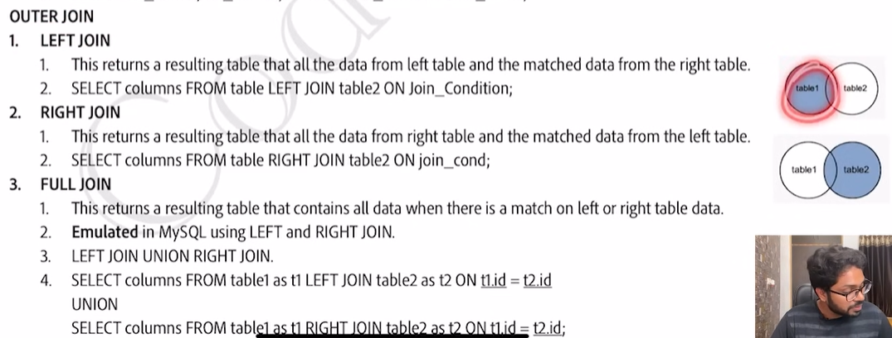
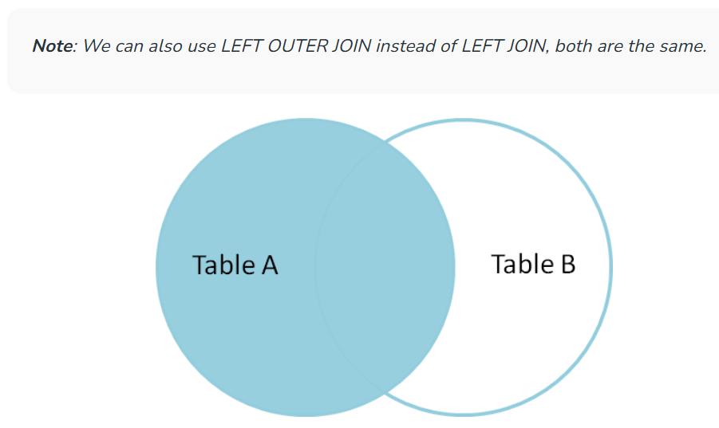
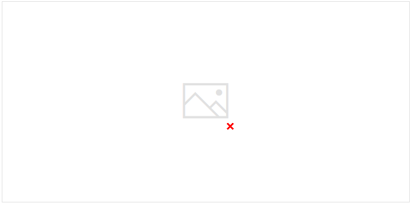
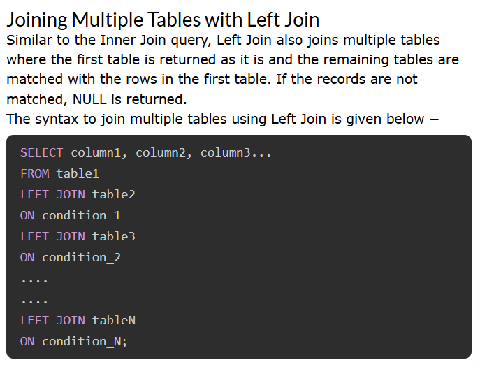
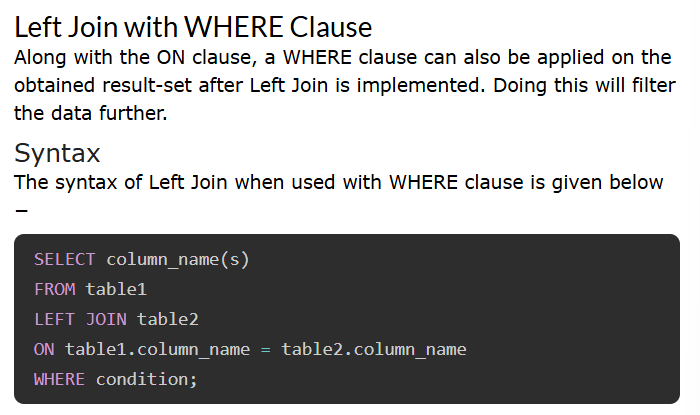

# 2.4.7.2 Left Join

LEFT JOIN returns all the rows of the table on the left side of the join and matches rows for the table on the right side of the join.

Retrieves all the records from the first table, Matching records from the second table and NULL values in the unmatched rows.

For the rows for which there is no matching row on the right side, the result-set will contain null. LEFT JOIN is also known as LEFT OUTER JOIN.

If there is no matching record in the right table, the right table records will contain **NULL values**.

If a certain row is present in the left table but not in the right table, the result will include this row, but with a NULL value in each column from the right table. If a record from the right table is not on the left, it will not be included in the result.

Left Join or Left Outer Join in SQL combines two or more tables, where the first table is returned wholly; but, only the matching record(s) are retrieved from the consequent tables. If zero (0) records are matched in the consequent tables, the join will still return a row in the result, but with NULL in each column from the right table.

If the number of rows in first table is less than the number of rows in second table, the rows in second table that do not have any counterparts in the first table will be discarded from the result.

If we use left join to combine two different tables, then we will get all the records from the left table. But we will get only those records from the right table, which have the corresponding key in the left table. Rest other records in the right table for which the common column value doesn't match with the common column value of the left table; then, it is displayed as NULL.

**Table 1 and Table 2 order should be maintained. **

**Student (ROLL_NO, NAME, ADDRESS, PHONE, AGE)**

**StudentCourse(COURSE_ID, ROLL_NO)**

**LEFT JOIN AS ALIASES**

In this query, we’ll use aliases “e” for the Emp table and “d” for the department table. The [SELECT ](<https://www.geeksforgeeks.org/sql-select-query>)statement references these aliases for each column, making the query easier to read and type. Aliases simplify code and improve readability, especially with long or complex table names.

