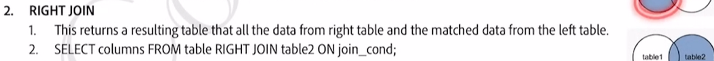
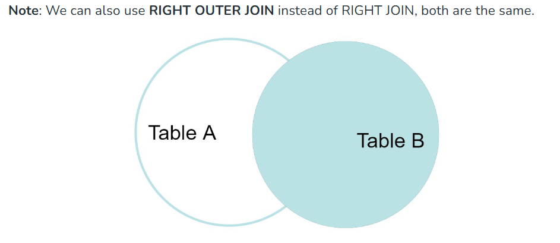
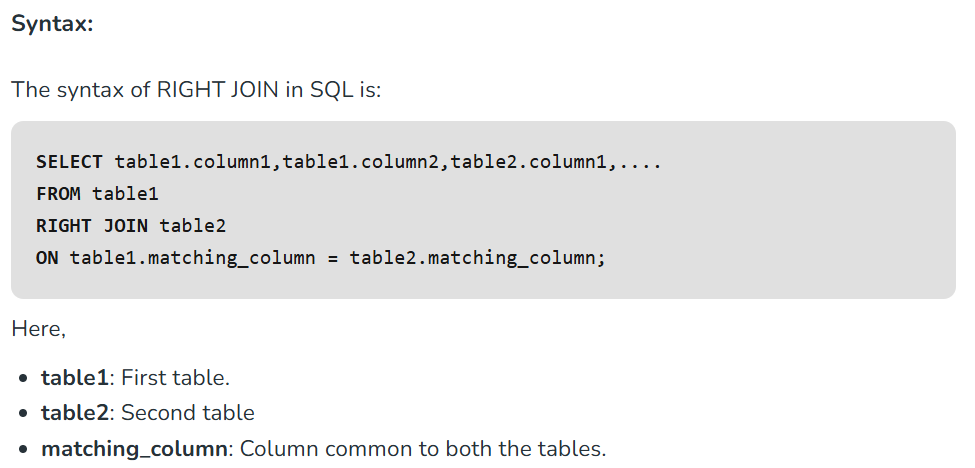
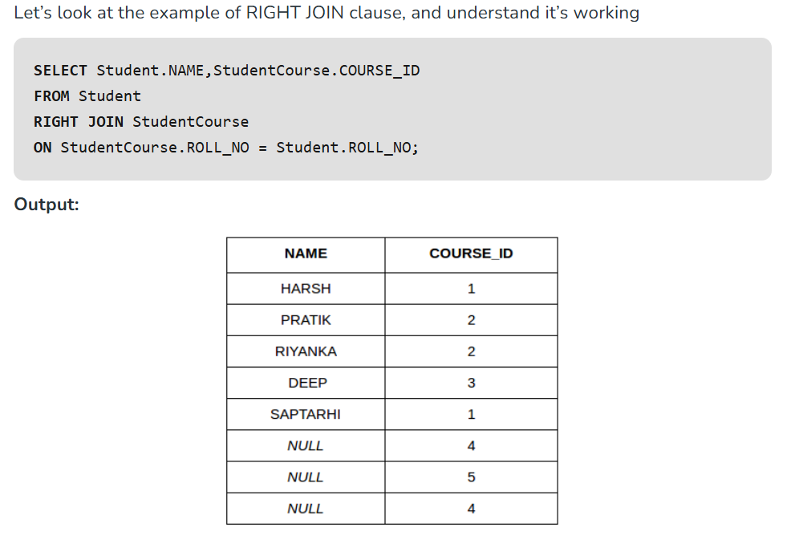
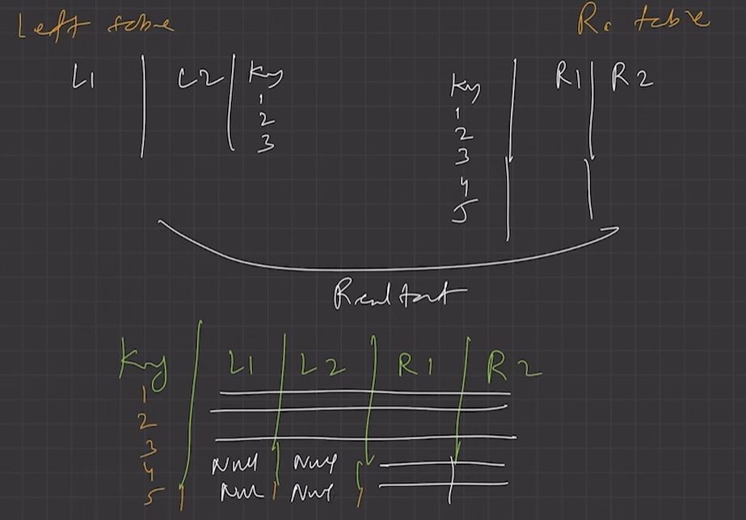

# 2.4.7.3 Right Join

[RIGHT JOIN](<https://www.geeksforgeeks.org/sql-right-join>) returns all the rows of the table on the right side of the join and matching rows for the table on the left side of the join.It is very similar to LEFT JOIN For the rows for which there is no matching row on the left side, the result-set will contain *null*. RIGHT JOIN is also known as RIGHT OUTER JOIN.

**Student (ROLL_NO, NAME, ADDRESS, PHONE, AGE)**

**StudentCourse(COURSE_ID, ROLL_NO)**

