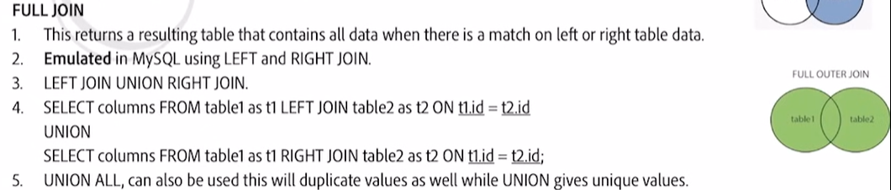
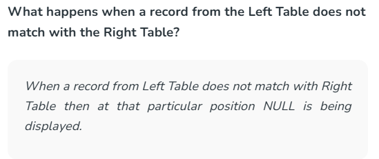
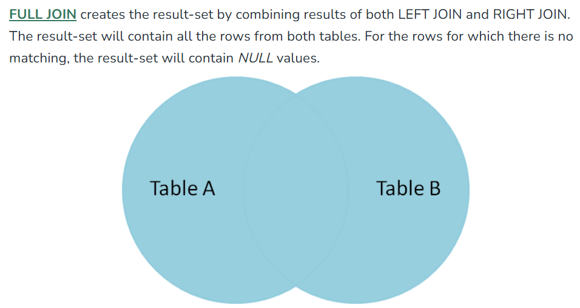
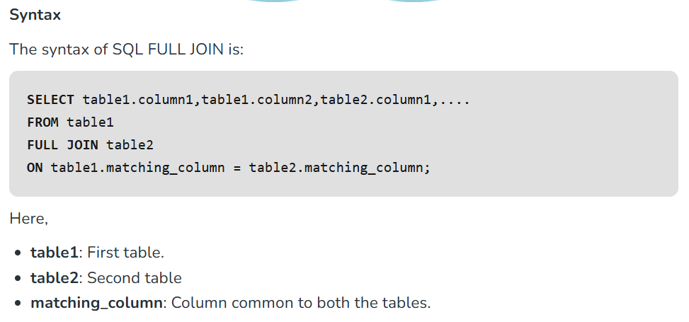
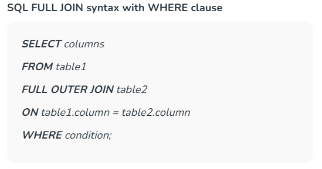
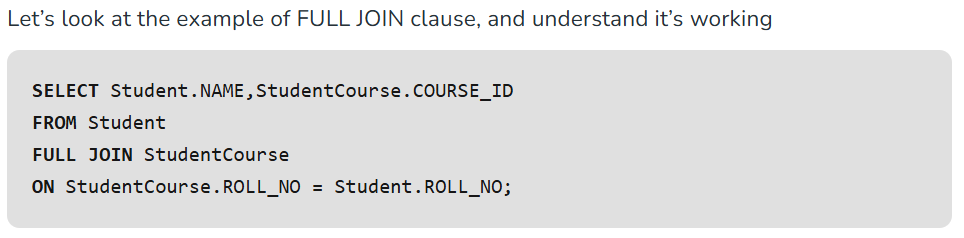
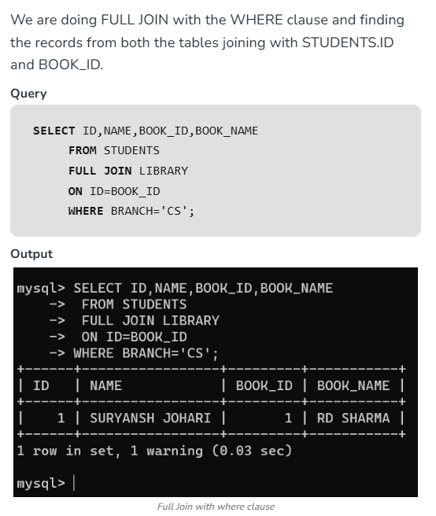
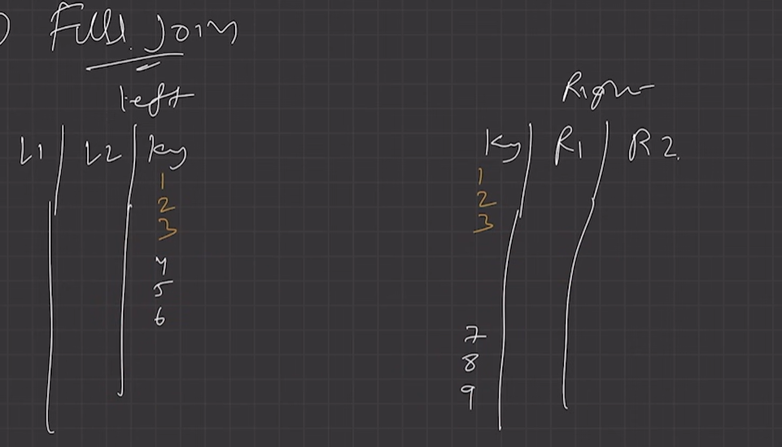
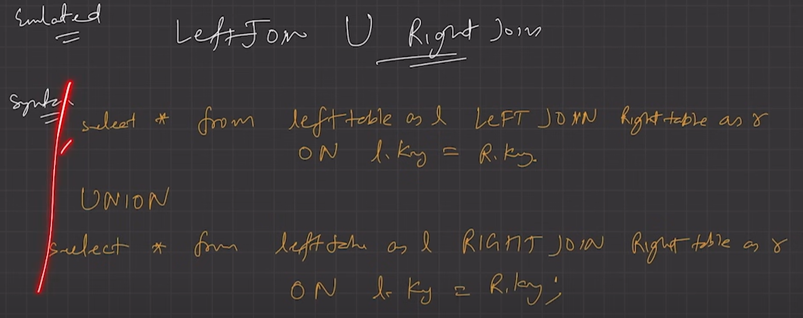

# 2.4.7.4 Full Join

SQL FULL JOIN or FULL OUTER JOIN returns a new table containing all records of the left and right table on a match.

FULL JOIN in SQL combines rows from both tables i.e. left and right table when there is a match in either of the table.

FULL JOIN can be considered as the combination of **LEFT JOIN** and **RIGHT JOIN**.

When there is no match at a given position then **NULL **is displayed at that particular position.

**Tip**: We can use **FULL JOIN** to combine multiple tables, by sequentially performing **FULL JOIN** on two tables at a time.

We can perform the FULL JOIN both with and without the WHERE clause.

| **NAME** | **COURSE_ID** |
| --- | --- |
| HARSH | 1 |
| PRATIK | 2 |
| RIYANKA | 2 |
| DEEP | 3 |
| SAPTARHI | 1 |
| DHANRAJ | NULL |
| ROHIT | NULL |
| NIRAJ | NULL |
| NULL | 4 |
| NULL | 5 |
| NULL | 4 |

EXAMPLE 2:

> **Source image unavailable in the OneNote backup.**
>
> ∕ 、 ~ Ⅹ oJJدnE 囚

