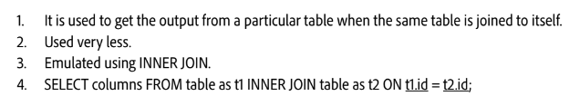
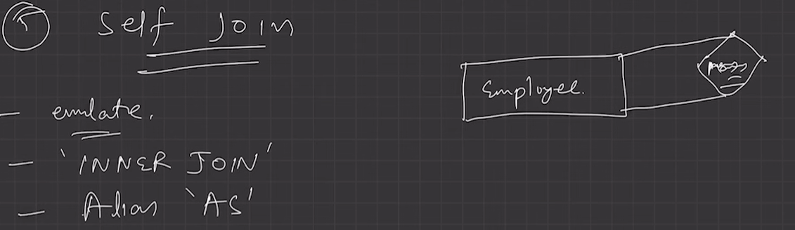
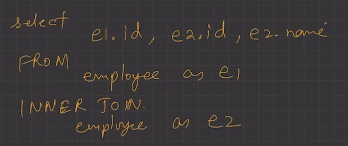
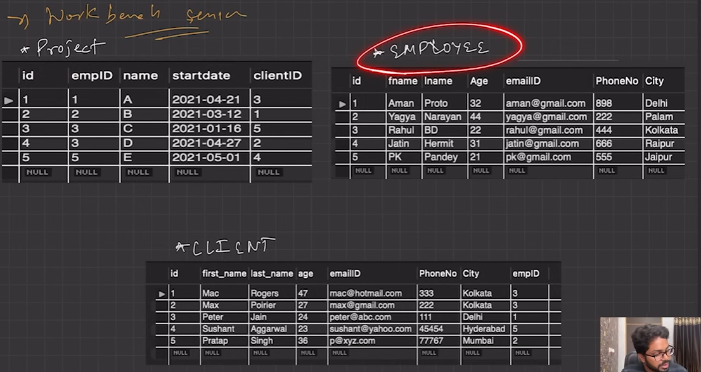
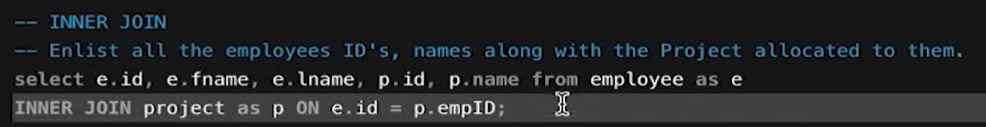
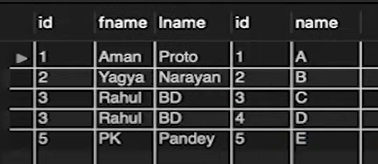

# 2.4.7.7 Self Join

A self-join is when a table is joined with itself, typically using aliases to distinguish between the two instances.

> **Source image unavailable in the OneNote backup.**
>
> - JOIN 
> Enlist all the employees ID •s, 
> "lect * from employee as e 
> names along with the Project allocated to them. 
> Fetch out alt the employee ID's and their contact detail who have been working 
> from Jaipur with the clients name working in Hyderabad. 
> 43:6S 
> fname 
> PK 
> I found 
> Filter Rows: Q 
> Export: 
> PhoneNo City 
> Inane 
> Proto 
> Pandey 
> Age 
> 32 
> 44 
> 21 
> emailID 
> @g-nail_corn 
> rahul@grnad.corn 
> rahut@grna/.com 
> 898 
> 222 
> 444 
> 444 
> Delhi 
> Palam 
> Kol kata 
> Kolkata 
> Jaipur 
> id 
> 2 
> 3 
> 4 
> emplD 
> 2 
> 3 
> name 
> A 
> B 
> c 
> E 
> startdate 
> 2021-04-21 
> 2021-03-12 
> 2021-01-16 
> 2021-04-27 
> 2021-05-01 
> clientlD 
> 3 
> 5 
> 2 
> 4

> **Source image unavailable in the OneNote backup.**

> **Source image unavailable in the OneNote backup.**

> **Source image unavailable in the OneNote backup.**

> **Source image unavailable in the OneNote backup.**

> **Source image unavailable in the OneNote backup.**
