# 2.5.2 LEC-12: ACID PROPERTIES, TRANSACTIONS

  1. **Transaction**

    1. A unit of work done against the DB in a logical sequence.

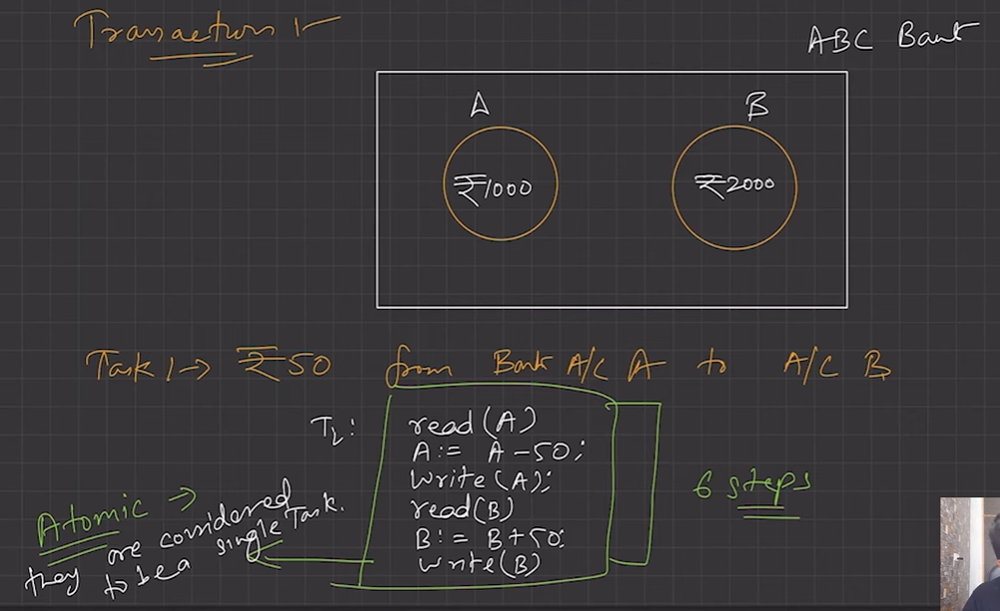

  1. Sequence is very important in transaction.

  1. It is a logical unit of work that contains one or more SQL statements. The result of all these statements in a transaction either gets completed successfully (all the changes made to the database are permanent) or if at any point any failure happens it gets rollbacked (all the changes being done are undone.)

  1. **ACID Properties**

ACID properties are the properties which ensures that transactions are processed reliably

and accurately, even in complex situations(sytem failures/network issues)

A-> Atomicity (Either execute all operations or none)

C-> Consistency (Read should fetch upto date data and write shouldn’t voilate

integrity constraints)

I-> Isolation (One transaction should be independent of other transaction)

D-> Durability (The commited transaction should remain even after a failure/crash)

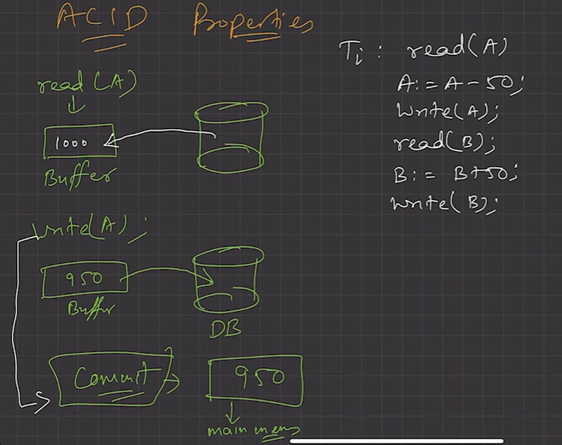

To ensure integrity of the data, we require that the **DB system maintain the following properties of the transaction**:

  1. **Atomicity**

    1. Either all operations of transaction are reflected properly in the DB, or none are.

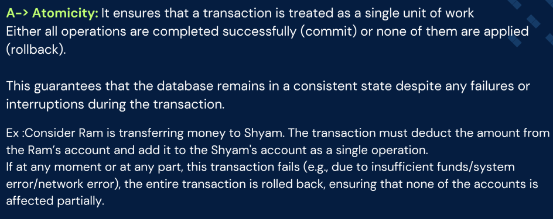

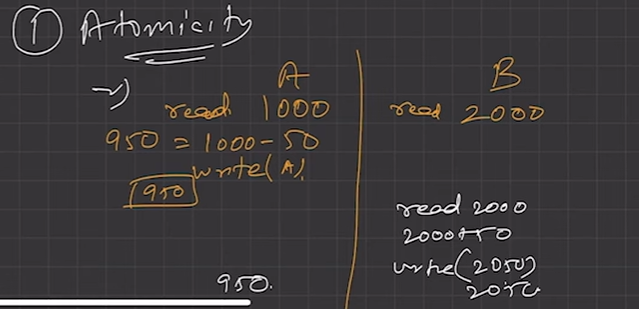

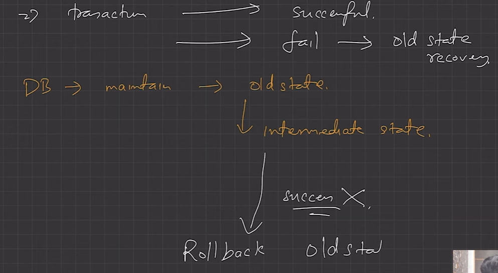

  1. **Consistency**

    1. Integrity constraints must be maintained before and after transaction.

    1. DB must be consistent after transaction happens.

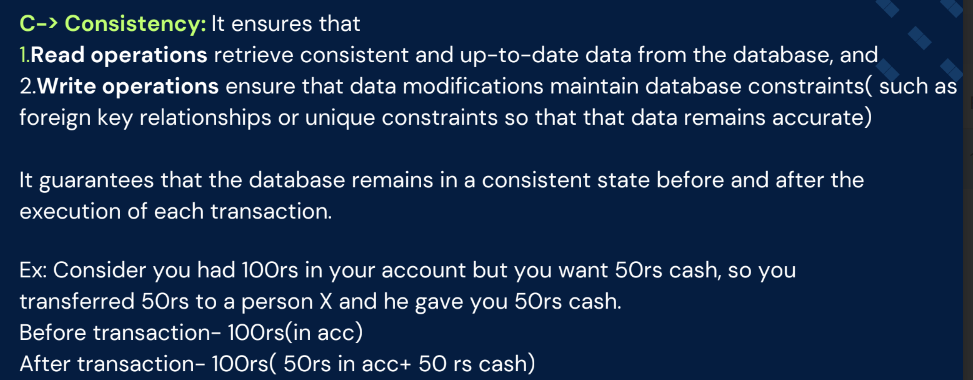

  1. **Isolation**

    1. Even though multiple transactions may execute concurrently, the system guarantees that, for every pair of transactions Ti and Tj, it appears to Ti that either Tj finished execution before Ti started, or Tj started execution after Ti finished. Thus, each transaction is unaware of other transactions executing concurrently in the system.

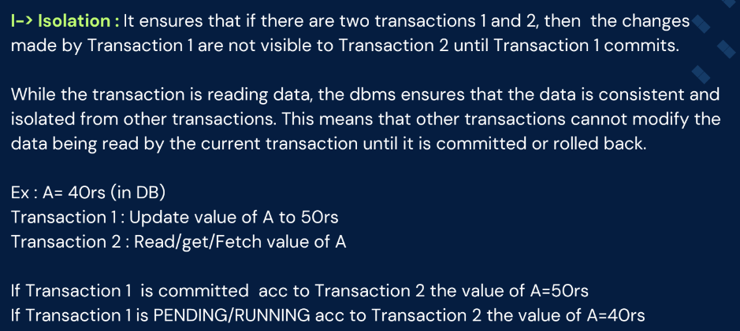

  1. Multiple transactions can happen in the system in isolation, without interfering each other.

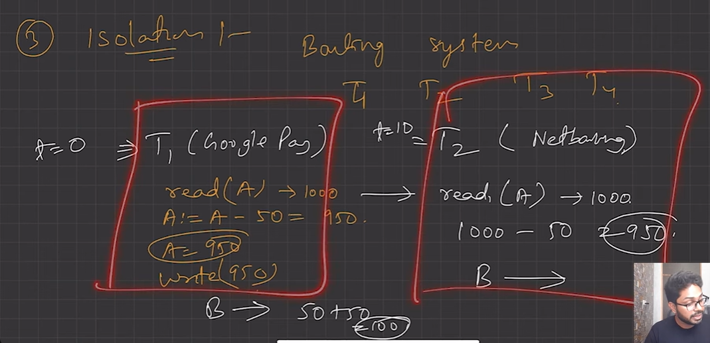

**Transactions ko sequentially chalana padega. T1 success/failure, then only T2 will execute. **

  1. **Durability**

    1. After transaction completes successfully, the changes it has made to the database persist, even if there are system failures.

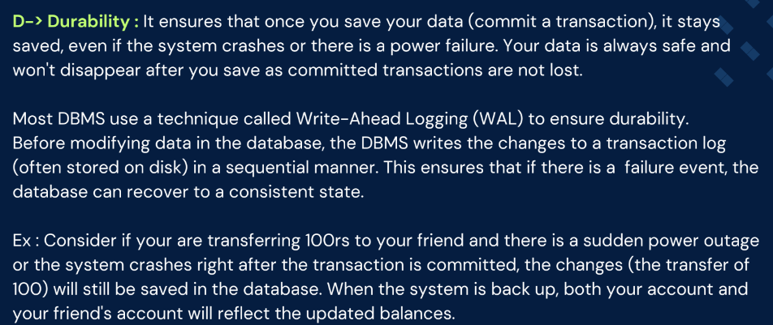

  1. Durability is maintained by Recovery Management Component of DBMS

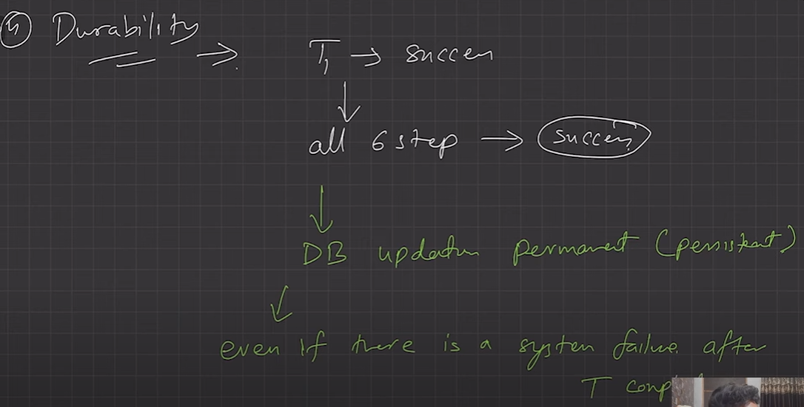

Either write to disk, during the transaction is happening or generate log of what steps have happened so that the state can be regenerated after the system has recovered from failure.

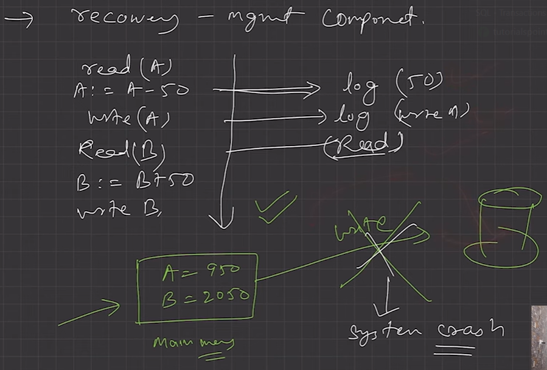
