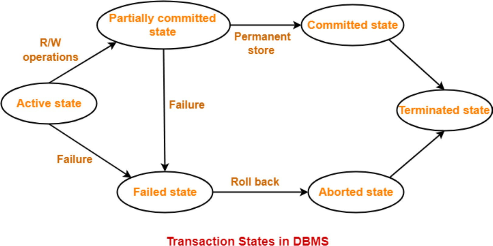

# 2.5.3 Transaction States

1. **Transaction states**

  1. **Active state**

    1. The very first state of the life cycle of the transaction, all the read and write operations are being performed. If they execute without any error the T comes to Partially committed state. Although if any error occurs then it leads to a Failed state.

    1. **Partially committed state**

      1. Aier transaction is executed the changes are saved in the buffer in the main memory. If the changes made are permanent on the DB then the state will transfer to the committed state and if there is any failure, the T will go to Failed state.

    1. **Committed state**

      1. When updates are made permanent on the DB. Then the T is said to be in the committed state. Rollback can’t be done from the committed states. New consistent state is achieved at this stage.

    1. **Failed state**

      1. When T is being executed and some failure occurs. Due to this it is impossible to continue the execution of the T.

    1. **Aborted state**

      1. When T reaches the failed state, all the changes made in the buffer are reversed. After that the T rollback completely. T reaches abort state after rollback. DB’s state prior to the T is achieved.

    1. **Terminated state**

      1. A transaction is said to have terminated if has either committed or aborted.
