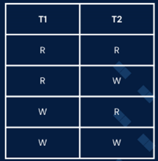
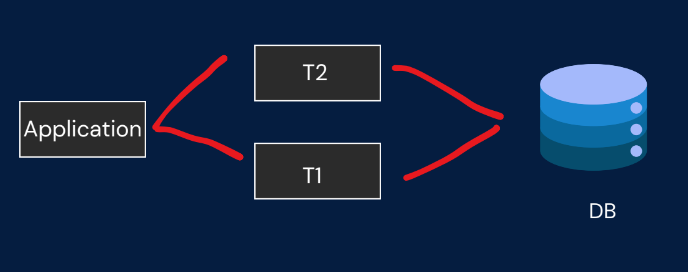
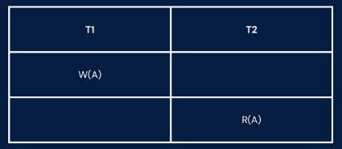
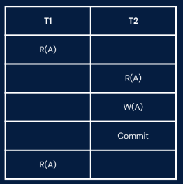
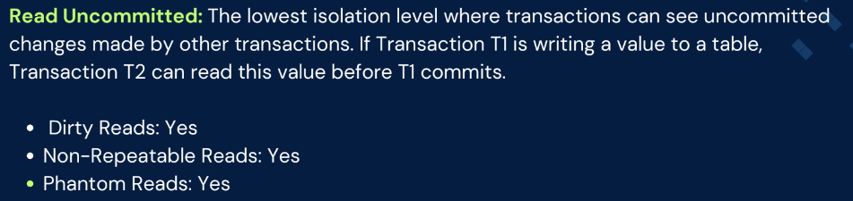
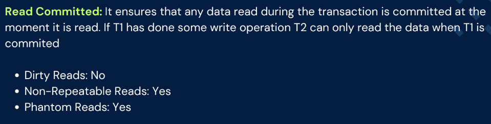
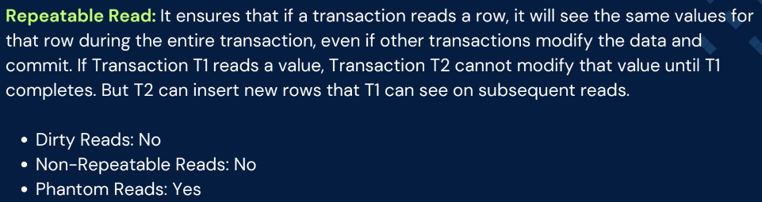
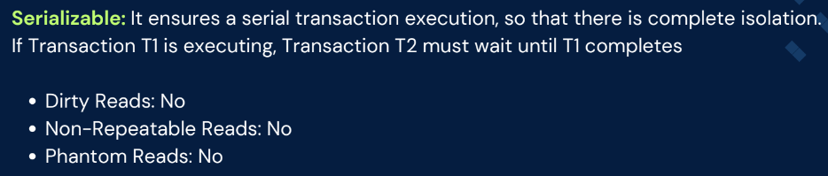

# 2.5.4 Isolation Levels and Types

Why do we need to learn about isolation level?

In systems where multiple transactions are executed concurrently, isolation levels manage

the extent to which the operations of one transaction are isolated from those of other

transactions.

Isolation levels help prevent common transactional anomalies:

• Dirty Read: Reading uncommitted data from another transaction.

• Non-repeatable Read: Data changes after it has been read within the same transaction.

• Phantom Read: New rows are added or removed by another transaction after a query.

Isolation level : It determines the degree to which the operations in one transaction are

isolated from those in other transactions.

Anamolies/Voilations to Isolation level

1.Dirty Read : Reading data written by a transaction that has not yet committed

Consider if T2 reads the data written by T1 and if T1 fails, it becomes irrelevant.

Anamolies/Voilations to Isolation level

2. Non-Repeatable Read : Reading the same row twice within a transaction and getting

different values because another transaction modified the row and committed.

Consider if T2 modifies the data which T1 already Read and if T1 continue the transaction the

data will be changed

3. Phantom Read : Getting different sets of rows in subsequent queries within the same

transaction because another transaction inserted or deleted rows and committed.

T1(Query(id))->Fetch the name

T2(Query(id)) -> Insert a new entry

T1(Query(id))->Fetch the name

ISOLATION LEVELS:

There are 4 isolation levels which helps us with these anamolies:

Types of Isolation Levels

  - Read Uncommitted

  - Read Committed

  - Repeatable Read

  - Serializable

[L61 : Isolation levels and its type \| Complete DBMS Course](<https://www.youtube.com/watch?v=8aOAgyOw420>)
