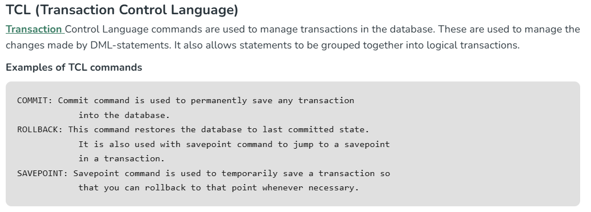

# 2.5.6 SQL - TCL

Transactional Control Commands

Transactional control commands are only used with the **DML Commands** such as - INSERT, UPDATE and DELETE. They cannot be used while creating tables or dropping them because these operations are automatically committed in the database. Following commands are used to control transactions.

  - **COMMIT** − to save the changes.

  - **ROLLBACK** − to roll back the changes.

  - **SAVEPOINT** − creates points within the groups of transactions in which to ROLLBACK.

  - **SET TRANSACTION** − Places a name on a transaction.

The COMMIT Command

The COMMIT command is the transactional command used to save changes invoked by a transaction. It saves all the transactions occurred on the database since the last COMMIT or ROLLBACK.

The syntax for the COMMIT command is as follows.

COMMIT;

Example

Firstly, let us create a table names CUSTOMERS using the following query −

CREATE TABLE CUSTOMERS (

ID INT NOT NULL,

NAME VARCHAR (20) NOT NULL,

AGE INT NOT NULL,

ADDRESS CHAR (25),

SALARY DECIMAL (18, 2),

PRIMARY KEY (ID)

);

We are inserting some records into the above-created table −

INSERT INTO CUSTOMERS VALUES

(1, 'Ramesh', 32, 'Ahmedabad', 2000.00),

(2, 'Khilan', 25, 'Delhi', 1500.00),

(3, 'Kaushik', 23, 'Kota', 2000.00),

(4, 'Chaitali', 25, 'Mumbai', 6500.00),

(5, 'Hardik', 27, 'Bhopal', 8500.00),

(6, 'Komal', 22, 'Hyderabad', 4500.00),

(7, 'Muffy', 24, 'Indore', 10000.00);

The table will be created as follows −

| ID | NAME | AGE | ADDRESS | SALARY |
| --- | --- | --- | --- | --- |
| 1 | Ramesh | 32 | Ahmedabad | 2000.00 |
| 2 | Khilan | 25 | Delhi | 1500.00 |
| 3 | Kaushik | 23 | Kota | 2000.00 |
| 4 | Chaitali | 25 | Mumbai | 6500.00 |
| 5 | Hardik | 27 | Bhopal | 8500.00 |
| 6 | Komal | 22 | Hyderabad | 4500.00 |
| 7 | Muffy | 24 | Indore | 10000.00 |

Following query would delete those records from the table which have AGE as 25 and then COMMIT the changes in the database.

DELETE FROM CUSTOMERS WHERE AGE = 25;

COMMIT;

Verification

The two rows from the table would be deleted and if you verify the contents of the CUSTOMERS table using the SELECT statement as −

SELECT \* FROM CUSTOMERS;

The table will be displayed as follows −

| ID | NAME | AGE | ADDRESS | SALARY |
| --- | --- | --- | --- | --- |
| 1 | Ramesh | 32 | Ahmedabad | 2000.00 |
| 3 | Kaushik | 23 | Kota | 2000.00 |
| 5 | Hardik | 27 | Bhopal | 8500.00 |
| 6 | Komal | 22 | Hyderabad | 4500.00 |
| 7 | Muffy | 24 | Indore | 10000.00 |

The ROLLBACK Command

The ROLLBACK command is the transactional command used to undo transactions that have not already been saved to the database. This command can only undo transactions since the last COMMIT or ROLLBACK.

The syntax for a ROLLBACK command is as follows −

ROLLBACK;

Example

Consider the CUSTOMERS table having the following records −

| ID | NAME | AGE | ADDRESS | SALARY |
| --- | --- | --- | --- | --- |
| 1 | Ramesh | 32 | Ahmedabad | 2000.00 |
| 2 | Khilan | 25 | Delhi | 1500.00 |
| 3 | Kaushik | 23 | Kota | 2000.00 |
| 4 | Chaitali | 25 | Mumbai | 6500.00 |
| 5 | Hardik | 27 | Bhopal | 8500.00 |
| 6 | Komal | 22 | Hyderabad | 4500.00 |
| 7 | Muffy | 24 | Indore | 10000.00 |

Following query would delete those records from the table where the AGE value is 25 and then ROLLBACK the changes in the database.

DELETE FROM CUSTOMERS WHERE AGE = 25;

ROLLBACK;

Verification

The delete operation would not impact the table and the SELECT statement would produce the following result.

| ID | NAME | AGE | ADDRESS | SALARY |
| --- | --- | --- | --- | --- |
| 1 | Ramesh | 32 | Ahmedabad | 2000.00 |
| 2 | Khilan | 25 | Delhi | 1500.00 |
| 3 | Kaushik | 23 | Kota | 2000.00 |
| 4 | Chaitali | 25 | Mumbai | 6500.00 |
| 5 | Hardik | 27 | Bhopal | 8500.00 |
| 6 | Komal | 22 | Hyderabad | 4500.00 |
| 7 | Muffy | 24 | Indore | 10000.00 |

The SAVEPOINT Command

A SAVEPOINT is a logical rollback point in a transaction.

Usually, when you execute the ROLLBACK command, it undoes the changes until the last COMMIT. But, if you create save points you can partially roll the transaction back to these points. You can create multiple save points between two commits.

The syntax to create a SAVEPOINT among the transactions is as shown below.

SAVEPOINT savepoint_name;

Then, to roll back to the SAVEPOINT created, you can use the following syntax −

ROLLBACK TO savepoint_name;

Example

Following is an example where you plan to delete the three different records from the CUSTOMERS table. You want to create a SAVEPOINT before each delete, so that you can ROLLBACK to any SAVEPOINT at any time to return the appropriate data to its original state.

Consider the CUSTOMERS table having the following records.

| ID | NAME | AGE | ADDRESS | SALARY |
| --- | --- | --- | --- | --- |
| 1 | Ramesh | 32 | Ahmedabad | 2000.00 |
| 2 | Khilan | 25 | Delhi | 1500.00 |
| 3 | Kaushik | 23 | Kota | 2000.00 |
| 4 | Chaitali | 25 | Mumbai | 6500.00 |
| 5 | Hardik | 27 | Bhopal | 8500.00 |
| 6 | Komal | 22 | Hyderabad | 4500.00 |
| 7 | Muffy | 24 | Indore | 10000.00 |

The following code block contains the series of operations.

SAVEPOINT SP1;

Query OK, 0 rows affected (0.00 sec)

DELETE FROM CUSTOMERS WHERE ID=1;

Query OK, 1 row affected (0.01 sec)

SAVEPOINT SP2;

Query OK, 0 rows affected (0.00 sec)

DELETE FROM CUSTOMERS WHERE ID=2;

Query OK, 0 rows affected (0.00 sec)

SAVEPOINT SP3;

Query OK, 0 rows affected (0.00 sec)

DELETE FROM CUSTOMERS WHERE ID=3;

Query OK, 1 row affected (0.01 sec)

Now that the three deletions have taken place, let us assume that you have changed your mind and decided to ROLLBACK to the SAVEPOINT that you identified as SP2. Because SP2 was created after the first deletion, the last two deletions are undone −

ROLLBACK TO SP2;

Verification

If you display the CUSTOMERS table, you can notice that only the first deletion took place since you rolled back to SP2.

| ID | NAME | AGE | ADDRESS | SALARY |
| --- | --- | --- | --- | --- |
| 2 | Khilan | 25 | Delhi | 1500.00 |
| 3 | Kaushik | 23 | Kota | 2000.00 |
| 4 | Chaitali | 25 | Mumbai | 6500.00 |
| 5 | Hardik | 27 | Bhopal | 8500.00 |
| 6 | Komal | 22 | Hyderabad | 4500.00 |
| 7 | Muffy | 24 | Indore | 10000.00 |

The RELEASE SAVEPOINT Command

The RELEASE SAVEPOINT command is used to remove an existing SAVEPOINT.

The syntax for a RELEASE SAVEPOINT command is as follows.

RELEASE SAVEPOINT SAVEPOINT_NAME;

Once a SAVEPOINT has been released, you can no longer use the ROLLBACK command to undo transactions performed since the last SAVEPOINT.

The SET TRANSACTION Command

The SET TRANSACTION command can be used to initiate a database transaction. This command is used to specify characteristics for the transaction that follows. For example, you can specify a transaction to be read only or read write.

Syntax

The syntax for a SET TRANSACTION command is as follows.

SET TRANSACTION \[ READ WRITE | READ ONLY \];
