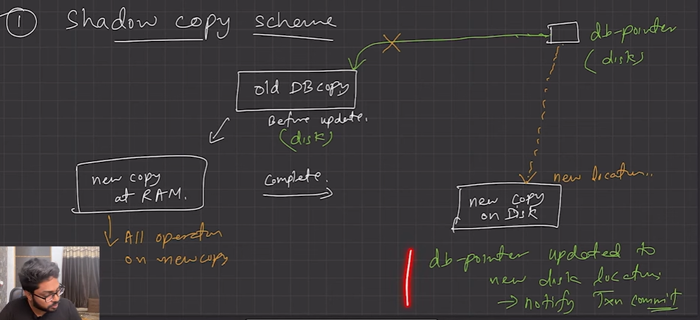
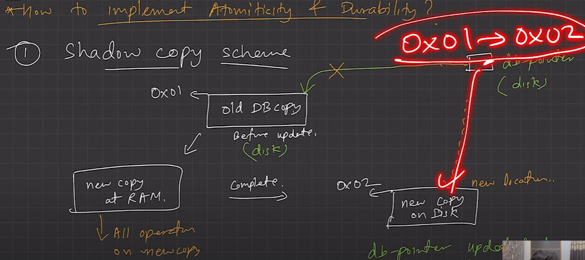
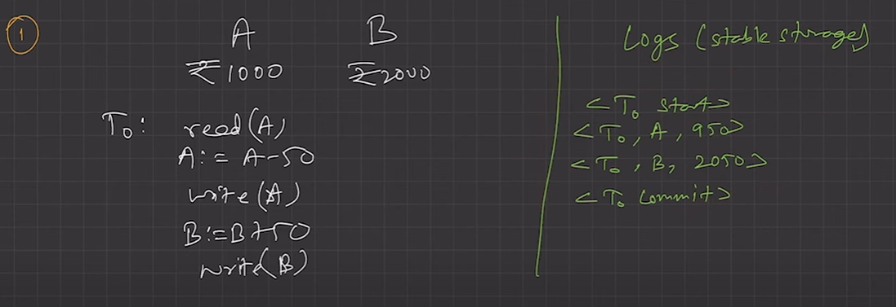
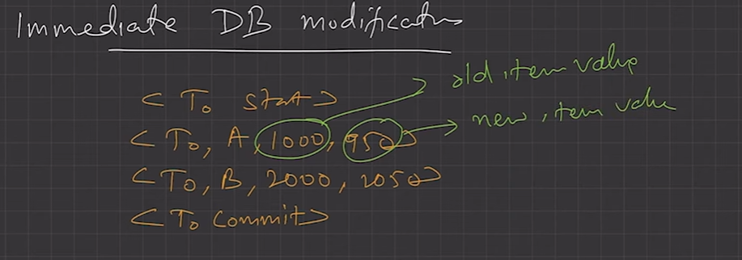

# 2.5.7 LEC-13: How to implement Atomicity and Durability in Transactions

  1. **Recovery Mechanism Component **of DBMS supports **atomicity and durability.**

  1. **Shadow-copy scheme**

    1. Based on making copies of DB (aka, **shadow copies)**.

    1. Assumption only one Transaction (T) is active at a time.

    1. A pointer called **db-pointer **is maintained on the **disk**; which at any instant points to current copy of DB.

    1. T, that wants to update DB first creates a complete copy of DB.

  1. All further updates are done on new DB copy leaving the original copy (shadow copy) untouched.

  1. If at any point the **T has to be aborted **the system deletes the new copy. And the old copy is not affected.

  1. If T success, it is committed as,

    1. OS makes sure all the pages of the new copy of DB written on the disk.

    1. DB system updates the db-pointer to point to the new copy of DB.

    1. New copy is now the current copy of DB.

    1. The old copy is deleted.

    1. The T is said to have been **COMMITTED **at the point where the updated db-pointer is written to disk.

  1. **Atomicity**

    1. If T fails at any time before db-pointer is updated, the old content of DB are not affected.

    1. T abort can be done by just deleting the new copy of DB.

    1. Hence, either all updates are reflected or none.

  1. **Durability**

    1. Suppose, system fails are any time before the updated db-pointer is wriUen to disk.

    1. When the system restarts, it will read db-pointer G will thus, see the original content of DB and none of the effects of T will be visible.

    1. T is assumed to be successful only when db-pointer is updated.

    1. If **system fails after **db-pointer has been updated. Before that all the pages of the new copy were written to disk. Hence, when system restarts, it will read new DB copy.

  1. The implementation is dependent on write to the db-pointer being atomic. Luckily, disk system provide atomic updates to entire block or at least a disk sector. So, we make sure db-pointer lies entirely in a single sector. By storing db-pointer at the beginning of a block.

  1. **Inefficient**, as entire DB is copied for every Transaction.

  1. **Log-based recovery methods**

    1. The log is a sequence of records. Log of each transaction is maintained in some **stable storage (atomic, robust, recoverable) **so that if any failure occurs, then it can be recovered from there.

    1. If any operation is performed on the database, then it will be recorded in the log.

  1. But the process of storing the logs should be done **before **the actual transaction is applied in the database.

  1. **Stable storage **is a classification of computer data storage technology that guarantees atomicity for any given write operation and allows software to be written that is robust against some hardware and power failures.

  1. **Deferred DB Modifications**

    1. Ensuring **atomicity **by recording all the DB modifications in the log but deferring the execution of all the write operations until the final action of the T has been executed.

    1. Log information is used to execute deferred writes when T is completed.

    1. If system crashed before the T completes, or if T is aborted, the information in the logs are ignored.

    1. If T completes, the records associated to it in the log file are used in executing the deferred writes.

    1. If failure occur while this updating is taking place, we preform redo.

  1. **Immediate DB Modifications**

    1. DB modifications to be output to the DB while the T is still in active state.

    1. DB modifications written by active T are called uncommitted modifications.

  1. In the event of crash or T failure, system uses old value field of the log records to restore modified values.

  1. Update takes place only after log records in a stable storage.

  1. Failure handling

    1. System failure before T completes, or if T aborted, then old value field is used to undo the T.

    1. If T completes and system crashes, then new value field is used to redo T having commit logs in the logs.

  1. **CheckPoints** : - The checkpoint is a type of mechanism where all the previous logs are removed from the system and permanently stored in the storage disk. - The checkpoint is like a bookmark. While the execution of the transaction, such checkpoints are marked, and the transaction is executed then using the steps of the transaction, the log files will be created. - When it reaches to the checkpoint, then the transaction will be updated into the database, and till that point, the entire log file will be removed from the file. Then the log file is updated with the new step of transaction till next checkpoint and so on. - The checkpoint is used to declare a point before which the DBMS was in the consistent state, and all transactions were committed.
