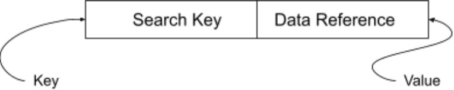
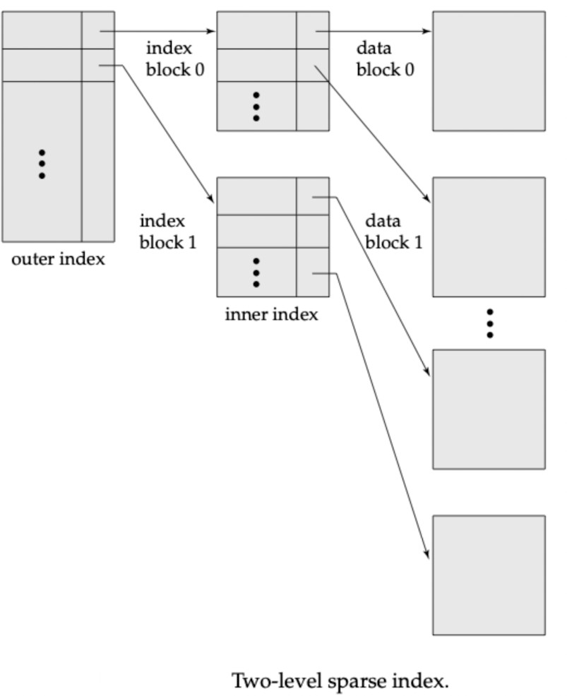

# 2.6.1 LEC-14: Indexing in DBMS

  1. **Indexing **is used to **optimise the performance **of a database by minimising the number of disk accesses required when a query is processed.

  1. The index is a type of **data structure. **It is used to locate and access the data in a database table quickly.

**Speeds up operation **with read operations like **SELECT **queries, **WHERE **clause etc.

  1. **Search Key**: Contains copy of primary key or candidate key of the table or something else.

  1. **Data Reference**: Pointer holding the address of disk block where the value of the corresponding key is stored.

  1. Indexing is **optional**, but increases access speed. It is not the primary mean to access the tuple, it is the secondary mean.

  1. **Index file is always sorted.**

  1. **Indexing Methods**

    1. **Primary Index (Clustering Index)**

      1. A file may have several indices, on different search keys. If the data file containing the records is sequentially ordered, a Primary index is an index whose search key also defines the sequential order of the file.

      1. **NOTE**: The term primary index is sometimes used to mean an index on a primary key. However, such usage is

**nonstandard **and **should be avoided.**

  1. All files are ordered sequentially on some search key. It could be Primary Key or non-primary key.

  1. **Dense And Sparse Indices**

    1. **Dense Index**

      1. The dense index contains an index record for every search key value in the data file.

      1. The index record contains the search-key value and a pointer to the first data record with that search-key value.

The rest of the records with the same search-key value would be stored sequentially aier the first record.

  1. It needs more space to store index record itself. The index records have the search key and a pointer to the actual record on the disk.

  1. **Sparse Index**

    1. An index record appears for only some of the search-key values.

    1. Sparse Index helps you to resolve the issues of dense Indexing in DBMS. In this method of indexing technique, a range of index columns stores the same data block address, and when data needs to be retrieved, the block address will be fetched.

  1. Primary Indexing can be based on Data file is sorted w.r.t Primary Key attributeor non-key aUributes.

  1. **Based on Key aUribute**

    1. Data file is sorted w.r.t primary key aUribute.

    1. PK will be used as search-key in Index.

    1. Sparse Index will be formed i.e., no. of entries in the index file = no. of blocks in datafile.

  1. **Based on Non-Key aUribute**

    1. Data file is sorted w.r.t non-key aUribute.

    1. No. Of entries in the index = unique non-key attributevalue in the data file.

This is dense index as, all the unique values have an entry in the index file.

  1. E.g., Let’s assume that a company recruited many employees in various departments. In this case, clustering indexing in DBMS should be created for all employees who belong to the same dept.

  1. **Multi-level Index**

    1. Index with two or more levels.

    1. If the single level index become enough large that the binary search it self would take much time, we can break down indexing into multiple levels.

  1. **Secondary Index (Non-Clustering Index)**

    1. Datafile is unsorted. Hence, Primary Indexing is not possible.

    1. Can be done on key or non-key aUribute.

    1. Called secondary indexing because normally one indexing is already applied.

    1. No. Of entries in the index file = no. of records in the data file.

    1. It's an example of Dense index.

  1. **Advantages of Indexing**

    1. Faster access and retrieval of data.

    1. IO is less.

  1. **Limitations of Indexing**

    1. Additional space to store index table

    1. Indexing Decrease performance in INSERT, DELETE, and UPDATE query.
