# 2.7.1 LEC-11: Normalisation

1. **Normalization **is a step towards DB optimization.

1. **Functional Dependency (FD)**

  1. It's a relationship between the primary key attribute (usually) of the relation to that of the other attribute of the relation.

  1. X -> Y, the left side of FD is known as a **Determinant**, the right side of the production is known as a **Dependent**.

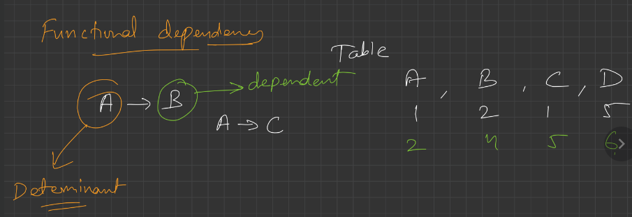

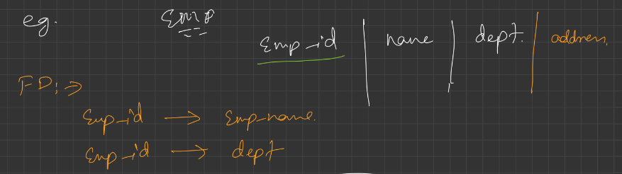

1. **Types of FD**

  1. **Trivial FD**

    1. A -> B has trivial functional dependency if B is a subset of A. A -> A, B->B are also Trivial FD.

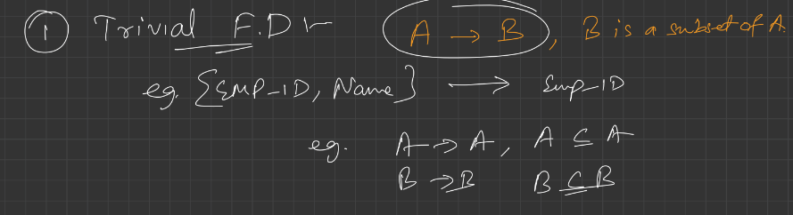

1. **Non-trivial FD**

  1. A -> B has a non-trivial functional dependency if B is not a subset of A. \[A intersection B is NULL\].

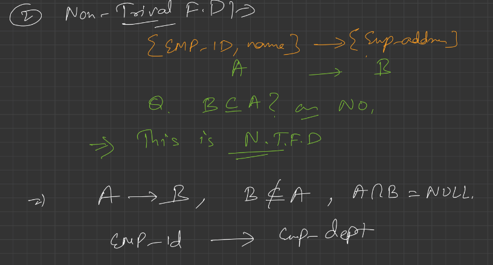

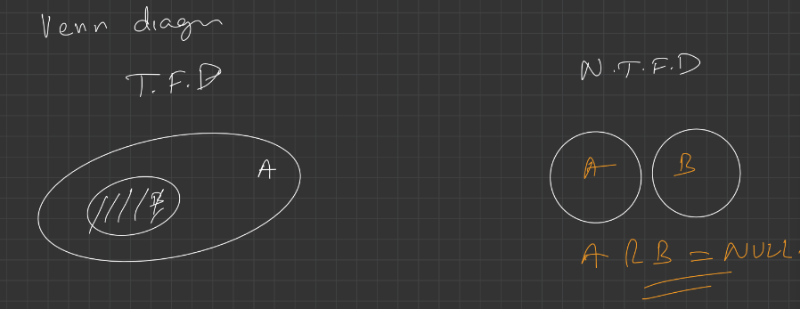

1. **Rules of FD (Armstrong’s axioms)**

  1. **Reflexive**

    1. If ‘A’ is a set of attributes and ‘B’ is a subset of ‘A’. Then, Aэ B holds.

    1. If A ⊇ B then A -> B.

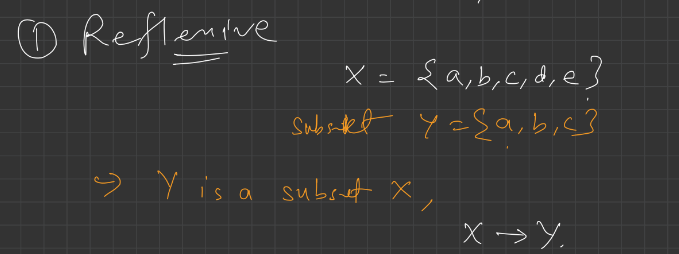

1. **Augmentation**

  1. If B can be determined from A, then adding an attribute to this functional dependency won’t change anything.

  1. If A -> B holds, then AX -> BX holds too. ‘X’ being a set of attributes.

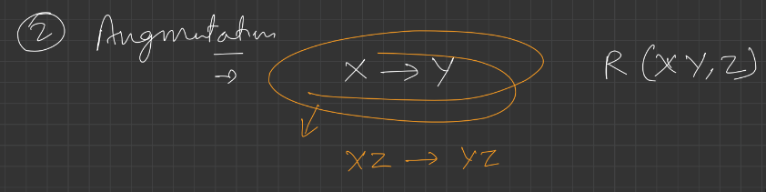

1. **Transitivity**

  1. If A determines B and B determines C, we can say that A determines C.

  1. if A -> B and B -> C then A-> C.

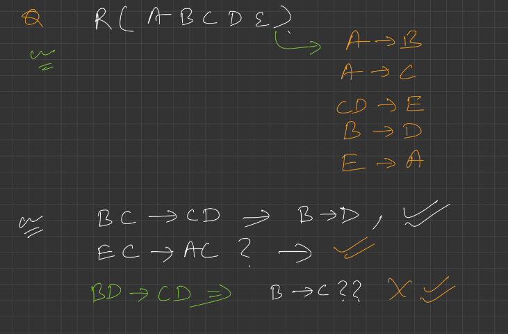

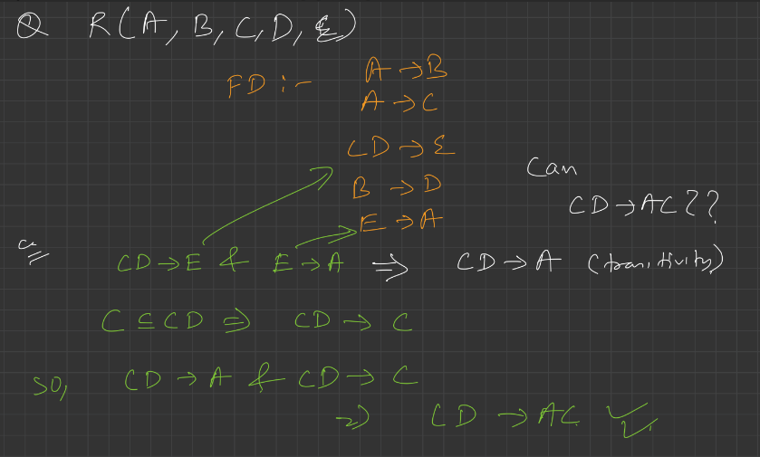

1. **Why Normalization?**

  1. To avoid redundancy in the DB, not to store redundant data.

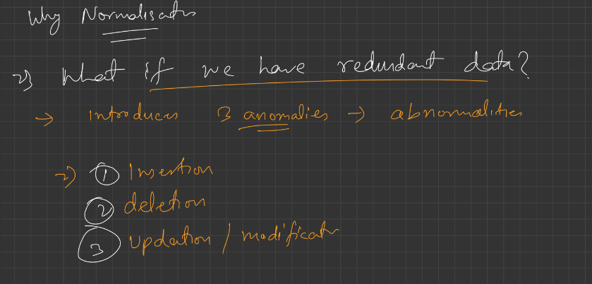

1. **What happen if we have redundant data?**

  1. Insertion, deletion and updation anomalies arises.

1. **Anomalies**

  1. Anomalies means abnormalities, there are three types of anomalies introduced by data redundancy.

  1. **Insertion anomaly**

    1. When certain data (attribute) can not be inserted into the DB without the presence of other data.

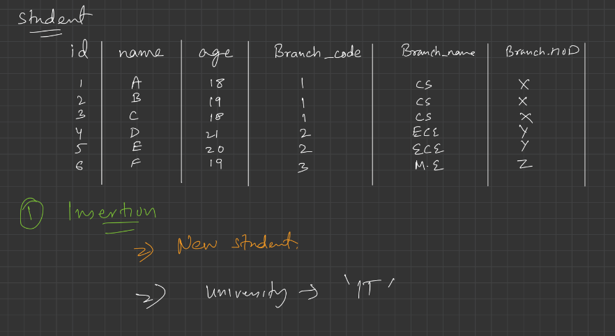

Not able to add 7 due to absence of branch data. But existence of student and branch should be independent.

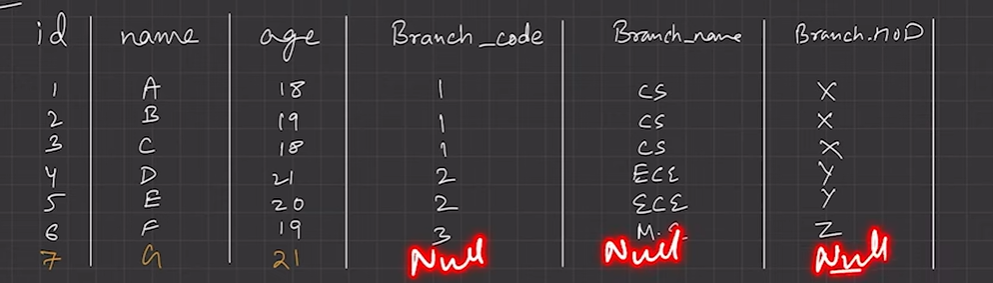

1. **Deletion anomaly**

  1. The delete anomaly refers to the situation where the deletion of data results in the unintended loss of some other important data.

ME branch lost, since only one student was there and it was deleted.

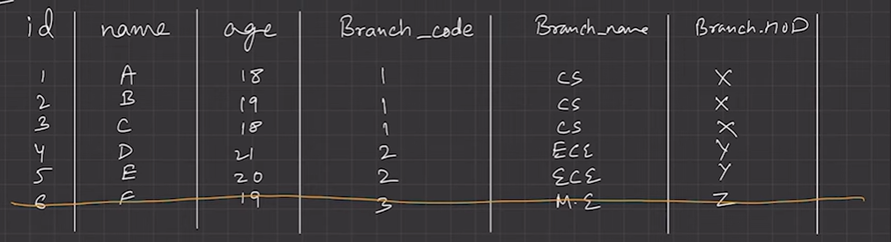

1. **Updation anomaly **(or modification anomaly)

  1. The update anomaly is when an update of a single data value requires multiple rows of data to be updated.

  1. Due to updation to many places, may be **Data inconsistency **arises, if one forgets to update the data at all the intended places.

example of normalisation -

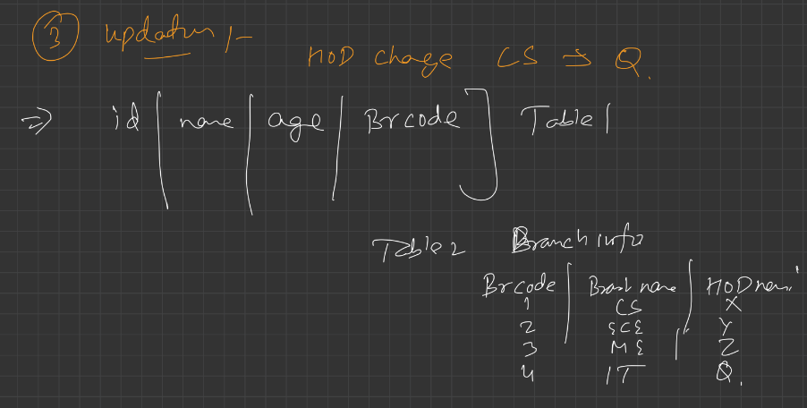

  1. Due to these anomalies, **DB size increases **and **DB performance become very slow.**

  1. To rectify these anomalies and the effect of these of DB, we use **Database optimization technique **called **NORMALISATION**.

  1. **What is Normalization?**

    1. Normalisation is used to minimise the redundancy from a relations. It is also used to eliminate undesirable characteristics like Insertion, Update, and Deletion Anomalies.

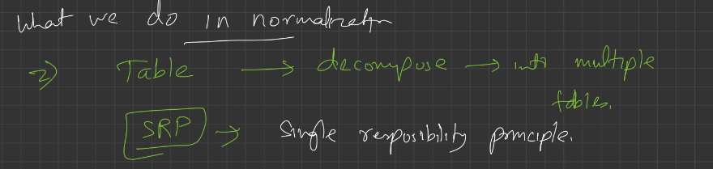

  1. Normalisation divides the composite attributes into individual attributes OR larger table into smaller and links them using relationships.

  1. Keep decomposing the table until SRP is achieved.

  1. The normal form is used to reduce redundancy from the database table.

  1. **Types of Normal forms**

    1. **1NF**

      1. Every relation cell must have atomic value.

      1. Relation must not have multi-valued attributes.

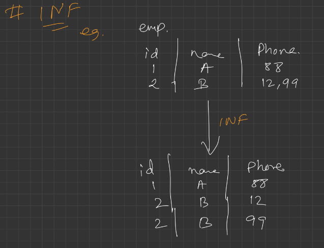

  1. **2NF**

    1. Relation must be in 1NF.

    1. There should not be any partial dependency.

      1. All non-prime attributes must be fully dependent on PK.

      1. Non-prime attribute can not depend on the part of the PK.

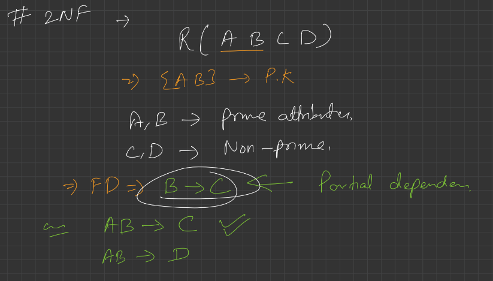

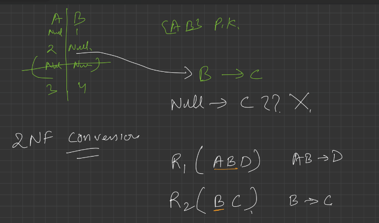

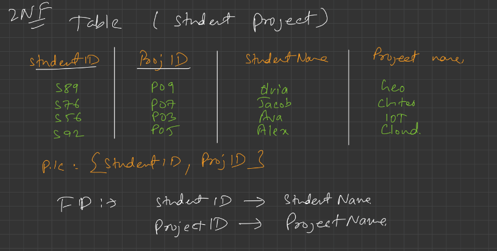

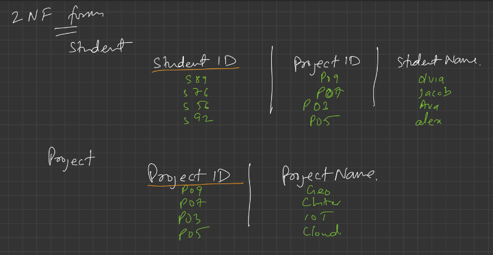

  1. **3NF**

    1. Relation must be in 2NF.

    1. No transitivity dependency exists.

**1.    **Non-prime attribute should not find a non-prime attribute.

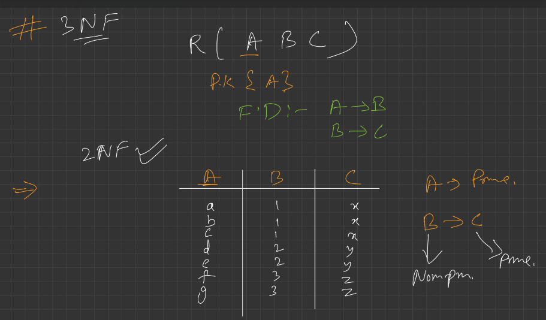

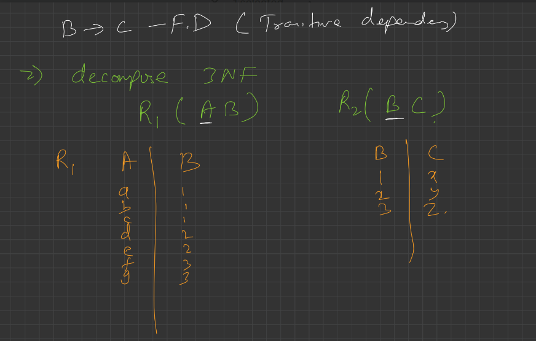

  1. **BCNF (Boyce-Codd normal form)**

    1. Relation must be in 3NF.

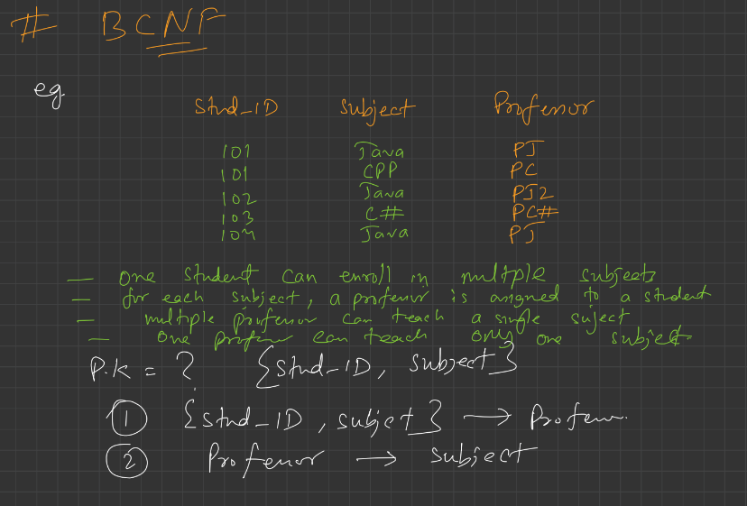

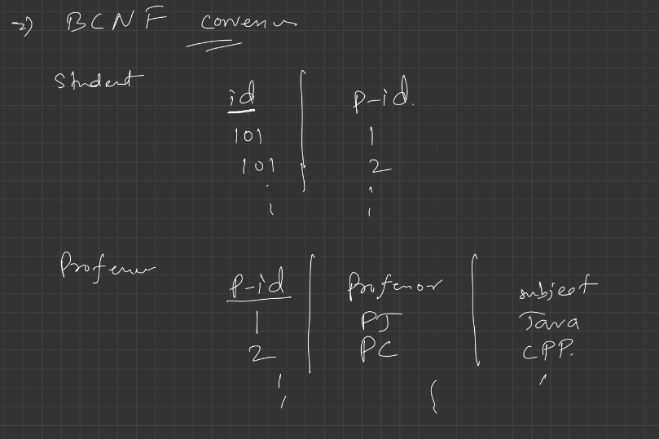

  1. FD: A -> B, A must be a super key.

**1.    **We must not derive prime attribute from any prime or non-prime aUribute.

  1. **Advantages of Normalisation**

    1. Normalisation helps to minimise data redundancy.

    1. Greater overall database organisation.

    1. Data consistency is maintained in DB.
