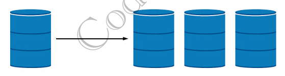
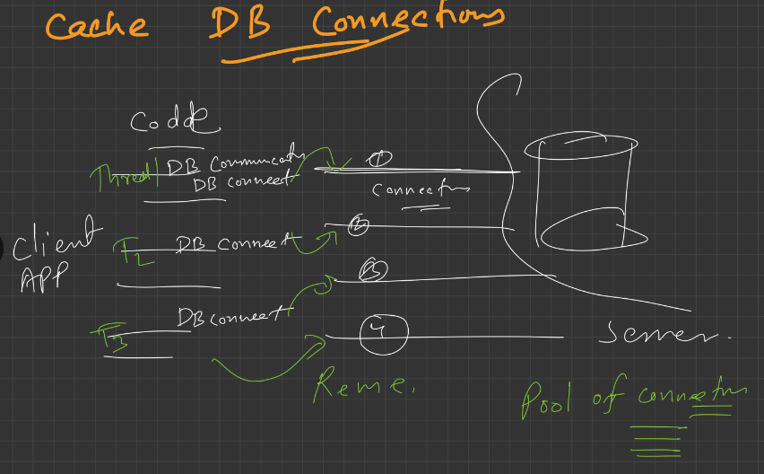
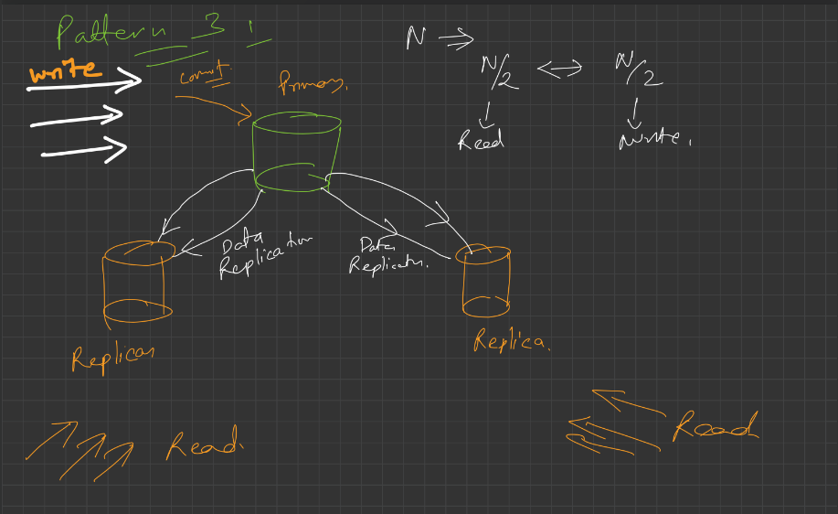
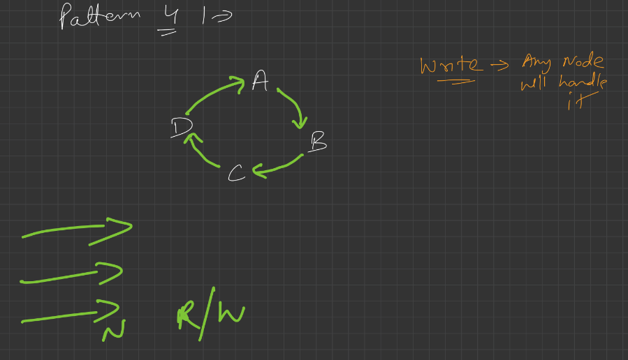
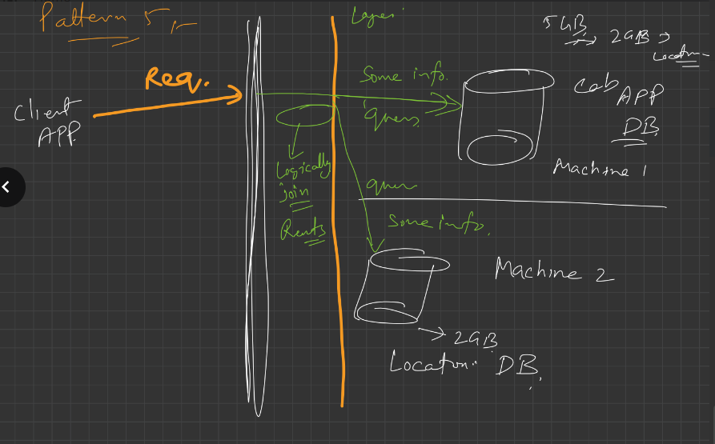
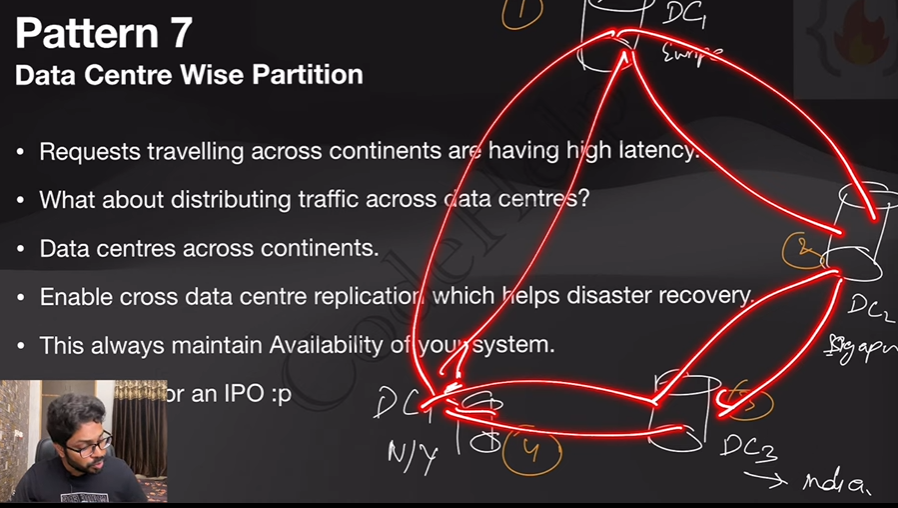

# 2.8.1 Lecture 19: Database Scaling Patterns

What will you learn?

• Step by Step manner, when to choose which Scaling option.

• Which Scaling option is feasible practically at the moment.

A Case Study Cab Booking APP

• Tiny startup.

• ~10 customers onboard.

• A single small machine DB stores all customers, trips, locations, booking data, and customer trip history.

• ~1 trip booking in 5 mins.

Your App becoming famous, but… The PROBLEM begins

• Requests scales upto 30 bookings per minute. Concurrent requests.

• Your tiny DB system has started performing poorly.  Large amount of data.

• API latency has increased a lot.

• Transactions facing Deadlock, Starvation, and frequent failure.

• Sluggish App experience.

• Customer dis-satisfaction

Is there any solution?

• We have to apply some kind of performance optimisation measures.

• We might have to scale our system going forward.

**DATABASE SCALING**

**Pattern 1 **

**Query Optimisation & Connection Pool Implementation **

• Cache frequently used non-dynamic data like, booking history, payment history, user profiles etc.  Store past data on client app directly. Dynamic data such as current ride cost, traffic etc. only should be fetched from server.

• Introduce Database Redundancy. (Or may be use NoSQL). Earlier we use to normalise the DB, then a query when comes hits all the tables, and outputs the "joins" from each table. Instead of dividing, introduce redundancy to improve performance. Or use NoSQL DB.

• Use connection pool libraries to Cache DB connections.

• Multiple application threads can use same DB connection.

• Good optimisations as of now.

• Scaled the business to one more city, and now getting ~100 booking per minute

**Pattern 2 **

**Vertical Scaling or Scale-up **

• Upgrading our initial tiny machine.

• RAM by 2x and SSD by 3x etc.

• Scale up is pocket friendly till a point only.

• More you scale up, cost increases exponentially.

• Good Optimisation as of now.

• Business is growing, you decided to scale it to 3 more cities and now getting 300 booking per minute.

**Pattern 3 **

**Command Query Responsibility Segregation (CQRS)**

** \[Master-Slave Architecture\]**

• The scaled up big machine is not able to handle all read/write requests.

• Separate read/write operations physical machine wise.

• 2 more machines as replica to the primary machine.  N/3 in each.

• All read queries to replicas.

• All write queries to primary.

• Business is growing, you decided to scale it to 2 more cities.

• Primary is not able to handle all write requests.

• Lag between primary and replica is impacting user experience.

**Pattern 4 **

**Multi Primary Replication **

• Why not distribute write request to replica also?

• All machines can work as primary & replica.  A=B=C=D

• Multi primary configuration is a logical circular ring.

• Write data to any node.

• Read data from any node that replies to the broadcast first.

• You scale to 5 more cities & your system is in pain again. (~50 req/s)

**Pattern 5 **

**Partitioning of Data by Functionality**

• What about separating the location tables in separate DB schema?

• What about putting that DB in separate machines with primary-replica or multi-primary configuration?

• Different DB can host data categorised by different functionality.

• Backend or application layer has to take responsibility to join the results.

• Planning to expand your business to other country.

**Pattern 6 **

**Horizontal Scaling or Scale-out **

• Sharding - multiple shards.

• Allocate 50 machines - all having same DB schema - each machine just hold a part of data. • Locality of data should be there.

• Each machine can have their own replicas, may be used in failure recovery.

• Sharding is generally hard to apply. But “No Pain, No Gain”

• Scaling the business across continents.

**Pattern 7 **

**Data Centre Wise Partition **

• Requests travelling across continents are having high latency.

• What about distributing traffic across data centres?

• Data centres across continents.

• Enable cross data centre replication which helps disaster recovery.

• This always maintain Availability of your system.

• Now, Plan for an IPO :p
