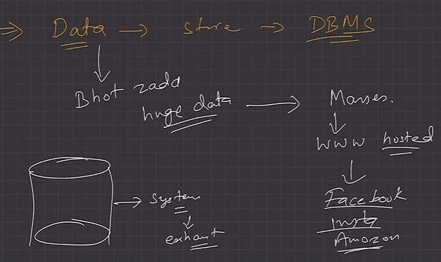
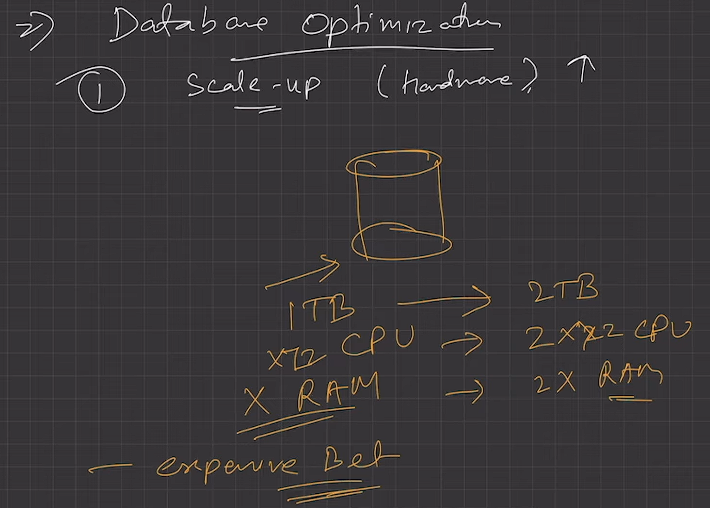
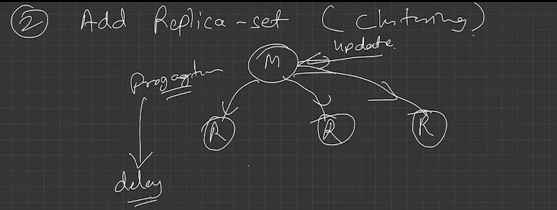
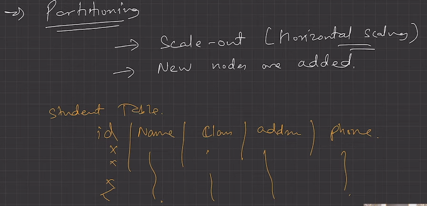
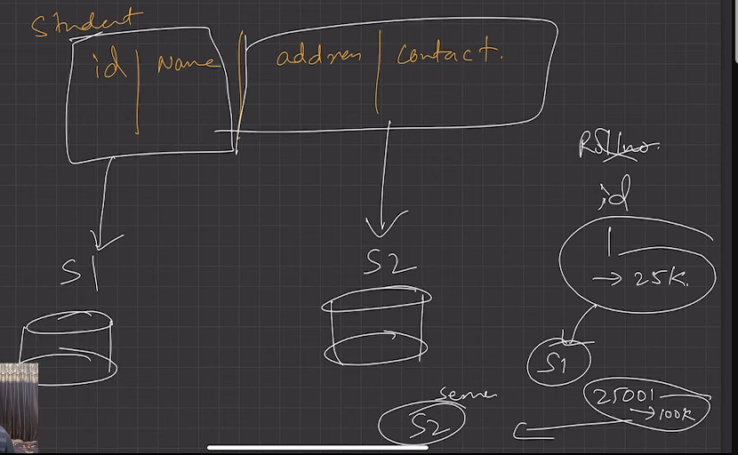
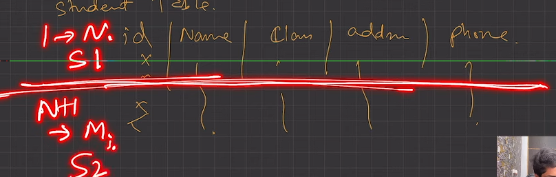
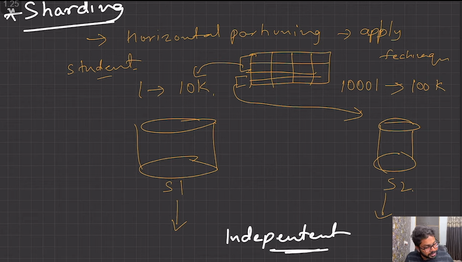
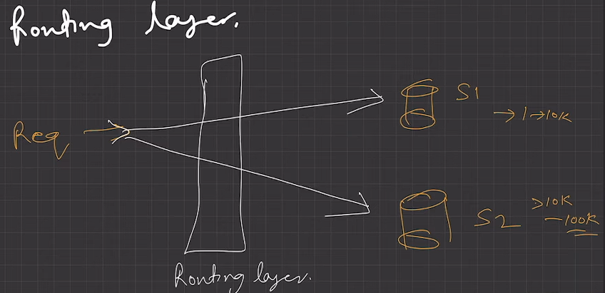
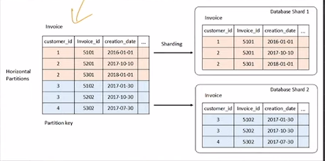

# 2.9.1 LEC-18: Partitioning & Sharding in DBMS (DB Optimisation)

1. **A big problem **can be solved easily when it is chopped into several smaller sub-problems. That is what the partitioning technique does. It divides a big database containing data metrics and indexes into smaller and handy slices of data called partitions. The partitioned tables are directly used by SQL queries without any alteration. Once the database is partitioned, the data definition language can easily work on the smaller partitioned slices, instead of handling the giant database altogether. This is how partitioning cuts down the problems in managing large database tables.

If we have a huge amount of data then system will be exhausted, and their would be problem in manageability.

If the number of requests are large than system will not be able to handle them properly.

To solve this we have to have distributed database systems, and apply DB optimization.

Method 1:

**Method 2:**

**Method 3: **

  1. **Partitioning **is the technique used to divide stored database objects into separate servers. Due to this, there is an increase in performance, controllability of the data. We can manage huge chunks of data optimally. When we horizontally scale our machines/servers, we know that it gives us a challenging time dealing with relational databases as it’s quite tough to maintain the relations. But if we apply partitioning to the database that is already scaled out i.e. equipped with multiple servers, we can partition our database among those servers and handle the big data easily.

    1. **Vertical Partitioning**

      1. Slicing relation vertically / column-wise.

      1. Need to access different servers to get complete tuples.

  1. **Horizontal Partitioning**

    1. Slicing relation horizontally / row-wise.

    1. Independent chunks of data tuples are stored in different servers.

  1. **When Partitioning is Applied?**

    1. Dataset become much huge that managing and dealing with it become a tedious task.

    1. The number of requests are enough larger that the single DB server access is taking huge time and hence the system’s response time become high.

  1. **Advantages of Partitioning**

    1. Parallelism

    1. Availability

    1. Performance

    1. Manageability

    1. Reduce Cost, as scaling-up or vertical scaling might be costly.

  1. **Distributed Database**

    1. A single logical database that is, spread across multiple locations (servers) and logically interconnected by network.

    1. This is the product of applying DB optimisation techniques like **Clustering, Partitioning and Sharding.**

    1. Why this is needed? point 3.2.

  1. **Sharding**

    1. Technique to implement Horizontal Partitioning.

  1. The **fundamental idea **of Sharding is the idea that instead of having all the data sit on one DB instance, we split it up and introduce a Routing layer so that we can forward the request to the right instances that actually contain the data.

**Look-Up layer to know which DB instance the request goes to. Shard Key / Participation key on which partition has been based upon. **

  1. **Pros**

    1. Scalability (Scale Out)

    1. Availability

  1. **Cons**

    1. Complexity, making partition mapping, Routing layer to be implemented in the system, Non-uniformity that creates the necessity of Re- Sharding

    1. Not well suited for Analytical type of queries, as the data is spread across different DB instances. (Scatter-Gather problem)

Sum(total) = Sum(S1) + Sum(S2)

so by sharding, we need to calculate the sum twice. once for S1 and S2.
